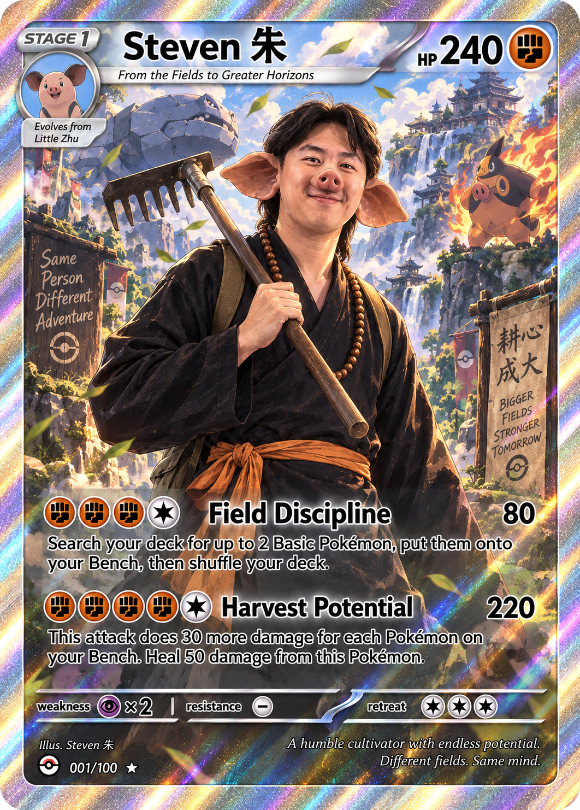
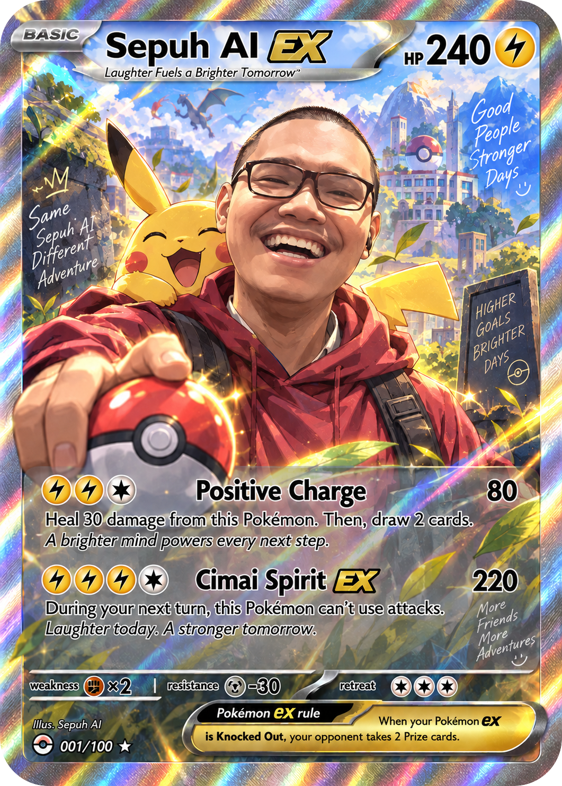

# SI SMART Kecemasan Siswa

Final project for Data Mining and Decision Support Systems, Kelompok 1. A Random Forest predicts a student's anxiety score from 11 lifestyle and academic factors. SMART then ranks students by priority and recommends one of five interventions (Sleep, Exercise, Study, Counseling, Relaxation), with explanations, sensitivity analysis, and a safety rule. The model is pretrained on a Kaggle sample. It can be retrained on the team's confidential Google Form answers.

| Path | Contents |
|---|---|
| `app/` | Streamlit app (bilingual ID/EN) with explainable-AI results and a CRISP-DM Data Mining page, training and retraining scripts, black-box and white-box tests. See [app/README.md](app/README.md) and [app/tests/TESTING.md](app/tests/TESTING.md) |
| `code/` | Original Google Colab notebook |
| `PPT-Doc_CRISP-DM/` | CRISP-DM phase documents (phases 1-6) matching the built system; weekly decks; `_rancangan-awal/` keeps the first design |
| `deliverables/laporan-dm/` | Laporan Teknis Data Mining (.docx) |
| `deliverables/user-manual/` | User Manual (.docx) with annotated screenshots |
| `deliverables/ppt/` | Final presentation (.pptx, about 15 minutes, speaker notes included) |
| `deliverables/pkm/` | Proposal PKM-KC (.docx) in the 2026 format, plus the simbelmawa form values |
| `deliverables/uts/` | Laporan UTS SPK (.docx), SMART spreadsheet with traceable Excel formulas (.xlsx), and README, per the UTS SPK rubric |
| `deliverables/build/` | Scripts that rebuild the documents: `node build_laporan.js`, `node build_manual.js`, `node build_ppt.js`, `node build_pkm.js`, `node build_uts.js` (after `npm install`); `build_uts_xlsx.py` for the spreadsheet |

Quick start: `cd app && pip install -r requirements.txt && streamlit run streamlit_app.py`.

## Meet the member Kelompok 1- Anxiety Detection SMART Method

<table>
  <tr>
    <td align="center"> Steven Feryanta 412025028</td>
    <td align="center"> Steven Iwan 412024008</td>
    <td align="center"> Triemas Putra 412024018</td>
    <td align="center"> Davidson Rafael 412024030</td>
  </tr>
</table>
