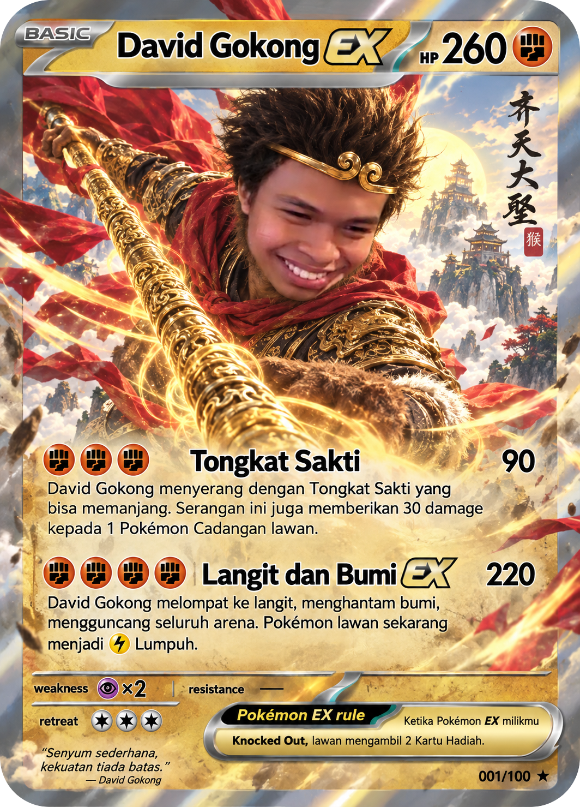

# Kelompok 1

## Sistem Rekomendasi Penangan Kecemasan Siswa SMA Menggunakan Metode Simple Multi-Attribute Rating Technique (SMART)

---

## Description

Membuat Sistem Pendukung Keputusan untuk menentukan Siswa mana yang mengalami risiko gangguan kecemasan berdasarkan kriteria Lama Tidur, Jam Belajar, Waktu Bermain/Olahraga, Ekspektasi Keluarga, Performa Akademik, Kondisi Finansial dan Beban Tugas serta skor kecemasan yang diprediksi menggunakan Random Forest dengan rentang 0-10. Kemudian Sistem juga akan memberikan rekomendasi kegiatan untuk mengurangi kecemasan pada siswa SMA berdasarkan Alternatif Olahraga, Tidur, Belajar, Relaksasi, dan Konseling.

---

## Meet the member

<table>
  <tr>
    <td align="center"> Steven Iwan 412024008</td>
    <td align="center"> Triemas Putra 412024018</td>
    <td align="center"> Davidson Rafael K. N 412024030</td>
  </tr>
</table>