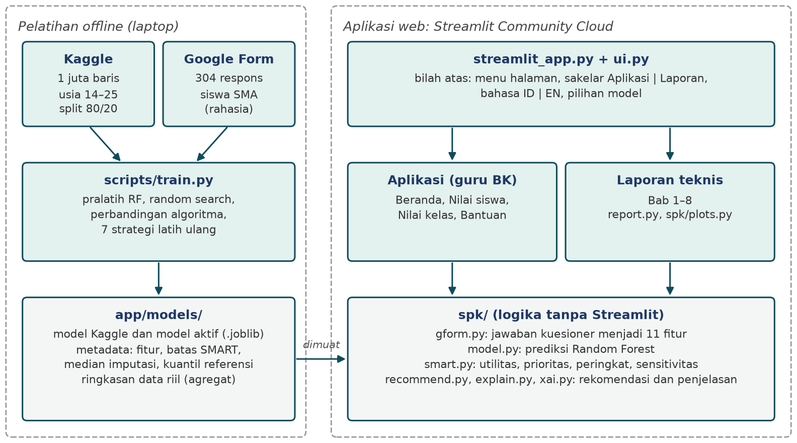

[[TOC]]

[[PAGEBREAK]]

# Pendahuluan

Laporan ini mendokumentasikan teknik Data Mining pada proyek akhir **Sistem Pendukung Keputusan Rekomendasi Penanganan Kecemasan Siswa**. Fokusnya adalah validasi teknis *pipeline* Data Mining dengan metodologi **CRISP-DM** (*Cross-Industry Standard Process for Data Mining*): pemahaman masalah, pemahaman dan persiapan data, pemodelan Random Forest, evaluasi, dan integrasi model ke aplikasi web **SI SMART** berbasis Streamlit. Aplikasi tersebut menggabungkan prediksi Data Mining dengan metode SPK SMART.

Laporan memakai dua sumber data: dataset publik Kaggle (1 juta baris) untuk pralatih, dan **304 respons kuesioner riil** siswa SMA yang bersifat rahasia untuk pelatihan ulang dan pengujian.

[[PAGEBREAK]]
# 1. Business Understanding


---

## 1.1 Latar Belakang Masalah

Kecemasan (*anxiety*) adalah kekhawatiran berlebih yang memengaruhi pikiran, emosi, dan aktivitas sehari-hari. Pada siswa, pemicunya banyak berasal dari tekanan akademik: ujian, tugas yang menumpuk, tuntutan nilai, dan ekspektasi orang tua. Dampaknya berantai: konsentrasi turun, tugas terlambat, motivasi melemah, hingga prestasi dan kesejahteraan mental menurun.

Indikasi kecemasan sering tidak disadari oleh siswa, guru, maupun orang tua. Identifikasi masih bergantung pada observasi guru Bimbingan Konseling (BK). Cara ini punya tiga keterbatasan:

1. **Kapasitas terbatas.** Jumlah guru BK jauh lebih sedikit daripada siswa, sehingga penjaringan menyeluruh sulit dilakukan secara rutin.
2. **Reaktif.** Penanganan biasanya dimulai setelah gejala jelas atau prestasi sudah turun.
3. **Subjektif.** Pilihan bentuk penanganan sering bergantung pada pengalaman pribadi, tanpa dasar multikriteria yang terdokumentasi dan dapat ditelusuri.

Padahal data tentang kebiasaan belajar, tidur, aktivitas fisik, tekanan keluarga, dan kelelahan dapat dikumpulkan dengan kuesioner singkat. Data ini dapat diolah dengan **data mining** untuk memperkirakan tingkat kecemasan, lalu dengan **Sistem Pendukung Keputusan (SPK)** untuk menentukan siapa yang ditangani lebih dulu dan penanganan apa yang paling sesuai.


## 1.2 Tujuan Bisnis

Membangun aplikasi web yang membantu guru BK:

1. **Mendeteksi dini** siswa dengan indikasi kecemasan tinggi dari data kuesioner, tanpa menanyakan gejala secara langsung.
2. **Menyusun prioritas** siswa yang perlu ditangani lebih dulu, sehingga waktu BK yang terbatas dipakai secara adil dan terukur.
3. **Merekomendasikan bentuk penanganan** dari lima alternatif, lengkap dengan alasan yang dapat dijelaskan kepada siswa dan orang tua.

| Kode | Alternatif penanganan | Keterangan |
|---|---|---|
| A1 | Sleep (Tidur) | Program perbaikan pola tidur (*sleep hygiene*) dan jadwal malam |
| A2 | Exercise (Olahraga) | Program aktivitas fisik terjadwal |
| A3 | Study (Strategi belajar) | Pelatihan manajemen waktu dan strategi belajar |
| A4 | Counseling (Konseling) | Konseling individual dengan guru BK; rujukan profesional bila perlu |
| A5 | Relaxation (Relaksasi) | Latihan pernapasan, *mindfulness*, manajemen stres |

## 1.3 Tujuan Data Mining

| Kode | Tujuan | Teknik |
|---|---|---|
| DM-1 | Memprediksi skor kecemasan (0–10) dari faktor gaya hidup dan akademik | Regresi *Random Forest* |
| DM-2 | Mengidentifikasi faktor yang paling berpengaruh terhadap skor kecemasan | *Feature importance* (Gini) dan korelasi |
| DM-3 | Menyediakan input kriteria SPK: prediksi kecemasan menjadi salah satu kriteria SMART | Integrasi RF untuk kriteria SMART |
| DM-4 | Menyesuaikan model dengan populasi sasaran (siswa SMA) | Pelatihan ulang pada data kuesioner riil |

**Titik temu Data Mining dan SPK.** Data mining bekerja pada tahap *diagnosis* (seberapa tinggi indikasi kecemasan dan faktor apa yang dominan). SMART bekerja pada tahap *preskripsi* (siapa lebih dulu dan penanganan apa yang paling tepat).

## 1.4 Faktor dan Kriteria

Delapan kriteria SMART diturunkan dari faktor penyebab kecemasan:

| Kriteria | Jenis | Makna "membutuhkan perhatian" |
|---|---|---|
| Prediksi kecemasan (RF) | benefit | makin tinggi makin butuh |
| Jam belajar per hari | benefit | beban belajar panjang |
| Nilai rata-rata rapor | cost | makin rendah makin butuh |
| Jam tidur | cost | makin sedikit makin butuh |
| Hari olahraga per minggu | cost | makin jarang makin butuh |
| Tekanan finansial | benefit | makin tinggi makin butuh |
| Ekspektasi keluarga | benefit | makin tinggi makin butuh |
| Skor kelelahan (*burnout*) | benefit | makin tinggi makin butuh |

Dalam proyek ini, **benefit** berarti nilai tinggi menaikkan utilitas, sehingga siswa lebih diprioritaskan. **Cost** berarti nilai rendah yang menaikkan utilitas.

## 1.5 Kriteria Keberhasilan

### 1.5.1 Data Mining

| Kode | Kriteria | Target | Hasil |
|---|---|---|---|
| D1 | Model lebih baik dari baseline rata-rata | MAE < baseline | Tercapai (0,758 vs 1,222 pada 138.509 baris uji Kaggle) |
| D2 | Daya jelaskan model | R² ≥ 0,60 | Tercapai (0,608 pada 138.509 baris uji Kaggle) |
| D3 | Faktor dominan masuk akal secara teori | Faktor stres/kelelahan di peringkat atas | Tercapai (stres 0,75, *burnout* 0,21) |
| D4 | Kinerja pada data riil | MAE lebih rendah dari model Kaggle tanpa latih ulang | Tercapai (MAE 1,113 vs 1,874 pada 59 respons *holdout*) |

### 1.5.2 SPK

| Kode | Kriteria | Target | Hasil |
|---|---|---|---|
| S1 | Stabilitas terhadap perubahan bobot | ≥ 90% rekomendasi utama tetap saat bobot diubah acak ±10% | Kaggle 94,3%; data riil 95,5% |
| S2 | Setiap rekomendasi dapat dijelaskan | 100% hasil disertai kontribusi kriteria dan alasan | Tercapai di aplikasi |
| S3 | Aturan pengaman | Siswa berisiko tinggi selalu mendapat rujukan konseling | Tercapai (10% prediksi tertinggi) |

## 1.6 Rencana Proyek

| Fase | Aktivitas | Keluaran |
|---|---|---|
| 1. Business Understanding | Merumuskan masalah, tujuan, kriteria, dan alternatif | Dokumen ini |
| 2. Data Understanding | Memahami dataset Kaggle dan kuesioner riil | Kamus data, statistik deskriptif |
| 3. Data Preparation | Sampling, encoding, pemetaan jawaban kuesioner menjadi fitur, pembagian data | Dataset siap model |
| 4. Modeling | Random Forest, pelatihan ulang, SMART | Model + matriks keputusan |
| 5. Evaluation | Metrik regresi, perbandingan algoritma, sensitivitas bobot, keadilan | Laporan evaluasi |
| 6. Deployment | Aplikasi Streamlit bilingual di Streamlit Community Cloud | Aplikasi daring + panduan |


[[PAGEBREAK]]

# 2. Data Understanding


---

## 2.1 Sumber Data

Proyek memakai dua sumber data dengan peran berbeda.

| Aspek | Data pralatih (Kaggle) | Data riil (kuesioner) |
|---|---|---|
| Sumber | Kaggle *student-mental-health-and-burnout* | Google Form yang disebarkan tim ke siswa SMA |
| Ukuran asli | 1.000.000 baris × 20 kolom | **304 respons** × 68 kolom (195 dari formulir awal, 109 dari formulir revisi) |
| Yang dipakai | Rentang usia pelajar 14–25 = **692.545 baris** (berkas hanya berisi usia 17–25), dibagi 80/20 menjadi data latih dan uji | Usia 14–25 dengan jawaban Psikologis lengkap = **292 respons** |
| Populasi | Mahasiswa, usia 17–29 | Siswa SMA/SMP akhir, usia 14–24 (median 15) |
| Peran | Pralatih model; pembanding model Kaggle dan latar penjelasan AI | Pelatihan ulang dan pengujian model |
| Kerahasiaan | Publik | **Rahasia**: tidak masuk repositori |

Alasan dua sumber: data Kaggle besar dan lengkap sehingga cocok untuk membangun model awal, tetapi populasinya bukan siswa SMA. Data kuesioner sesuai populasi sasaran, tetapi jumlahnya kecil. Model dilatih lebih dulu pada Kaggle, lalu disesuaikan dengan data kuesioner.

## 2.2 Deskripsi Data Kaggle (1.000.000 baris)

Seluruh berkas dipakai. Tidak ada nilai hilang, tidak ada baris duplikat, dan tidak ada nilai mustahil (semua skor 0–10, jam tidur 3–10, nilai 42–97). Usia tersebar merata pada 17–29 tahun, sekitar 77.000 baris per usia.

| Atribut | Tipe | Rata-rata | Std | Min | Median | Maks | Peran |
|---|---|---|---|---|---|---|---|
| age | numerik | 23,00 | 3,74 | 17 | 23 | 29 | fitur (dibersihkan ke 14–25) |
| gender | kategorikal | Female 480.070 · Male 479.643 · Other 40.287 | | | | | fitur |
| academic_year | ordinal | 2,50 | 1,12 | 1 | 3 | 4 | tidak dipakai |
| study_hours_per_day | numerik | 5,00 | 1,99 | 0,00 | 5,00 | 14,00 | fitur + kriteria |
| exam_pressure | numerik | 6,00 | 1,55 | 1,00 | 6,00 | 10,00 | fitur |
| academic_performance | numerik | 71,00 | 5,66 | 42,37 | 71,00 | 97,25 | fitur + kriteria |
| stress_level | numerik | 4,25 | 1,68 | 0,00 | 4,24 | 10,00 | fitur |
| **anxiety_score** | numerik | 2,99 | 1,51 | 0,00 | 2,97 | 10,00 | **target** |
| depression_score | numerik | 1,27 | 1,22 | 0,00 | 1,05 | 8,53 | tidak dipakai (hasil) |
| sleep_hours | numerik | 6,50 | 1,47 | 3,00 | 6,50 | 10,00 | fitur + kriteria |
| physical_activity | numerik | 3,01 | 1,46 | 0,00 | 3,00 | 7,00 | fitur + kriteria |
| social_support | numerik | 5,00 | 1,98 | 0,00 | 5,00 | 10,00 | tidak dipakai |
| screen_time | numerik | 5,02 | 1,96 | 1,00 | 5,00 | 12,00 | tidak dipakai |
| internet_usage | numerik | 5,04 | 2,16 | 1,00 | 5,00 | 14,00 | tidak dipakai |
| financial_stress | numerik | 5,00 | 1,98 | 0,00 | 5,00 | 10,00 | fitur + kriteria |
| family_expectation | numerik | 5,98 | 1,96 | 0,00 | 6,00 | 10,00 | fitur + kriteria |
| burnout_score | numerik | 1,78 | 1,66 | 0,00 | 1,50 | 10,00 | fitur + kriteria |
| mental_health_index | numerik | 7,02 | 1,31 | 1,31 | 7,07 | 10,00 | tidak dipakai (hasil) |
| risk_level | kategorikal | Low 766.645 · Medium 218.275 · High 15.080 | | | | | tidak dipakai (hasil) |
| dropout_risk | numerik | 1,32 | 1,34 | 0,00 | 1,01 | 9,33 | tidak dipakai (hasil) |

### 2.2.1 Korelasi dengan skor kecemasan

| Atribut | r (Pearson) | Atribut | r (Pearson) |
|---|---|---|---|
| stress_level | 0,761 | study_hours_per_day | 0,269 |
| burnout_score | 0,668 | family_expectation | 0,264 |
| depression_score | 0,476 | academic_performance | 0,045 |
| dropout_risk | 0,462 | physical_activity | −0,132 |
| financial_stress | 0,354 | sleep_hours | −0,200 |
| exam_pressure | 0,350 | mental_health_index | −0,869 |

Korelasi pada 692.545 baris usia 14–25 hampir sama (selisih ≤ 0,002), jadi pembersihan usia tidak mengubah pola data.

Hasil temuan yang diperoleh:

- `stress_level` dan `burnout_score` paling kuat berhubungan dengan kecemasan.
- `mental_health_index`, `depression_score`, `dropout_risk`, dan `risk_level` adalah **variabel hasil** yang sangat terkait dengan target. `mental_health_index` bahkan dihitung langsung dari target: `10 − 0,4·stres − 0,3·kecemasan − 0,3·depresi` (cocok tepat). Memakainya sebagai fitur menimbulkan *label leakage*, jadi keempatnya dikeluarkan.
- `social_support`, `screen_time`, dan `internet_usage` hampir tidak berkorelasi (|r| < 0,01) sehingga tidak dipakai.
- `academic_year` tidak berlaku untuk siswa SMA dan juga tidak berkorelasi.

## 2.3 Deskripsi Data Kuesioner

Kuesioner terdiri atas bagian berikut. Bentuk jawaban: pilihan rentang, skala Likert 5 titik, atau isian angka.

| Bagian | Contoh butir | Dipakai untuk |
|---|---|---|
| Identitas | jenis kelamin, tanggal lahir, nama sekolah, sumber informasi, nama teman | gender dan usia; sisanya **data pribadi yang dibuang** |
| Kebiasaan belajar | jam belajar per hari, belajar larut malam, waktu tidak cukup, tugas terlambat | jam belajar, tingkat stres |
| Tidur | durasi tidur, jam mulai tidur, kurang tidur, mengantuk di kelas | jam tidur (+ ekstra) |
| Akademik | nilai rata-rata rapor, persentase kehadiran | nilai rapor (+ ekstra) |
| Media sosial | durasi harian, saat belajar, sebelum tidur | ekstra |
| Tuntutan dan tekanan | tugas bersamaan, tertekan ujian, takut mengecewakan orang tua, tuntutan nilai keluarga | tekanan ujian, stres, ekspektasi keluarga |
| Aktivitas fisik | hari olahraga per minggu, menit per sesi, aktivitas ringan | aktivitas fisik (+ ekstra) |
| Kegiatan di luar sekolah | jumlah ekskul, jam per minggu, lomba | ekstra |
| Kelelahan | sulit membagi waktu, kelelahan, kehilangan minat, rasa percaya diri | *burnout* |
| Pertemanan | diterima, teman dipercaya, dukungan, tekanan konformitas, konflik | ekstra |
| **Psikologis** | gugup/cemas, sulit mengendalikan khawatir, konsentrasi (dibalik), pikiran terganggu, sulit menyelesaikan tugas; formulir revisi menambah mudah tersinggung dan menghindari kegiatan | **target skor kecemasan** |
| Pola makan | uang saku cukup, jajan, minuman manis/berkafein, makan saat tertekan, melewatkan makan | tekanan finansial (+ ekstra) |

"Ekstra" berarti butir disimpan untuk analisis korelasi dan satu eksperimen model yang diperluas. Butir ini tidak dipakai model yang dideploy, karena model harus tetap sejajar dengan 11 fitur Kaggle.

### 2.3.1 Statistik data kuesioner

Ekspor berisi **304 respons** dan 68 kolom. Satu formulir Google dipakai dalam dua versi: 195 respons dijawab pada formulir awal dan 109 pada formulir revisi (yang menambah butir seperti "nilai di bawah target", "bisa bercerita ke keluarga", kualitas tidur, dan dua butir Psikologis). Setiap skor gabungan dirata-rata dari butir yang dijawab baris itu, sehingga kedua versi dapat digabung. Pemeriksaan penggabungan dibahas pada tahap persiapan data.

- **Usia** dihitung dari tanggal lahir. Ekspor tidak memuat *timestamp*, jadi tanggal acuannya adalah tanggal pemrosesan. 8 tanggal lahir tidak masuk akal (tahun 2026–2027) sehingga usianya dikosongkan. 11 respons di luar rentang 14–25 (10 berusia 13, 1 berusia 30) dibuang. 1 respons tidak lengkap pada butir Psikologis sehingga tidak memiliki target.
- **Dipakai:** 292 respons, laki-laki 160 dan perempuan 132; usia 14 (89), 15 (97), 16 (41), 17 (35), 18 (14), 19–24 (16).
- Tidak ada baris jawaban duplikat; 1 baris menjawab semua butir Likert sama (*straight-lining*) dan tetap dipakai.

| Fitur | Rata-rata | Std | Min | Median | Maks | Rata-rata Kaggle |
|---|---|---|---|---|---|---|
| age | 15,39 | 1,53 | 14 | 15 | 24 | 21,00 |
| study_hours_per_day | 2,12 | 1,99 | 0,25 | 1,50 | 10,00 | 5,01 |
| academic_performance | 81,83 | 8,47 | 40,00 | 84,00 | 100,00 | 71,07 |
| exam_pressure | 5,82 | 2,20 | 1,00 | 5,50 | 10,00 | 6,01 |
| stress_level | 4,39 | 1,48 | 0,00 | 4,58 | 8,75 | 4,24 |
| sleep_hours | 6,73 | 1,35 | 4,00 | 6,50 | 12,00 | 6,52 |
| physical_activity | 2,73 | 1,99 | 0,00 | 1,50 | 7,00 | 3,01 |
| financial_stress | 3,38 | 2,57 | 0,00 | 2,50 | 10,00 | 5,01 |
| family_expectation | 4,72 | 2,46 | 0,00 | 5,00 | 10,00 | 5,97 |
| burnout_score | 4,67 | 1,80 | 0,00 | 5,00 | 10,00 | 1,77 |
| **anxiety_score** | **5,01** | 1,78 | 0,00 | 5,00 | 9,29 | **2,99** |

Perbedaan dengan Kaggle cukup besar: siswa belajar lebih sedikit di luar sekolah (2,1 vs 5,0 jam), nilai rapor lebih tinggi, *burnout* jauh lebih tinggi (4,7 vs 1,8), dan **skor kecemasan rata-rata 5,0 dibanding 3,0**. Karena sebaran target bergeser sejauh ini, model Kaggle tidak dapat dipakai langsung untuk siswa SMA.

**Korelasi dengan skor kecemasan (data riil).**

| Fitur | r | Fitur | r |
|---|---|---|---|
| exam_pressure | 0,498 | financial_stress | 0,001 |
| burnout_score | 0,490 | physical_activity | −0,027 |
| family_expectation | 0,389 | age | −0,060 |
| stress_level | 0,303 | academic_performance | −0,118 |
| study_hours_per_day | 0,029 | sleep_hours | −0,126 |

Pola faktor dominan berbeda dari Kaggle. Pada siswa SMA, tekanan ujian, *burnout*, dan ekspektasi keluarga paling berhubungan dengan kecemasan, sedangkan pada Kaggle tingkat stres jauh mendominasi (r 0,76). Di antara butir ekstra, kualitas tidur (r 0,55), merasa kurang tidur (0,37), mengantuk di kelas (0,37), konflik dengan teman (0,34), dan media sosial saat belajar (0,32) paling berkorelasi.

## 2.4 Kualitas Data

| Dimensi | Kaggle | Kuesioner (pemeriksaan otomatis `spk/gform.py`) |
|---|---|---|
| Kelengkapan | 0 nilai hilang | 8 usia kosong (tanggal lahir tidak masuk akal), 1 nilai kosong pada 6 fitur, 1 target kosong; fitur kosong diisi median data latih |
| Duplikat | 0 | 0 baris jawaban identik |
| Validitas | rentang wajar | nilai di luar rentang dikosongkan; jawaban isian bebas yang tidak terbaca hanya pada butir ekstra (31 jawaban, mis. jam kegiatan ditulis dalam menit) |
| Kesungguhan | – | 1 baris *straight-lining* |
| Privasi | tidak ada data pribadi | tanggal lahir dan isian bebas dibuang segera setelah usia dihitung; 12 kolom pertanyaan tambahan yang tidak dipetakan tidak dipakai |
| Konsistensi butir | – | Cronbach α: kecemasan 0,78 (7 butir) / 0,69 (5 butir); *burnout* 0,67; tingkat stres 0,32; tekanan ujian 0,38; ekspektasi keluarga 0,37 |

## 2.5 Keterbatasan

- Dataset Kaggle berasal dari mahasiswa, bukan siswa SMA, dan sebaran skornya berbeda jauh dari data riil. Karena itu model dilatih ulang dengan data riil.
- Skor gabungan tingkat stres, tekanan ujian, dan ekspektasi keluarga memiliki konsistensi butir rendah (α 0,32–0,38), jadi butir-butirnya mengukur hal yang cukup berbeda.
- 292 respons masih kecil untuk model yang stabil; hasil *holdout* 59 respons memiliki ketidakpastian besar.
- Tingkat stres dan tekanan finansial pada kuesioner adalah **proksi**, sehingga maknanya tidak identik dengan kolom Kaggle.
- Data kuesioner bersifat *self-report* dan *cross-sectional*: rawan bias sosial dan tidak menunjukkan sebab-akibat.
- Sampel kuesioner tidak acak (disebar lewat sekolah, media sosial, dan teman), sehingga generalisasinya terbatas.


[[PAGEBREAK]]

# 3. Data Preparation


---

## 3.1 Ringkasan Langkah

| # | Langkah | Data Kaggle | Data kuesioner | Kode |
|---|---|---|---|---|
| 1 | Pembersihan usia | 1 juta; usia 14–25 (692.545) | usia 14–25 | `data.clean`, `config.AGE_RANGE` |
| 2 | Seleksi atribut | 11 fitur + target; buang variabel hasil | petakan ±50 kolom ke *field* | `config.FEATURES`, `gform_mapping.json` |
| 3 | Pembersihan | tidak ada nilai hilang/duplikat | duplikat, rentang, jawaban tak dikenal, data pribadi | `spk/gform.py` |
| 4 | Encoding | `gender` menjadi kode tetap | teks jawaban menjadi angka | `data.encode_gender`, `gform.encode` |
| 5 | Konstruksi fitur | – | 11 fitur skala Kaggle + target | `gform.derive` |
| 6 | Imputasi | – | median data latih | `gform.impute` |
| 7 | Pembagian data | 80% latih (554.036) / 20% uji (138.509), stratifikasi usia | 80% pengembangan / 20% *holdout* + CV 5-fold ×2 | `data.split_full`, `spk/retrain.py` |

## 3.2 Data Kaggle

### 3.2.1 Pembersihan usia

Data Kaggle berasal dari mahasiswa usia 17–29, sedangkan pengguna sasaran adalah pelajar. Agar data yang ditambang mewakili usia pelajar, hanya baris dalam rentang **14–25 tahun** yang dipakai. Batas 14 mencakup siswa SMA pengisi kuesioner, dan 25 adalah akhir masa kuliah umum. Karena berkas Kaggle mulai dari usia 17, yang tersisa adalah usia 17–25: **692.545 dari 1.000.000 baris** (307.455 baris dibuang). Model dasar karena itu tidak pernah melihat pelajar berusia 14–16; penyesuaian ke siswa SMA dilakukan dengan pelatihan ulang.

Seluruh berkas dipakai, bukan sampel.

### 3.2.2 Seleksi atribut

- **Target:** `anxiety_score`.
- **Fitur (11):** `age`, `gender`, `study_hours_per_day`, `academic_performance`, `exam_pressure`, `stress_level`, `sleep_hours`, `physical_activity`, `financial_stress`, `family_expectation`, `burnout_score`.
- **Dibuang:** `depression_score`, `mental_health_index`, `risk_level`, `dropout_risk` (variabel hasil/*leakage*); `social_support`, `screen_time`, `internet_usage` (korelasi ≈ 0); `academic_year` (tidak berlaku untuk SMA).

### 3.2.3 Encoding

`gender` dikodekan dengan pemetaan tetap `Female=0, Male=1, Other=2`. Pemetaan ini menggunakan hasil `LabelEncoder`.

Random Forest tidak memerlukan normalisasi fitur, sehingga fitur numerik dipakai apa adanya.

### 3.2.4 Pembagian data

692.545 baris dibagi **80% latih (554.036 baris)** dan **20% uji (138.509 baris)** dengan `test_size=0.2`, `random_state=42`, dan stratifikasi per usia, sehingga setiap usia 17–25 mendapat porsi yang sama (±11,1%) di kedua bagian (`data.split_full`). Rata-rata target pada data latih 2,99 dan pada data uji 2,98.

Dari data uji diambil **20.000 baris** (juga distratifikasi per usia) sebagai **populasi referensi** aplikasi. Baris ini tidak pernah dipakai melatih model mana pun. Kegunaannya: grafik populasi di laporan teknis, 100 siswa pembanding untuk penjelasan Shapley, nilai median pada simulasi "bagaimana jika", serta batas SMART dan persentil bila model Kaggle dipilih. Model aktif (data riil) memakai batas SMART dan kuantil dari 292 respons riil, yaitu responden yang juga menjadi data latihnya; aplikasi hanya menyimpan kuantil tersebut, bukan baris jawabannya. Dari data latih disimpan 8.000 baris untuk strategi pelatihan ulang.

### 3.2.5 Pemeriksaan outlier

Selain nilai hilang dan duplikat (tidak ada), diperiksa nilai ekstrem. Tiap kolom memiliki paling banyak 0,6% baris di luar 3 simpangan baku; semuanya nilai yang masih masuk akal (misalnya 14 jam belajar atau nilai rapor 45), bukan kesalahan data. Skor *burnout* bernilai 0 pada 23% baris dan kecemasan 0 pada 2,7% baris; ini batas bawah skala, bukan galat.

Untuk memastikan, baris ekstrem dibuang dari **data latih saja**, lalu model diuji pada 138.509 baris uji yang sama:

| Pembersihan data latih | Baris latih | R² uji (Gradient Boosting) |
|---|---|---|
| Tanpa pembersihan tambahan | 554.036 | **0,6083** |
| Buang baris dengan nilai di luar 3 simpangan baku | 547.004 | 0,6079 |
| Buang baris di luar persentil 1–99 | 483.776 | 0,6058 |
| Buang baris dengan kecemasan 0 atau 10 | 539.326 | 0,6049 |
| Buang 2% outlier (*Isolation Forest*) | 542.955 | 0,6080 |

Tidak ada pembersihan yang menaikkan R², jadi tidak ada baris lain yang dibuang. Data uji tidak boleh ikut dibersihkan: membuang baris uji yang sulit diprediksi menaikkan R² secara semu (0,67 bila galat > 2 simpangan baku dibuang), padahal modelnya sama.

## 3.3 Data Kuesioner (Google Form)

### 3.3.1 Pencocokan kolom

Ekspor Google Form memakai judul pertanyaan sebagai nama kolom. Pertanyaan grid tertulis sebagai `Judul grid [teks baris]`. Berkas `spk/gform_mapping.json` mencocokkan setiap *field* dengan potongan teks pertanyaan. Beberapa judul dipakai dua kali di formulir, misalnya "Rata-Rata Jam Belajar Per Hari" dan "Target pengumpulan tugas". Untuk kasus ini, sistem memilih kolom yang jawabannya paling banyak dapat dibaca oleh *parser* field tersebut. Skrip `scripts/inspect_gform.py` menampilkan hasil pencocokan sebelum pelatihan.

**Dua versi formulir.** Kuesioner direvisi saat pengumpulan data masih berjalan: beberapa butir ditambahkan, beberapa dihapus, dan beberapa judul pertanyaan diperbaiki. Kedua versi berada dalam satu Google Form yang sama, sehingga satu ekspor memuat jawaban dari keduanya, dan nama kolom selalu mengikuti judul pertanyaan terbaru. Penanganannya:

- Butir yang baru ada di formulir revisi bersifat opsional. Pada jawaban versi awal butir ini kosong, dan kekosongan itu tidak dianggap galat.
- Setiap respons ditandai sebagai versi awal atau revisi. Respons dianggap revisi bila menjawab salah satu butir baru, atau memilih opsi "> 5 kali" yang baru ditambahkan pada revisi.
- Kolom pertanyaan yang sudah dihapus dari formulir tidak dipakai.
- Bila sebuah butir opsional cocok dengan dua kolom yang sama kuat, butir itu dilewati dan dicatat, sehingga proses tetap berjalan.

### 3.3.2 Pembersihan

- **Data pribadi dibuang:** *timestamp*, tanggal lahir, nama sekolah, sumber informasi, nama teman, email, dan jawaban esai kondisi saat bangun tidur (teks bebas dapat memuat nama). Pembuangan terjadi segera setelah usia dihitung. Setiap baris diberi ID anonim `R0001…`.
- **Duplikat:** baris dengan jawaban identik dibuang.
- **Rentang:** nilai rapor di luar 0–100 dan jam di luar rentang pertanyaan dikosongkan.
- **Jawaban tak dikenal** dihitung dan dicontohkan di laporan privat agar pemetaan dapat diperbaiki.
- ***Straight-lining***: jumlah baris dengan semua jawaban Likert sama dilaporkan.

### 3.3.3 Encoding jawaban

| Jenis jawaban | Contoh | Menjadi |
|---|---|---|
| Rentang jam | "Dibawah 30 menit", "1 jam 30 menit", "12 jam" | 0,25 · 1,5 · 12 |
| Likert frekuensi | Tidak pernah … Sangat sering (atau … Selalu) | 1 … 5 |
| Likert persetujuan | Sangat tidak setuju … Sangat setuju | 1 … 5 |
| Ordinal 5 tingkat | Tidak pernah / 1 kali / 2-3 kali / 4-5 kali / > 5 kali | 1 … 5 (versi lama tidak punya tingkat 5) |
| Hari olahraga | 0 / 1-2 / 3-4 / 5-6 / 7 hari | 0 · 1,5 · 3,5 · 5,5 · 7 (titik tengah) |
| Jenis kelamin | Laki-laki / Perempuan | Male / Female |

*Parser* juga menerima variasi penulisan: huruf besar/kecil, tanda pisah "–" atau "-", dan nomor urut di depan opsi.

### 3.3.4 Konstruksi fitur (pemetaan ke skala Kaggle)

Agar model Kaggle dapat dipakai dan dilatih ulang, jawaban kuesioner diubah ke rentang yang sama dengan fitur Kaggle. `unit(x)` berarti skala ordinal 1…n dipetakan ke 0…1.

| Fitur model | Rumus |
|---|---|
| age | ⌊(tanggal acuan − tanggal lahir) / 365,25⌋; tanggal acuan = *timestamp*, atau tanggal pemrosesan bila ekspor tidak memuat *timestamp* (seperti ekspor riil) |
| gender | jenis kelamin |
| study_hours_per_day | jam belajar (jam) |
| academic_performance | nilai rata-rata rapor |
| exam_pressure | 1 + 9 × rata-rata unit(tertekan ujian, nilai di bawah target ᴿ), rentang 1–10 |
| stress_level | 10 × rata-rata unit(tugas bersamaan, waktu tidak cukup, tugas terlambat, belajar larut malam) |
| sleep_hours | durasi tidur (jam) |
| physical_activity | hari olahraga per minggu |
| financial_stress | 10 × (5 − uang saku cukup) / 4 (dibalik) |
| family_expectation | 10 × rata-rata unit(takut mengecewakan orang tua, tuntutan nilai keluarga) |
| burnout_score | 10 × rata-rata unit(sulit membagi waktu, kelelahan, kehilangan minat) |
| **anxiety_score** (target) | 10 × rata-rata unit(P01, P02, 1 − unit(P03), P04, P05, P06 ᴿ, P07 ᴿ), rentang 0–10 |
| x_sleep_quality (tambahan) | 10 × rata-rata unit(sulit tertidur, terbangun lalu sulit tidur lagi, mimpi buruk/gelisah) ᴿ |

ᴿ = butir yang hanya ada di formulir revisi. Rata-rata diambil dari butir yang dijawab baris tersebut, sehingga pada baris versi lama rumus kembali ke rumus awal, misalnya anxiety_score = [Σ(P − 1) untuk P01, P02, P04, P05 + (5 − P03)] / 2. Target membutuhkan kelima butir P01–P05; P06–P07 ikut bila dijawab. Opsi "4-5 kali" bernilai tingkat 4 dari 5 (0,75) pada kedua versi, jadi label yang sama selalu bernilai sama.

Butir Psikologis (P01–P07) hanya membentuk target dan **tidak pernah** menjadi fitur, sehingga tidak ada *label leakage*.

### 3.3.5 Pemeriksaan penggabungan dua versi

Sebelum jawaban formulir awal dan revisi digabung, tiga hal diperiksa:

1. **Jumlah respons per versi.** Ada 195 respons formulir awal dan 109 respons formulir revisi. Opsi "> 5 kali" yang hanya ada di formulir revisi dipilih 6 kali pada butir belajar larut malam dan 3 kali pada butir tugas terlambat.
2. **Konsistensi butir** (*Cronbach's alpha*, α). Mengukur apakah butir-butir yang digabung menjadi satu skor mengukur hal yang sama. Nilai α ≥ 0,6 dianggap cukup.
3. **Kesetaraan versi.** Pada respons revisi, skor dihitung dua kali: dari butir lama saja dan dari semua butir. Korelasi tinggi (*r* ≥ 0,8) dan selisih rata-rata kecil (kurang dari 0,5 poin) berarti kedua versi mengukur hal yang sama dan aman digabung.

| Skor gabungan | Butir | Respons | α | *r* butir lama vs semua butir | Selisih rata-rata |
|---|---|---|---|---|---|
| Skor kecemasan (target) | 7 (5 lama + 2 revisi) | 109 | 0,78 | 0,958 | −0,05 |
| Skor kecemasan, butir lama saja | 5 | 303 | 0,69 | – | – |
| Tekanan ujian | 2 (1 lama + 1 revisi) | 109 | 0,38 | 0,823 | −0,34 |
| Ekspektasi keluarga | 2 | 303 | 0,45 | – | – |
| Kelelahan (*burnout*) | 3 | 303 | 0,67 | – | – |
| Tingkat stres | 4 | 303 | 0,32 | – | – |
| Kualitas tidur (tambahan, bukan fitur model) | 3 (revisi) | 109 | 0,61 | – | – |

Hasilnya:

- Skor kecemasan dan tekanan ujian lolos uji kesetaraan (*r* ≥ 0,82, selisih paling besar 0,34 poin), jadi kedua versi formulir **digabung**.
- Butir revisi "saya mampu membicarakan kesulitan dengan keluarga" semula masuk skor ekspektasi keluarga, tetapi menurunkan α dari 0,53 menjadi 0,37 pada 109 respons revisi. Butir ini **dikeluarkan** dari skor tersebut dan disimpan sebagai butir tambahan (*r* = −0,26 dengan kecemasan).
- Tingkat stres (α 0,32), tekanan ujian (α 0,38), dan ekspektasi keluarga (α 0,45) masih di bawah 0,6. Butir-butirnya tetap dipakai karena tidak ada butir pengganti, dan keterbatasan ini dicatat pada keterbatasan data serta evaluasi.

### 3.3.6 Imputasi

Fitur yang kosong diisi median data kuesioner. Untuk gender, dipakai modus. Nilai median disimpan di metadata model, sehingga unggahan baru di aplikasi diisi dengan nilai yang sama persis. Baris tanpa target dibuang dari pelatihan.

### 3.3.7 Pembagian data

- **80% pengembangan dan 20% holdout** (`random_state=42`) bila respons ≥ 30, distratifikasi menurut versi formulir agar proporsi baris lama dan baru sama di kedua bagian. Laporan menampilkan galat holdout per versi.
- Butir tambahan (`x_…`) yang kosong pada baris versi lama tidak diimputasi untuk model laporan S4; Random Forest menangani nilai kosong secara langsung, sehingga baris lama tidak tampak "rata-rata".
- Pada data pengembangan dijalankan ***repeated k-fold cross-validation*** (5 lipatan × 2 ulangan) untuk memilih strategi pelatihan ulang.
- Model akhir dilatih ulang pada seluruh respons dengan strategi terpilih.

**Hasil pada data riil:**

| Langkah | Baris |
|---|---|
| Ekspor mentah | 304 |
| Setelah buang duplikat | 304 (0 duplikat) |
| Usia 14–25 (atau usia kosong) | 293 (11 dibuang: 10 berusia 13, 1 berusia 30) |
| Dengan target lengkap | **292** |
| Pengembangan / *holdout* | **233 / 59** (*holdout*: 39 formulir awal, 20 formulir revisi) |

Nilai yang diimputasi: 8 usia (tanggal lahir tidak masuk akal) dan 1 nilai pada tekanan ujian, tingkat stres, aktivitas fisik, tekanan finansial, ekspektasi keluarga, dan *burnout*. Median yang disimpan antara lain usia 15, jam belajar 1,5, nilai rapor 84, jam tidur 6,5, dan *burnout* 5,0.

## 3.4 Penyiapan Data untuk SMART

Matriks keputusan berisi 8 kriteria untuk setiap siswa: 7 fitur langsung ditambah `rf_anxiety_score` hasil prediksi RF. Normalisasi utilitas membutuhkan min dan maks tiap kriteria. Batas ini dihitung dari populasi referensi saat pelatihan dan disimpan di metadata (`smart_bounds`), agar satu siswa pun dapat dinilai. Batas diambil dari 20.000 baris referensi (bagian data uji Kaggle), atau dari data riil bila respons ≥ 50. Model aktif memakai batas dari 292 respons riil, misalnya prediksi kecemasan 1,95–7,64, jam belajar 0,25–10, dan jam tidur 4–12.

## 3.5 Keluaran Fase

| Berkas | Isi | Di repositori? |
|---|---|---|
| `app/data/dataset.csv` | 20.000 baris uji Kaggle (populasi referensi) | ya |
| `app/data/kaggle_retrain.csv.gz` | 8.000 baris latih Kaggle untuk strategi S2 | ya |
| `app/data/private/gform_data.csv` | ekspor kuesioner riil (304 respons) | **tidak** (gitignore) |
| `app/reports/question_merge_report.md` | pertanyaan mana digabung menjadi fitur/kriteria (agregat) | ya |
| metadata model | `smart_bounds`, `impute_medians`, `gender_map` | ya |


[[PAGEBREAK]]

# 4. Modeling


---

## 4.1 Gambaran Umum

| Modul | Teknik | Masukan | Keluaran |
|---|---|---|---|
| M1 — Prediksi (Data Mining) | Random Forest Regressor | 11 fitur siswa | `rf_anxiety_score` (0–10) |
| M2 — Faktor dominan | *Gini feature importance* | model M1 | peringkat faktor |
| M3 — Pelatihan ulang | 7 strategi untuk menyesuaikan model Kaggle dengan data riil | model M1 + data kuesioner | model aktif |
| M4 — Keputusan (SPK) | SMART | 7 fitur + `rf_anxiety_score` | skor prioritas, peringkat 5 alternatif |

Alurnya: fitur siswa dipakai Random Forest untuk memprediksi skor kecemasan. Prediksi itu menjadi salah satu kriteria SMART, dan SMART menghasilkan skor prioritas serta rekomendasi penanganan. Di titik inilah Data Mining dan SPK terintegrasi.

## 4.2 M1 — Random Forest Regressor

### 4.2.1 Alasan pemilihan

Target (`anxiety_score`) kontinu, jadi masalahnya adalah **regresi**. Random Forest dipilih karena:

- Menangkap hubungan non-linear dan interaksi antarfaktor tanpa asumsi bentuk hubungan.
- Tahan terhadap *outlier* dan skala fitur yang berbeda, tanpa normalisasi.
- Menyediakan *feature importance* untuk penjelasan.
- Cocok untuk jawaban kuesioner ordinal dan data berukuran kecil, dengan *bagging* yang mengurangi *overfitting*.

### 4.2.2 Konfigurasi parameter

| Parameter | Nilai | Alasan |
|---|---|---|
| `n_estimators` | 300 | cukup banyak pohon agar prediksi stabil pada data besar |
| `max_depth` | 12 | cukup dalam untuk 554.036 baris tanpa menghafal data latih |
| `min_samples_split` | 2 | bawaan scikit-learn |
| `min_samples_leaf` | 50 (3 untuk data riil) | setiap daun mewakili minimal 50 siswa: prediksi lebih halus dan tidak menghafal |
| `max_features` | 0,75 | tiap pemisahan melihat 75% fitur (8 dari 11) |
| `max_samples` | 0,6 | tiap pohon dilatih pada 60% baris latih, sehingga pohon lebih beragam |
| `random_state` | 42 | hasil dapat direproduksi |
| `n_jobs` | −1 | memakai semua inti CPU saat pelatihan |

Nilai ini dipilih dengan ***random search***: 25 kombinasi parameter, masing-masing dinilai dengan **validasi silang 5-fold** pada 50.000 baris latih. Kombinasi terbaik mencapai R² CV 0,5996; pengaturan yang lebih sederhana (200 pohon, kedalaman 10, `max_features="sqrt"`) mencapai 0,5966 dan berada di peringkat 11. Data uji tidak dipakai selama pencarian. Pengaturan sederhana ini dipakai untuk data kuesioner yang kecil.

Model dilatih pada seluruh 554.036 baris latih dan disimpan sebagai `app/models/rf_anxiety_model.joblib` (±29 MB), dengan metadata di `rf_anxiety_model_metadata.json`.

### 4.2.3 Perbandingan dengan algoritma lain

Validasi silang 5-fold memakai 50.000 baris latih yang sama untuk semua algoritma. Skor uji didapat dari model yang dilatih pada seluruh 554.036 baris latih dan diuji pada 138.509 baris uji.

| Algoritma | MAE CV | RMSE CV | R² CV | MAE uji | R² uji |
|---|---|---|---|---|---|
| Baseline rata-rata | 1,2128 | 1,5040 | −0,0001 | 1,2217 | 0,0000 |
| Regresi linear | **0,7604** | **0,9499** | **0,6011** | 0,7602 | 0,6064 |
| Decision Tree (kedalaman 10) | 0,7989 | 1,0047 | 0,5537 | 0,7644 | 0,6010 |
| Gradient Boosting | 0,7606 | 0,9505 | 0,6006 | **0,7579** | **0,6083** |
| **Random Forest (dipakai)** | 0,7610 | 0,9515 | 0,5998 | 0,7583 | 0,6077 |

Pada data uji, Random Forest, Gradient Boosting, dan regresi linear praktis setara: selisih R² paling besar 0,002. Semua jauh lebih baik dari baseline. Pohon tunggal mendekati karena data latih sangat besar, tetapi tetap paling lemah di antara model yang dilatih. RF tetap dipakai karena:

1. Kinerjanya setara dengan algoritma terbaik.
2. Data kuesioner riil berbentuk ordinal dan tidak dijamin linear.
3. Metode pelatihan ulang dengan *warm start* (M3) memerlukan model *ensemble* pohon.

**Batas R².** Semua jenis model berhenti di R² ≈ 0,61. Hutan acak yang dilatih pada sisa galat regresi linear hanya mencapai R² −0,01, artinya sekitar 40% variasi skor kecemasan adalah derau yang tidak dibawa 11 fitur. Hanya `mental_health_index` yang dapat menaikkannya (ke ±0,80), tetapi kolom itu dihitung dari target dan termasuk *leakage*.

### 4.2.4 M2 — Faktor dominan

| Peringkat | Fitur | *Importance* |
|---|---|---|
| 1 | stress_level | 0,7512 |
| 2 | burnout_score | 0,2080 |
| 3 | financial_stress | 0,0128 |
| 4 | sleep_hours | 0,0072 |
| 5 | exam_pressure | 0,0070 |
| 6 | family_expectation | 0,0032 |
| 7 | study_hours_per_day | 0,0032 |
| 8 | physical_activity | 0,0030 |
| 9 | academic_performance | 0,0029 |
| 10 | age | 0,0011 |
| 11 | gender | 0,0004 |

Tingkat stres dan kelelahan menyumbang 96% kepentingan, sejalan dengan analisis korelasi pada data Kaggle. Dengan daun minimal 50 siswa, model hampir hanya memisahkan pada dua fitur terkuat; fitur lain tetap berperan dalam SMART sebagai kriteria tersendiri. Gender hampir tidak berpengaruh (0,04%), sehingga risiko bias gender kecil (diperiksa pada evaluasi keadilan).

## 4.3 M3 — Pelatihan Ulang dengan Data Riil

Tujuannya adalah menyesuaikan model dari populasi mahasiswa (Kaggle) ke siswa SMA (kuesioner). Tujuh strategi dibandingkan:

| Kode | Strategi | Penjelasan |
|---|---|---|
| S0 | Kaggle saja | model M1 tanpa pelatihan ulang (pembanding) |
| S1 | Data riil saja | RF baru hanya dari kuesioner (`min_samples_leaf=3`) |
| S2 (w = 1, 10, 50) | Gabungan berbobot | 8.000 baris Kaggle + data riil; tiap baris riil diberi bobot w |
| S3 (+200, +600) | *Warm start* | 300 pohon Kaggle dipertahankan, lalu ditambah 200 atau 600 pohon baru yang dilatih pada data riil |
| S4 | Data riil diperluas | S1 ditambah butir ekstra kuesioner (media sosial, pertemanan, pola makan, dll.); hanya dilaporkan, tidak dideploy |

Strategi dengan **MAE validasi silang terendah** di antara S0–S3 dipilih, lalu dilatih ulang pada seluruh respons. Hasilnya disimpan sebagai `rf_real_model.joblib`, dan aplikasi otomatis memakainya.

### 4.3.1 Hasil pada data riil

Validasi silang 5-fold × 2 pada 233 respons pengembangan; *holdout* 59 respons yang tidak dipakai memilih strategi.

| Strategi | MAE CV (± sd) | R² CV | MAE *holdout* | R² *holdout* |
|---|---|---|---|---|
| S0 Kaggle saja | 1,751 ± 0,204 | −0,605 | 1,874 | −0,346 |
| **S1 Data riil saja (dipilih)** | **1,251 ± 0,082** | **0,204** | **1,113** | **0,441** |
| S2 gabungan, w = 1 | 1,287 ± 0,085 | 0,162 | 1,185 | 0,389 |
| S2 gabungan, w = 10 | 1,263 ± 0,076 | 0,189 | 1,155 | 0,443 |
| S2 gabungan, w = 50 | 1,252 ± 0,072 | 0,200 | 1,158 | 0,422 |
| S3 *warm start* +200 | 1,444 ± 0,140 | −0,070 | 1,445 | 0,179 |
| S3 *warm start* +600 | 1,309 ± 0,097 | 0,132 | 1,239 | 0,383 |
| S4 riil + butir ekstra (tidak dideploy) | 1,203 ± 0,093 | 0,280 | – | – |

Temuan:

- **Model Kaggle tidak berlaku untuk siswa SMA.** S0 memiliki R² negatif: lebih buruk daripada menebak rata-rata. Penyebabnya pergeseran sebaran (rata-rata kecemasan riil 5,0 vs 3,0 di Kaggle) dan pola faktor yang berbeda.
- **S1 dipilih**, dengan S2 w = 50 hampir sama (selisih MAE CV 0,001). Menambahkan data Kaggle tidak membantu. *Warm start* paling buruk di antara strategi latih ulang, karena 300 pohon Kaggle tetap ikut memberi suara.
- **S4** (dengan butir ekstra seperti kualitas tidur, media sosial, dan konflik teman) paling akurat pada CV (MAE 1,203). Butir ini tidak ada di dataset Kaggle maupun di formulir aplikasi, sehingga hanya dilaporkan sebagai arah pengembangan.
- R² *holdout* (0,44) lebih tinggi daripada R² CV (0,20). Dengan hanya 59 respons, angka *holdout* memiliki ketidakpastian besar; R² CV memberi gambaran yang lebih hati-hati.

Model aktif: 200 pohon, kedalaman 10, `max_features="sqrt"`, `min_samples_leaf=3` (pengaturan sederhana dengan daun lebih besar untuk data kecil), dilatih pada 292 respons.

| Peringkat | Fitur | *Importance* (model aktif) |
|---|---|---|
| 1 | burnout_score | 0,222 |
| 2 | exam_pressure | 0,196 |
| 3 | family_expectation | 0,139 |
| 4 | stress_level | 0,125 |
| 5 | academic_performance | 0,083 |
| 6 | sleep_hours | 0,061 |
| 7 | study_hours_per_day | 0,049 |
| 8 | age | 0,038 |
| 9 | physical_activity | 0,033 |
| 10 | financial_stress | 0,033 |
| 11 | gender | 0,020 |

Berbeda dengan model Kaggle (stres 75%), model riil membagi kepentingan lebih merata: *burnout*, tekanan ujian, dan ekspektasi keluarga paling berpengaruh, sesuai korelasi pada data riil.

## 4.4 M4 — SMART

### 4.4.1 Langkah

1. **Matriks keputusan.** Setiap siswa memiliki 8 nilai kriteria.
2. **Utilitas** (normalisasi min–maks memakai batas referensi):
   - benefit: `u = (x − min) / (max − min)`
   - cost: `u = (max − x) / (max − min)`
   - Nilai di luar batas dipotong ke rentang 0–1.
3. **Skor prioritas:** `P = Σ wⱼ uⱼ` dengan bobot sama `wⱼ = 1/8`. Siswa diurutkan dengan `rank(method="dense")` dari skor tertinggi.
4. **Skor tiap alternatif:** `Sₐ = Σ wₐⱼ uⱼ`, dengan bobot khusus alternatif a (tabel 4.2).
5. **Rekomendasi:** alternatif dengan Sₐ tertinggi; aplikasi menampilkan tiga teratas.
6. **Aturan pengaman:** bila prediksi kecemasan ≥ persentil 90 kelompok pembanding (292 responden riil untuk model aktif, ambang 6,28), konseling dan rujukan selalu ditampilkan.

### 4.4.2 Bobot alternatif

Bobot ditetapkan berbasis domain: setiap alternatif menekankan kriteria yang paling relevan dengannya. Contohnya, Sleep menekankan jam tidur dan Study menekankan jam belajar serta nilai.

| Kriteria | Sleep | Exercise | Study | Counseling | Relaxation |
|---|---|---|---|---|---|
| Prediksi kecemasan | 0,15 | 0,143 | 0,10 | 0,30 | 0,20 |
| Jam belajar | 0,10 | 0,048 | 0,40 | 0,05 | 0,05 |
| Nilai rapor | 0,10 | 0,048 | 0,30 | 0,05 | 0,05 |
| Jam tidur | 0,40 | 0,048 | 0,00 | 0,05 | 0,20 |
| Aktivitas fisik | 0,05 | 0,429 | 0,00 | 0,05 | 0,10 |
| Tekanan finansial | 0,05 | 0,048 | 0,05 | 0,20 | 0,15 |
| Ekspektasi keluarga | 0,05 | 0,048 | 0,05 | 0,15 | 0,15 |
| *Burnout* | 0,10 | 0,190 | 0,10 | 0,15 | 0,10 |

### 4.4.3 Contoh perhitungan (siswa STU00006)

Siswa laki-laki, 19 tahun, dari populasi referensi. Batas min/maks dari 20.000 siswa referensi.

| Kriteria | Nilai x | Min | Maks | Jenis | Utilitas u |
|---|---|---|---|---|---|
| Prediksi kecemasan | 3,800 | 0,333 | 7,161 | benefit | 0,508 |
| Jam belajar | 5,360 | 0,000 | 14,000 | benefit | 0,383 |
| Nilai rapor | 69,234 | 45,172 | 92,627 | cost | 0,493 |
| Jam tidur | 4,194 | 3,000 | 10,000 | cost | 0,829 |
| Aktivitas fisik | 1,674 | 0,000 | 7,000 | cost | 0,761 |
| Tekanan finansial | 6,869 | 0,000 | 10,000 | benefit | 0,687 |
| Ekspektasi keluarga | 5,802 | 0,000 | 10,000 | benefit | 0,580 |
| *Burnout* | 2,587 | 0,000 | 9,855 | benefit | 0,263 |

Contoh utilitas jam tidur (cost): u = (10,000 − 4,194) / (10,000 − 3,000) = 0,829.

**Skor prioritas** P = (0,508 + 0,383 + 0,493 + 0,829 + 0,761 + 0,687 + 0,580 + 0,263) / 8 = **0,563**, lebih tinggi dari 91% siswa referensi.

**Skor alternatif** (Σ bobot × utilitas):

| Peringkat | Alternatif | Skor | Kontribusi terbesar |
|---|---|---|---|
| 1 | **Sleep** | **0,623** | jam tidur 0,40 × 0,829 = 0,332 |
| 2 | Relaxation | 0,604 | jam tidur 0,166; tekanan finansial 0,103 |
| 3 | Exercise | 0,590 | aktivitas fisik 0,326 |
| 4 | Counseling | 0,539 | prediksi kecemasan 0,152; tekanan finansial 0,137 |
| 5 | Study | 0,441 | jam belajar 0,153; nilai rapor 0,148 |

Penjelasan yang dihasilkan aplikasi: *"Tidur mendapat skor tertinggi (0,623). Pendorong utama: jam tidur sedikit (4,2 jam), prediksi kecemasan tinggi (3,8/10), nilai rapor 69,2. Selisih dengan alternatif kedua (Relaksasi) 0,020. Selisihnya kecil, jadi Relaksasi juga layak dipertimbangkan."*

### 4.4.4 Hasil pada populasi referensi (20.000 siswa)

| Alternatif | Jumlah siswa | Porsi |
|---|---|---|
| Sleep | 5.238 | 26,2% |
| Exercise | 7.323 | 36,6% |
| Study | 1.882 | 9,4% |
| Counseling | 2.337 | 11,7% |
| Relaxation | 3.220 | 16,1% |

Exercise paling sering direkomendasikan, diikuti Sleep; Study paling jarang.

## 4.5 Keluaran Fase

| Berkas | Isi |
|---|---|
| `app/models/rf_anxiety_model.joblib` + metadata | model dasar (Kaggle), metrik, batas SMART |
| `app/models/model_comparison.json` | perbandingan 5 algoritma |
| `app/models/rf_tuning.json` | hasil *random search* 25 pengaturan RF |
| `app/models/rf_real_model.joblib` + metadata + `real_summary.json` | model aktif setelah data riil (agregat saja) |
| `app/spk/smart.py`, `config.py` | implementasi SMART dan bobot alternatif |


[[PAGEBREAK]]

# 5. Evaluation


---

## 5.1 Kerangka Evaluasi

| Lapis | Pertanyaan | Metode |
|---|---|---|
| Teknis (Data Mining) | Seberapa akurat prediksi skor kecemasan? | MAE, MSE, RMSE, R², perbandingan algoritma, analisis galat |
| Keputusan (SPK) | Apakah rekomendasi stabil dan masuk akal? | Uji sensitivitas bobot, contoh kasus |
| Etika | Apakah hasil adil antar kelompok? | MAE dan sebaran rekomendasi per gender |
| Bisnis | Apakah tujuan bisnis tercapai? | Kriteria keberhasilan, evaluasi pengguna |

## 5.2 Metrik Regresi

Masalahnya regresi, jadi metrik yang dipakai:

| Metrik | Rumus | Arti |
|---|---|---|
| MAE | (1/n) Σ \|y − ŷ\| | rata-rata selisih absolut, dalam satuan skor (0–10) |
| MSE | (1/n) Σ (y − ŷ)² | menghukum kesalahan besar |
| RMSE | √MSE | seperti MSE, dalam satuan skor |
| R² | 1 − SS_res / SS_tot | porsi variasi target yang dijelaskan model |

### 5.2.1 Model dasar (Kaggle), data uji 138.509 baris

| MAE | MSE | RMSE | R² |
|---|---|---|---|
| **0,7583** | 0,8969 | 0,9470 | **0,6077** |

Rata-rata prediksi meleset ±0,76 poin pada skala 0–10, dan model menjelaskan 61% variasi skor kecemasan. Dengan 138.509 baris uji, R² hanya bergeser ±0,002 bila pembagian data diacak ulang, jadi angka ini bukan kebetulan pembagian.

### 5.2.2 Analisis galat

- Grafik aktual vs prediksi (Laporan teknis, Bab 2) menunjukkan titik mengikuti garis diagonal. Prediksi untuk skor ekstrem cenderung **ditarik ke tengah**: rentang prediksi 0,33–7,21, sedangkan rentang aktual 0–9,63. Ini sifat umum Random Forest, yang merata-ratakan pohon.
- Konsekuensinya, siswa dengan kecemasan sangat tinggi dapat terprediksi lebih rendah dari sebenarnya. Karena itu aturan pengaman memakai **persentil** (10% prediksi tertinggi), bukan ambang absolut.

### 5.2.3 Perbandingan algoritma

RF setara dengan regresi linear dan gradient boosting (selisih R² uji ≤ 0,002), jauh lebih baik dari baseline (MAE 1,222) dan lebih baik dari pohon tunggal (MAE 0,764).

### 5.2.4 Pelatihan ulang dan pengujian pada data riil

| Uji | Data | Hasil |
|---|---|---|
| Pemilihan strategi | CV 5-fold × 2 pada 233 respons pengembangan | S1 (data riil saja) terbaik: MAE CV 1,251 ± 0,082, R² CV 0,204; S0 (Kaggle): MAE 1,751, R² −0,605 |
| *Holdout* | 59 respons yang tidak dipakai memilih | S1: MAE 1,113, RMSE 1,393, R² 0,441; S0: MAE 1,874, RMSE 2,162, R² −0,346 |

Kriteria D4 **tercapai**: MAE model terpilih 41% lebih rendah daripada model Kaggle pada *holdout*. Rata-rata prediksi pada 292 respons (5,00) sama dengan rata-rata skor sebenarnya (5,01), sedangkan model Kaggle meremehkan kecemasan siswa SMA.

Per versi formulir (*holdout*): formulir awal MAE 1,000 (39 respons), formulir revisi MAE 1,334 (20 respons). Galat formulir revisi lebih besar, tetapi kelompoknya kecil.

**Perbandingan Kaggle dan data riil.** Pada data Kaggle, model mencapai R² 0,608; pada siswa SMA hanya 0,20 (CV) sampai 0,44 (*holdout*). Data riil jauh lebih sedikit (292 vs 554.036 baris), skor gabungannya kurang konsisten (α tingkat stres 0,32), dan jawaban *self-report* lebih bising. Dengan galat rata-rata ±1,1 poin pada skala 0–10, prediksi cukup untuk **mengurutkan** siswa (skrining), tetapi tidak untuk menetapkan skor pasti.

## 5.3 Evaluasi Modul Keputusan (SMART)

### 5.3.1 Sensitivitas bobot

**Per kriteria.** Bobot satu kriteria diubah −20%, −10%, +10%, dan +20% pada semua alternatif. Bobot lain dinormalkan ulang agar Σw = 1. Yang dihitung adalah porsi siswa (dari 20.000) yang rekomendasi utamanya berubah.

| Kriteria | −20% | −10% | +10% | +20% |
|---|---|---|---|---|
| Prediksi kecemasan | 1,5% | 0,8% | 0,7% | 1,4% |
| Jam belajar | 2,1% | 1,0% | 0,9% | 1,8% |
| Nilai rapor | 1,8% | 1,0% | 1,0% | 1,9% |
| Jam tidur | 5,5% | 2,5% | 2,2% | 4,1% |
| Aktivitas fisik | 7,0% | 3,2% | 2,9% | 5,2% |
| Tekanan finansial | 2,9% | 1,5% | 1,4% | 2,5% |
| Ekspektasi keluarga | 2,9% | 1,6% | 1,4% | 2,7% |
| *Burnout* | 3,2% | 1,5% | 1,6% | 3,1% |

Perubahan ±10% pada satu bobot mengubah paling banyak 3,2% rekomendasi. Kriteria paling sensitif adalah aktivitas fisik dan jam tidur, karena keduanya menjadi bobot dominan Exercise dan Sleep.

**Acak menyeluruh.** Semua bobot dikalikan faktor acak U(1 − p, 1 + p) sebanyak 100 kali.

| p | Rekomendasi utama tetap | Tiga besar tetap | Iterasi terburuk |
|---|---|---|---|
| ±10% | **94,3%** | 95,3% | 90,7% |
| ±20% | 89,0% | 90,6% | 82,5% |

Kriteria S1 (≥ 90% tetap pada ±10%) terpenuhi.

**Per siswa.** Halaman Rekomendasi menampilkan tabel 8 kriteria × 4 perubahan untuk siswa yang sedang dinilai. Sel yang rekomendasinya berubah diwarnai, sehingga guru BK dapat melihat apakah hasil siswa tersebut kokoh atau berada di batas.

### 5.3.2 Contoh kasus

Contoh STU00006 direkomendasikan **Sleep**. Jam tidurnya 4,2 jam, jauh di bawah rata-rata 6,5 jam (utilitas 0,829). Hasil ini masuk akal secara domain. Relaksasi hanya terpaut 0,020, dan aplikasi menyebutkannya sebagai pilihan yang juga layak. Skor prioritasnya 0,563 (persentil 91), jadi siswa ini termasuk yang perlu ditangani lebih dulu.

### 5.3.3 Hasil SPK pada siswa SMA (data riil)

Model aktif (S1) dan batas SMART dari 292 respons riil, dihitung untuk setiap responden:

| Alternatif | Jumlah responden |
|---|---|
| Sleep | 92 |
| Exercise | 159 |
| Study | 6 |
| Counseling | 18 |
| Relaxation | 17 |

- Olahraga paling sering direkomendasikan (54%): median aktivitas fisik responden hanya 1,5 hari per minggu.
- Strategi belajar jarang muncul (2%), karena jam belajar di luar sekolah rendah (median 1,5 jam) sehingga utilitasnya kecil.
- **Stabilitas** pada data riil (100 kali bobot diacak ±10%): 95,5% rekomendasi utama tetap (iterasi terburuk 91,8%). Kriteria S1 tetap terpenuhi.
- **Aturan pengaman:** batas persentil 90 prediksi riil adalah 6,28; 30 dari 292 responden (10%) mendapat rekomendasi konseling dan rujukan.

## 5.4 Keadilan (*Fairness*)

| Gender | n (uji) | MAE |
|---|---|---|
| Female | 66.677 | 0,760 |
| Male | 66.303 | 0,756 |
| Other | 5.529 | 0,765 |

Selisih MAE antar gender < 0,01 poin. Sebaran rekomendasi per gender pada 20.000 siswa referensi juga hampir sama: Exercise 35–37%, Sleep 26–27%, Counseling 10–12%. Jadi tidak ditemukan bias gender yang berarti. Pada *holdout* data riil:

| Gender | n (*holdout*) | MAE | Rata-rata prediksi | Rata-rata sebenarnya |
|---|---|---|---|---|
| Female | 29 | 1,262 | 5,33 | 5,10 |
| Male | 30 | 0,969 | 5,02 | 5,10 |

Galat pada siswa perempuan 0,29 poin lebih besar, dan prediksinya sedikit lebih tinggi daripada skor sebenarnya. Kelompoknya kecil (29 dan 30 orang), jadi selisih ini belum pasti, tetapi perlu dipantau saat respons bertambah. Gender hanya menyumbang 2% kepentingan model. Kelompok dengan kurang dari 5 orang tidak ditampilkan demi privasi.

## 5.5 Evaluasi terhadap Tujuan Bisnis

| Tujuan bisnis | Bukti | Status |
|---|---|---|
| Deteksi dini | prediksi skor dari faktor non-gejala; persentil terhadap populasi | tercapai |
| Prioritas siswa | skor prioritas + unggah banyak siswa + unduh daftar | tercapai |
| Rekomendasi beralasan | tiga teratas, grafik kontribusi, kalimat alasan, uji sensitivitas | tercapai |
| Sesuai populasi SMA | pelatihan ulang dengan 292 respons kuesioner; MAE *holdout* 1,113 vs 1,874 model Kaggle | tercapai, dengan akurasi sedang (R² 0,20–0,44) |

## 5.6 Keputusan Lanjutan

Tahap evaluasi CRISP-DM ditutup dengan menentukan langkah berikutnya (*determine next steps*). Keputusannya:

1. **Lanjut ke deployment** dengan model data riil (S1) sebagai model aktif. Model Kaggle tetap tersedia di aplikasi sebagai pembanding.
2. **Pantau dan latih ulang.** Uji model pada respons baru, lalu latih ulang bila jumlah respons bertambah.
3. **Perbaiki kuesioner.** Butir tingkat stres dan tekanan ujian (α < 0,4) perlu diperbaiki. Butir tambahan seperti kualitas tidur, konflik teman, dan media sosial saat belajar layak dijadikan fitur, karena strategi S4 yang memakainya mencapai MAE validasi silang terendah.
4. **Validasi bobot SMART** dengan guru BK atau psikolog, yaitu kesesuaian rekomendasi pertama pada 20–30 kasus.


[[PAGEBREAK]]

# 6. Deployment


---

## 6.1 Rencana Deployment

| Aktivitas CRISP-DM | Wujud pada proyek |
|---|---|
| *Plan deployment* | Aplikasi web **Streamlit** bilingual (ID/EN), di-*hosting* gratis di **Streamlit Community Cloud** dari repositori GitHub |
| *Plan monitoring & maintenance* | Pipeline pelatihan ulang dengan data kuesioner baru; evaluasi pada data baru |
| *Produce final report* | Laporan teknis ini, panduan pengguna, presentasi |
| *Review project* | Peninjauan proyek di akhir bab ini |

**Mengapa Streamlit:** antarmuka multi-halaman bawaan, komponen grafik dan tabel yang lengkap, *caching* model, dan *hosting* gratis yang langsung terhubung ke GitHub, sesuai rekomendasi rubrik proyek.

## 6.2 Arsitektur



Prinsipnya: **aplikasi tidak pernah melatih model**. Pelatihan berjalan *offline*. Aplikasi hanya memuat model `.joblib` beserta metadata (fitur, pemetaan gender, batas SMART, median imputasi, kuantil referensi) lalu melakukan inferensi. *Preprocessing* saat inferensi memakai kode dan nilai yang sama persis dengan saat pelatihan: `gform.derive`, `GENDER_MAP`, `smart_bounds`, dan `impute_medians`.

## 6.3 Struktur Kode

| Berkas | Fungsi |
|---|---|
| `app/streamlit_app.py`, `app/ui.py` | titik masuk; daftar halaman kedua bagian; bilah atas (menu, sakelar Aplikasi/Laporan, ID/EN, pilihan model); pemuat model dan data |
| `app/app_pages/home.py`, `help.py` | Beranda dan Bantuan |
| `app/app_pages/recommendation.py` | kuesioner satu siswa (kosong di awal, contoh hanya mengisi formulir) dan hasil ringkas |
| `app/app_pages/batch.py` | unggah satu kelas: daftar rujukan, daftar prioritas, rencana program, evaluasi data baru |
| `app/result_views.py` | potongan hasil yang dipakai kedua bagian: kartu hasil, faktor utama, simulasi "bagaimana jika", kartu xAI |
| `app/report.py`, `app/app_pages/report/*.py` | Laporan teknis Bab 1–8: bab dan subbab bernomor, tabel dan gambar berkapsi, tombol bab sebelumnya/berikutnya |
| `app/spk/*.py` | logika murni tanpa Streamlit, diuji dengan `pytest` |
| `app/scripts/*.py` | pelatihan (`kaggle`, `tune`, `compare`, `real`), inspeksi kuesioner, evaluasi data baru, laporan penggabungan pertanyaan |
| `app/tests/` | 180 uji otomatis (*black-box* dan *white-box*): *parsing* kuesioner, perhitungan SMART, pelatihan ulang, setiap halaman kedua bagian dalam kedua bahasa |

## 6.4 Fitur Aplikasi

Aplikasi dibagi menjadi dua bagian yang dipilih dengan sakelar **Aplikasi | Laporan** di samping tombol bahasa. Bagian **Aplikasi** ditujukan untuk guru BK dan menampilkan hasil ringkas. Bagian **Laporan teknis** ditujukan untuk dosen dan penguji dan memuat seluruh perhitungan dan evaluasi.

| Bagian · halaman | Fitur | Kaitan rubrik |
|---|---|---|
| Aplikasi · Beranda | rumusan masalah, alur kerja, lima bentuk dukungan, tautan ke laporan teknis | *Problem formulation* |
| Aplikasi · Nilai siswa | kuesioner 18 butir yang kosong di awal dan wajib diisi lengkap; contoh risiko tinggi/rendah yang hanya mengisi formulir; hasil: rekomendasi utama, prediksi + label posisi (dengan rentang dan kelompok pembanding), skor prioritas, urutan lima pilihan, kalimat alasan, faktor utama (Shapley), simulasi "bagaimana jika" untuk beberapa faktor sekaligus, aturan pengaman | *Implementation*, *Explainability* |
| Aplikasi · Nilai kelas | unggah ekspor Google Form (.csv/.xlsx) atau CSV 11 kolom (ada template); data contoh 30 siswa bila diminta; kolom pribadi dibuang otomatis; daftar rujukan segera; daftar prioritas dengan filter; rencana program per bentuk dukungan; unduh CSV; evaluasi MAE/RMSE/R² bila jawaban Psikologis tersedia | *Implementation*, *Evaluation* |
| Laporan · Bab 1–2 | statistik data Kaggle dan agregat data riil; metrik, iterasi model, aktual vs prediksi, galat, *feature importance*, perbandingan algoritma dan strategi | *Data & Criteria*, *Algorithm* |
| Laporan · Bab 3 | perhitungan SMART langkah demi langkah untuk satu siswa: input, prediksi RF, nilai kriteria, utilitas dengan angka yang disubstitusi, matriks bobot, kontribusi w × u, peringkat, prioritas dan aturan pengaman, sensitivitas, dan xAI | *Algorithm*, *Explainability* |
| Laporan · Bab 4–6 | xAI global (Gini vs permutasi, PDP/ICE); hasil SMART pada populasi, stabilitas ±10%/±20%, peta sensitivitas per kriteria; keadilan per gender | *Evaluation & Sensitivity*, *Ethics* |
| Laporan · Bab 7–8 | enam fase CRISP-DM dengan angka langsung dari data, model, dan uji; arsitektur, metode, keterbatasan, etika, tim | *Data Mining process*, *Architecture* |
| Pengaturan | ID/EN; pilihan model (iterasi 1 Kaggle atau iterasi 2 data riil), hasil di semua halaman langsung berubah; perbandingan kedua model untuk satu siswa di Bab 3 | *Evaluation* |

## 6.5 Langkah Deployment

1. Pastikan `app/models/` berisi model dasar Kaggle (`rf_anxiety_model.joblib`, ±29 MB) dan model aktif data riil (`rf_real_model.joblib`, ±0,4 MB) beserta metadata dan `real_summary.json` (agregat saja). Ekspor kuesioner mentah **tidak** ikut di-*commit*.
2. *Push* ke GitHub (repositori privat `UKRIDA-Developer-Team/SIMBULL-SMART`, cabang `main`).
3. Di share.streamlit.io, pilih *Create app*, lalu pilih repositori, cabang `main`, berkas `app/streamlit_app.py`, dan Python 3.12. Beri Streamlit akses ke repositori privat.
4. Uji URL publik: setiap halaman dalam ID dan EN, satu penilaian siswa, dan unggah ekspor kuesioner (aplikasi membuang kolom pribadi dan tidak menyimpan apa pun).

Versi pustaka dipatok di `app/requirements.txt` (scikit-learn 1.9.1 sama dengan versi pembuat model) agar berkas `.joblib` dapat dimuat di server.

Aplikasi daring: https://si-smart.streamlit.app/

## 6.6 Pemantauan, Pemeliharaan, Privasi

| Aspek | Mekanisme |
|---|---|
| Kinerja pada data baru | unggah ekspor baru di halaman "Nilai kelas" atau jalankan `scripts/evaluate.py`; bandingkan model aktif dengan model Kaggle |
| Pelatihan ulang | jalankan `scripts/train.py --stage real` saat respons bertambah; strategi terbaik dipilih ulang otomatis |
| Versi model | metadata mencatat sumber data, strategi, jumlah baris, dan waktu pelatihan; ditampilkan di panel pilihan model |
| Privasi | tidak ada penyimpanan data di aplikasi; unggahan diproses di memori; kolom pribadi dibuang; unduhan tanpa identitas; repositori privat; sel agregat < 5 orang disembunyikan; laporan berisi contoh jawaban disimpan di folder yang di-*gitignore* |
| Keamanan penggunaan | penafian "bukan diagnosis" di setiap halaman; aturan pengaman rujukan untuk 10% prediksi tertinggi |

## 6.7 Peninjauan Proyek

**Yang berhasil:** prediksi Random Forest terintegrasi sebagai kriteria SMART dan berjalan dari satu siswa hingga 20.000 siswa referensi. Setiap rekomendasi dapat ditelusuri ke kontribusi kriteria. Pipeline data riil siap dipakai ulang begitu ada respons baru.

**Yang diperbaiki selama deployment:** normalisasi satu siswa memakai batas referensi yang disimpan bersama model; pembersihan usia 14–25; pelatihan pada seluruh data Kaggle dengan data uji 138.509 baris; *tuning* parameter dengan validasi silang.

**Pengembangan lanjutan:** validasi bobot oleh pakar BK; segmentasi siswa (*clustering*) dan aturan asosiasi; bobot SMART yang diturunkan dari *feature importance*; pengumpulan data berkala (longitudinal).


[[PAGEBREAK]]

# Lampiran Teknis

## A. Repositori dan Aplikasi

| Item | Tautan / lokasi |
|---|---|
| Repositori GitHub | https://github.com/UKRIDA-Developer-Team/SIMBULL-SMART |
| Cabang pengembangan | `future` (digabung ke `main` untuk deployment) |
| Aplikasi daring | https://si-smart.streamlit.app/ |
| Kode aplikasi | `app/` (lihat `app/README.md`) |

## B. Menjalankan Ulang Pipeline

```
cd app
python -m venv .venv && source .venv/bin/activate
pip install -r requirements-train.txt
python scripts/train.py --stage kaggle                            # model dasar (berkas Kaggle 1 juta baris; R² 0,6077)
python scripts/train.py --stage tune                              # random search parameter (CV 5-fold)
python scripts/train.py --stage compare                           # perbandingan algoritma
python scripts/inspect_gform.py data/private/gform_data.csv       # cek pemetaan kuesioner
python scripts/train.py --stage real --gform data/private/gform_data.csv   # model aktif (S1)
python scripts/merge_report.py data/private/gform_data.csv        # pertanyaan mana digabung
python scripts/evaluate.py --gform data/private/<respons_baru>.csv   # uji respons baru
pytest                                                            # uji otomatis
streamlit run streamlit_app.py
```

## C. Versi Pustaka

| Pustaka | Versi |
|---|---|
| Python | 3.12+ |
| scikit-learn | 1.9.1 |
| pandas | 3.0.6 |
| numpy | 2.5.3 |
| streamlit | 1.64.0 |
| matplotlib / seaborn | 3.11.2 / 0.13.2 |
