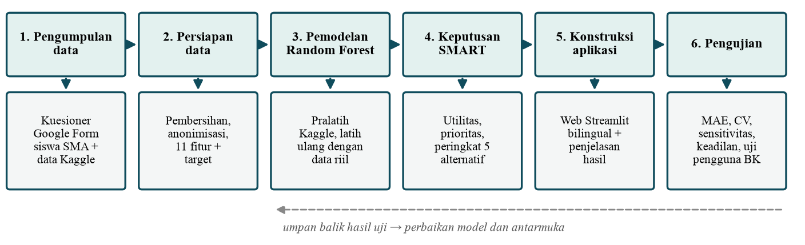

# BAB 1. PENDAHULUAN

## 1.1 Latar Belakang

Kecemasan adalah masalah kesehatan mental yang paling sering dialami remaja. Secara global, satu dari tujuh remaja berusia 10–19 tahun mengalami gangguan mental, dan kecemasan termasuk penyebab utama kesakitan pada kelompok usia ini (World Health Organization, 2025). Survei nasional pertama tentang kesehatan mental remaja Indonesia (I-NAMHS) menemukan bahwa satu dari tiga remaja berusia 10–17 tahun mengalami masalah kesehatan mental dalam 12 bulan terakhir, dan gangguan kecemasan merupakan gangguan yang paling banyak ditemukan (Center for Reproductive Health, University of Queensland dan Johns Hopkins Bloomberg School of Public Health, 2022). Survei yang sama menunjukkan kesenjangan layanan: hanya 2,6% remaja dengan masalah kesehatan mental yang mengakses layanan profesional, sementara 38,2% pengasuh memilih sekolah sebagai tempat mencari bantuan.

Sekolah karena itu menjadi garda depan, dan tumpuan utamanya adalah guru Bimbingan dan Konseling (BK). Namun, regulasi menetapkan satu guru BK melayani sekitar 150 siswa (Kementerian Pendidikan dan Kebudayaan, 2014). Dengan beban tersebut, penjaringan siswa yang cemas masih bergantung pada observasi dan laporan sukarela. Akibatnya penanganan bersifat reaktif, yaitu baru dimulai setelah gejala terlihat atau prestasi menurun. Pilihan bentuk penanganan juga sering didasarkan pada pengalaman pribadi tanpa kriteria yang terdokumentasi.

Di sisi lain, faktor pemicu kecemasan siswa, seperti beban tugas, tekanan ujian, jam tidur, aktivitas fisik, tekanan finansial, ekspektasi keluarga, dan kelelahan, dapat dikumpulkan dengan kuesioner singkat. Penelitian terdahulu menunjukkan bahwa algoritma *machine learning* dapat mengenali tingkat kecemasan dari data kuesioner. Bhatnagar, Agarwal dan Sharma (2023) memperoleh akurasi 78,9% dengan *Random Forest* pada mahasiswa teknik di India, dan Wang *et al.* (2025) menemukan *Random Forest* sebagai model terbaik (AUC 0,71) di antara tujuh algoritma untuk memprediksi kecemasan sosial mahasiswa keperawatan. Kedua penelitian tersebut berhenti pada prediksi. Belum ada keluaran yang menjawab pertanyaan praktis guru BK: siswa mana yang ditangani lebih dahulu, dan penanganan apa yang paling sesuai.

## 1.2 Rumusan Masalah dan Inspirasi

Karya ini terinspirasi dari praktik skrining di sekolah yang masih manual dan dari penelitian prediksi kecemasan di atas. Masalah yang dijawab adalah bagaimana membangun alat bantu yang (1) memperkirakan tingkat kecemasan siswa dari faktor gaya hidup dan akademik, tanpa menanyakan gejala secara langsung; (2) mengurutkan prioritas siswa secara objektif; dan (3) merekomendasikan bentuk penanganan beserta alasan yang dapat dijelaskan kepada siswa dan orang tua.

## 1.3 Keterbaruan dan Fase Final

Keterbaruan karya adalah integrasi dua pendekatan dalam satu aplikasi web siap pakai. **Random Forest** (Breiman, 2001) memprediksi skor kecemasan 0–10, lalu hasilnya menjadi salah satu kriteria metode **Simple Multi-Attribute Rating Technique (SMART)** (Edwards dan Barron, 1994). SMART menghasilkan skor prioritas dan peringkat lima alternatif penanganan: perbaikan pola tidur, program olahraga, strategi belajar, konseling, dan relaksasi. Aplikasi juga memuat penjelasan kontribusi setiap kriteria, uji sensitivitas bobot, pemeriksaan keadilan antargender, dan aturan pengaman. Aturan pengaman berarti siswa dengan prediksi kecemasan tertinggi selalu dirujuk ke konseling.

Prototipe fungsional telah dibangun dan diuji dengan data sekunder. Fase final PKM-KC adalah aplikasi yang **dilatih ulang dengan data kuesioner riil siswa SMA**, divalidasi oleh guru BK di sekolah mitra, dan dapat diakses daring tanpa biaya oleh sekolah.

## 1.4 Luaran dan Manfaat

Luaran yang ditargetkan: (1) aplikasi web SPK kecemasan siswa yang dapat diakses daring; (2) model terlatih pada data riil beserta laporan kinerjanya; (3) buku panduan pengguna untuk guru BK; (4) laporan kemajuan dan laporan akhir; serta (5) akun media sosial dan video promosi kegiatan. Manfaat bagi sekolah adalah skrining dini yang cepat dan terdokumentasi. Bagi guru BK, aplikasi memberi dasar keputusan yang transparan. Bagi siswa, aplikasi memberi peluang mendapat bantuan sebelum kecemasan berdampak pada prestasi.

# BAB 2. TINJAUAN PUSTAKA

## 2.1 Kecemasan pada Siswa dan Instrumen Skrining

Gangguan kecemasan umum ditandai kekhawatiran berlebih yang sulit dikendalikan, gelisah, dan sulit berkonsentrasi. Instrumen skrining singkat seperti GAD-7 terbukti valid untuk menjaring gejala tersebut (Spitzer *et al.*, 2006). Kuesioner karya ini mengadaptasi pendekatan yang sama dalam lima butir psikologis: gugup/cemas, sulit mengendalikan khawatir, konsentrasi, pikiran terganggu, dan sulit menyelesaikan tugas. Kelima butir hanya dipakai untuk membentuk label skor kecemasan. Model sendiri memprediksi dari faktor pemicu, yaitu beban akademik, tidur, aktivitas fisik, tekanan finansial, ekspektasi keluarga, dan kelelahan, sehingga skrining tidak perlu menanyakan gejala secara langsung.

## 2.2 Random Forest untuk Prediksi Kecemasan

Random Forest adalah *ensemble* banyak pohon keputusan. Setiap pohon dilatih pada sampel *bootstrap* dan memilih fitur secara acak pada tiap percabangan, lalu prediksinya dirata-ratakan (Breiman, 2001). Metode ini tahan terhadap *outlier*, menangkap hubungan non-linear, dan menyediakan ukuran kepentingan fitur (*Gini importance*) untuk penjelasan. Pada data kuesioner kesehatan mental mahasiswa, Random Forest memberi akurasi tertinggi dibanding Naïve Bayes, pohon keputusan, dan SVM (Bhatnagar, Agarwal dan Sharma, 2023), serta AUC tertinggi di antara tujuh model pada prediksi kecemasan sosial (Wang *et al.*, 2025). Implementasi karya ini memakai pustaka scikit-learn (Pedregosa *et al.*, 2011).

## 2.3 Metode SMART

SMART adalah metode keputusan multikriteria berbasis utilitas yang sederhana dan transparan (Edwards dan Barron, 1994). Setiap kriteria dinormalisasi menjadi utilitas 0–1. Untuk kriteria *benefit* dipakai u = (x − min)/(max − min), dan untuk kriteria *cost* dipakai u = (max − x)/(max − min). Skor akhir tiap alternatif adalah jumlah bobot × utilitas, dengan total bobot 1. Kesederhanaan ini penting di bidang sensitif seperti kesehatan mental: setiap angka dapat ditelusuri dan dijelaskan kepada guru, siswa, dan orang tua.

## 2.4 Proses Data Mining CRISP-DM

Pengembangan model mengikuti CRISP-DM: pemahaman bisnis, pemahaman data, persiapan data, pemodelan, evaluasi, dan penerapan (Wirth dan Hipp, 2000). Kerangka ini menjamin setiap keputusan teknis terdokumentasi dan dapat diulang.

## 2.5 Posisi Karya terhadap Produk yang Ada

Penelitian terdahulu (Bhatnagar, Agarwal dan Sharma, 2023; Wang *et al.*, 2025) menghasilkan model prediksi di tingkat penelitian dan ditujukan untuk mahasiswa. Keduanya tidak menyediakan aplikasi, urutan prioritas, rekomendasi penanganan, maupun penjelasan hasil. Karya ini menyempurnakan pendekatan tersebut dengan empat hal: (1) sasaran siswa SMA dengan data riil; (2) integrasi prediksi dan keputusan multikriteria; (3) penjelasan dan uji sensitivitas yang langsung terlihat oleh pengguna; dan (4) perlindungan privasi serta aturan rujukan sejak rancangan.

# BAB 3. TAHAP PELAKSANAAN

Pelaksanaan terdiri atas enam tahap berulang (Gambar 1). Hasil uji pada tahap 6 menjadi umpan balik untuk memperbaiki model dan antarmuka.

## 3.1 Tahap 1: Pengumpulan Data

**Data sekunder.** Dataset publik *Student Mental Health and Burnout* dari Kaggle (sharmajicoder, t.t.) berisi 1 juta baris dan diambil sampel acak 2% (20.000 baris, `random_state` = 42). Data ini dipakai untuk pralatih model dan sebagai populasi pembanding SMART.

**Data primer.** Kuesioner Google Form disebarkan kepada siswa SMA melalui sekolah mitra, dengan izin sekolah dan persetujuan orang tua. Kuesioner memuat sekitar 50 butir dalam delapan domain: kebiasaan belajar, tidur, media sosial, tuntutan dan tekanan, aktivitas fisik, kegiatan di luar sekolah, kelelahan, pertemanan, dan pola makan. Selain itu ada lima butir psikologis pembentuk label. Jawaban berupa rentang (mis. jam belajar), skala Likert 5 titik, dan isian angka (nilai rapor). Target minimal 200 respons valid. Jumlah respons yang telah terkumpul: ⟦ISI⟧.

## 3.2 Tahap 2: Persiapan Data

1. **Anonimisasi.** Kolom identitas (waktu isi, tanggal lahir, nama sekolah, nama teman) dibuang segera setelah usia dihitung. Setiap baris diberi ID anonim, dan data mentah tidak pernah disimpan di repositori.
2. **Pembersihan.** Duplikat dibuang, nilai di luar rentang dikosongkan, pola jawaban seragam (*straight-lining*) ditandai, dan nilai kosong diisi median data latih.
3. **Konstruksi fitur.** Jawaban dipetakan ke 11 fitur berskala sama dengan data Kaggle. Contohnya, tekanan ujian (Likert 1–5) menjadi 1–10, dan tingkat stres = 10 × rata-rata ternormalisasi dari butir tugas bersamaan, waktu belajar tidak cukup, tugas terlambat, dan belajar larut malam.
4. **Label.** Skor kecemasan = Σ(butir psikologis − 1), dengan butir konsentrasi dibalik, lalu dibagi 2 sehingga berskala 0–10. Butir pembentuk label **tidak pernah** menjadi fitur, sehingga tidak terjadi *label leakage*.
5. **Pembagian.** Data dibagi 80% pengembangan dan 20% *holdout*. Pada data pengembangan dijalankan validasi silang 5-*fold* × 2 ulangan.

## 3.3 Tahap 3: Pemodelan Random Forest

Model dikonfigurasi dengan 200 pohon, kedalaman maksimum 10, `min_samples_leaf` = 2, dan `max_features` = √n. Pada data Kaggle, model mencapai MAE 0,767 dan R² 0,614 pada 2.000 data uji. Model ini jauh lebih baik dari baseline rata-rata (MAE 1,237) dan setara dengan regresi linear serta *gradient boosting* (selisih MAE ≤ 0,012). Faktor dominannya adalah tingkat stres (0,43) dan kelelahan (0,30).

Untuk menyesuaikan model dengan siswa SMA, tujuh strategi pelatihan ulang dibandingkan dengan validasi silang: model Kaggle tanpa latih ulang; model hanya dari data riil; gabungan Kaggle dan data riil dengan bobot data riil 1, 10, atau 50; serta *warm start* yang menambah 200 atau 600 pohon baru dari data riil. Strategi dengan MAE terendah dipakai aplikasi. Hasil pada data riil: ⟦ISI: strategi terpilih, MAE dan R² holdout⟧.

## 3.4 Tahap 4: Pengolahan Algoritma Keputusan SMART

1. **Kriteria (8).** Prediksi kecemasan RF, jam belajar, tekanan finansial, ekspektasi keluarga, dan kelelahan bersifat *benefit* (makin tinggi makin membutuhkan perhatian). Nilai rapor, jam tidur, dan hari olahraga bersifat *cost*.
2. **Utilitas.** Nilai dinormalisasi min–maks memakai batas populasi referensi, sehingga satu siswa pun dapat dinilai. Nilai di luar batas dipotong ke rentang 0–1.
3. **Skor prioritas.** P = rata-rata utilitas kedelapan kriteria. Nilai ini menentukan urutan siswa yang ditangani lebih dahulu.
4. **Skor alternatif.** Sₐ = Σ wₐⱼ·uⱼ, dengan bobot khusus tiap alternatif yang berjumlah 1. Contohnya, alternatif perbaikan tidur memberi bobot 0,40 pada jam tidur. Alternatif dengan Sₐ tertinggi direkomendasikan, dan tiga teratas ditampilkan.
5. **Aturan pengaman.** Siswa dengan prediksi kecemasan di 10% teratas populasi referensi selalu mendapat rekomendasi konseling dan rujukan, apa pun hasil SMART.

**Contoh.** Siswa dengan jam tidur 3,1 jam memperoleh utilitas jam tidur 0,979. Alternatif perbaikan tidur mendapat skor tertinggi (0,706), dengan sumbangan terbesar 0,40 × 0,979 = 0,392. Skor prioritasnya 0,580, lebih tinggi dari 93% siswa referensi.

## 3.5 Tahap 5: Konstruksi Aplikasi

Aplikasi dibangun dengan Python dan Streamlit dan di-*hosting* di Streamlit Community Cloud. Arsitekturnya ada di Lampiran 5. Aplikasi memiliki empat halaman dalam dua bahasa (Indonesia/Inggris):

- **Beranda:** masalah dan alur kerja.
- **Rekomendasi:** isian kuesioner satu siswa, atau unggah ekspor Google Form untuk satu kelas.
- **Analisis:** kinerja model, grafik SMART, sensitivitas, dan keadilan.
- **Tentang:** metode, keterbatasan, dan etika.

Pelatihan berjalan terpisah dari aplikasi, sehingga aplikasi hanya melakukan inferensi dengan praproses yang sama persis dengan saat pelatihan.

## 3.6 Tahap 6: Pengujian Keandalan dan Penerimaan

**Uji teknis.** Uji teknis mencakup: (1) MAE, RMSE, dan R² pada data *holdout* dan pada respons baru; (2) 39 uji otomatis yang memastikan hasil identik dengan perhitungan manual; (3) uji sensitivitas, yaitu bobot tiap kriteria diubah ±10% dan ±20%, serta seluruh bobot diacak 100 kali; dan (4) uji keadilan berupa perbandingan MAE dan sebaran rekomendasi antargender. Hasil sementara pada data referensi: rekomendasi utama tetap pada 94,6% siswa saat bobot diacak ±10%; perubahan satu bobot ±10% mengubah paling banyak 3% rekomendasi; dan selisih MAE antargender di bawah 0,02 poin.

**Uji penerimaan.** Guru BK dan siswa di sekolah mitra mencoba aplikasi, lalu menilainya pada skala 1–5 untuk lima aspek: pemahaman fitur, kesesuaian hasil, manfaat dan efisiensi, stabilitas sistem, serta kenyamanan tampilan. Guru BK juga memeringkat alternatif penanganan secara manual untuk 20 kasus uji. Target: kesesuaian rekomendasi pertama ≥ 80% dan skor rata-rata penerimaan ≥ 4.

## 3.7 Analisis Hasil dan Etika

Keberhasilan dinilai dari tiga indikator: MAE model pada data riil lebih rendah dari model tanpa latih ulang, rekomendasi stabil terhadap perubahan bobot, dan target uji penerimaan tercapai. Aplikasi tidak menyimpan data, menampilkan penafian bahwa hasil bukan diagnosis klinis, dan hanya menampilkan statistik agregat untuk kelompok berisi minimal lima orang.

# BAB 4. BIAYA DAN JADWAL KEGIATAN

## 4.1 Anggaran Biaya

Tabel 1. Rekapitulasi rencana anggaran biaya

| No | Jenis Pengeluaran | Sumber Dana | Besaran Dana (Rp) |
|---|---|---|---|
| 1 | Bahan habis pakai (ATK, kertas, cetak lembar persetujuan, poster, buku panduan, x-banner, stiker QR) | Belmawa | 2.240.000 |
|  |  | Perguruan Tinggi | 1.000.000 |
| 2 | Sewa dan jasa (sewa server *cloud* 4 bulan) | Belmawa | 1.000.000 |
| 3 | Transportasi lokal ke sekolah mitra | Belmawa | 2.160.000 |
| 4 | Lain-lain (iklan media sosial, akses publikasi berbayar, komunikasi) | Belmawa | 1.100.000 |
| Jumlah |  |  | 7.500.000 |
| Rekap sumber dana |  | Belmawa | 6.500.000 |
|  |  | Perguruan Tinggi | 1.000.000 |
|  |  | Instansi Lain | 0 |
|  |  | Jumlah | 7.500.000 |

Proporsi: bahan habis pakai 43,2%, sewa dan jasa 13,3%, transportasi 28,8%, dan lain-lain 14,7%. Semua proporsi di bawah batas maksimum. Rincian ada di Lampiran 2.

## 4.2 Jadwal Kegiatan

Tabel 2. Jadwal kegiatan

| No | Kegiatan | Bulan 1 | Bulan 2 | Bulan 3 | Bulan 4 | Penanggung Jawab |
|---|---|---|---|---|---|---|
| 1 | Koordinasi dan perizinan sekolah mitra | ■ |  |  |  | ⟦Ketua⟧ |
| 2 | Pengumpulan data kuesioner siswa | ■ | ■ |  |  | Steven Iwan |
| 3 | Persiapan data dan anonimisasi |  | ■ |  |  | Davidson Rafael |
| 4 | Pelatihan ulang model dan penyesuaian SMART |  | ■ | ■ |  | Triemas Putra |
| 5 | Penyempurnaan dan deployment aplikasi |  | ■ | ■ |  | Triemas Putra |
| 6 | Uji keandalan (teknis, sensitivitas, keadilan) |  |  | ■ |  | Davidson Rafael |
| 7 | Uji coba dan evaluasi pengguna di sekolah mitra |  |  | ■ | ■ | Steven Feryanta |
| 8 | Perbaikan berdasarkan umpan balik |  |  |  | ■ | Triemas Putra |
| 9 | Publikasi media sosial, laporan kemajuan dan akhir | ■ | ■ | ■ | ■ | Steven Feryanta |

# DAFTAR PUSTAKA

Bhatnagar, S., Agarwal, J. dan Sharma, O.R. (2023) 'Detection and classification of anxiety in university students through the application of machine learning', *Procedia Computer Science*, 218, pp. 1542–1550.

Breiman, L. (2001) 'Random forests', *Machine Learning*, 45(1), pp. 5–32.

Center for Reproductive Health, University of Queensland dan Johns Hopkins Bloomberg School of Public Health (2022) *Indonesia – National Adolescent Mental Health Survey (I-NAMHS): Laporan Penelitian*. Yogyakarta: Pusat Kesehatan Reproduksi, Universitas Gadjah Mada.

Edwards, W. dan Barron, F.H. (1994) 'SMARTS and SMARTER: improved simple methods for multiattribute utility measurement', *Organizational Behavior and Human Decision Processes*, 60(3), pp. 306–325.

Kementerian Pendidikan dan Kebudayaan (2014) *Peraturan Menteri Pendidikan dan Kebudayaan Nomor 111 Tahun 2014 tentang Bimbingan dan Konseling pada Pendidikan Dasar dan Pendidikan Menengah*. Jakarta: Kementerian Pendidikan dan Kebudayaan.

Pedregosa, F. *et al.* (2011) 'Scikit-learn: machine learning in Python', *Journal of Machine Learning Research*, 12, pp. 2825–2830.

sharmajicoder (t.t.) *Student Mental Health and Burnout* [dataset]. Kaggle. Tersedia di: https://www.kaggle.com/datasets/sharmajicoder/student-mental-health-and-burnout (Diakses: 10 September 2026).

Spitzer, R.L., Kroenke, K., Williams, J.B.W. dan Löwe, B. (2006) 'A brief measure for assessing generalized anxiety disorder: the GAD-7', *Archives of Internal Medicine*, 166(10), pp. 1092–1097.

Wang, F., Xu, P., Huang, Y., Liu, L., Kong, L. dan Yang, F. (2025) 'Social anxiety prediction model for nursing students based on machine learning: a cross-sectional survey', *Frontiers in Psychiatry*, 16, 1721618.

Wirth, R. dan Hipp, J. (2000) 'CRISP-DM: towards a standard process model for data mining', dalam *Proceedings of the 4th International Conference on the Practical Applications of Knowledge Discovery and Data Mining*. Manchester, pp. 29–39.

World Health Organization (2025) *Mental health of adolescents*. Tersedia di: https://www.who.int/news-room/fact-sheets/detail/adolescent-mental-health (Diakses: 28 September 2026).
