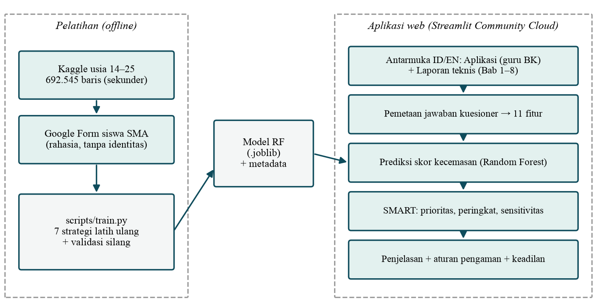
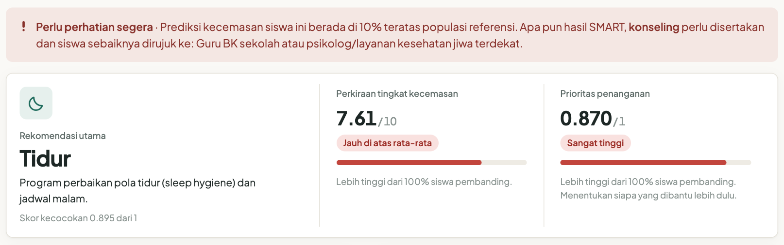
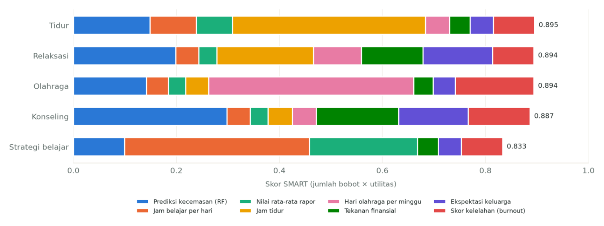

# LAMPIRAN

## Lampiran 1. Biodata Ketua, Anggota, dan Dosen Pendamping

Tim terdiri atas empat mahasiswa. Bagian bertanda ⟦ISI⟧ dilengkapi sendiri oleh yang bersangkutan.

**Daftar anggota tim**

| No | Nama Lengkap | NIM | Angkatan | Jabatan dalam Tim | Program Studi | Perguruan Tinggi |
|---|---|---|---|---|---|---|
| 1 | Steven Feryanta | 412025028 | 2025 | ⟦ISI: ketua/anggota⟧ | ⟦ISI⟧ | Universitas Kristen Krida Wacana |
| 2 | Steven Iwan | 412024008 | 2024 | ⟦ISI: ketua/anggota⟧ | ⟦ISI⟧ | Universitas Kristen Krida Wacana |
| 3 | Triemas Putra | 412024018 | 2024 | ⟦ISI: ketua/anggota⟧ | ⟦ISI⟧ | Universitas Kristen Krida Wacana |
| 4 | Davidson Rafael | 412024030 | 2024 | ⟦ISI: ketua/anggota⟧ | ⟦ISI⟧ | Universitas Kristen Krida Wacana |

**A.1 Identitas Diri: Steven Feryanta**

| No | Identitas | Isian |
|---|---|---|
| 1 | Nama Lengkap | Steven Feryanta |
| 2 | Jenis Kelamin | ⟦ISI⟧ |
| 3 | Program Studi | ⟦ISI⟧ |
| 4 | NIM | 412025028 |
| 5 | Tempat dan Tanggal Lahir | ⟦ISI⟧ |
| 6 | Alamat Surel | ⟦ISI⟧ |
| 7 | Nomor Telepon/HP | ⟦ISI⟧ |

**A.2 Identitas Diri: Steven Iwan**

| No | Identitas | Isian |
|---|---|---|
| 1 | Nama Lengkap | Steven Iwan |
| 2 | Jenis Kelamin | ⟦ISI⟧ |
| 3 | Program Studi | ⟦ISI⟧ |
| 4 | NIM | 412024008 |
| 5 | Tempat dan Tanggal Lahir | ⟦ISI⟧ |
| 6 | Alamat Surel | ⟦ISI⟧ |
| 7 | Nomor Telepon/HP | ⟦ISI⟧ |

**A.3 Identitas Diri: Triemas Putra**

| No | Identitas | Isian |
|---|---|---|
| 1 | Nama Lengkap | Triemas Putra |
| 2 | Jenis Kelamin | ⟦ISI⟧ |
| 3 | Program Studi | ⟦ISI⟧ |
| 4 | NIM | 412024018 |
| 5 | Tempat dan Tanggal Lahir | ⟦ISI⟧ |
| 6 | Alamat Surel | ⟦ISI⟧ |
| 7 | Nomor Telepon/HP | ⟦ISI⟧ |

**A.4 Identitas Diri: Davidson Rafael**

| No | Identitas | Isian |
|---|---|---|
| 1 | Nama Lengkap | Davidson Rafael |
| 2 | Jenis Kelamin | ⟦ISI⟧ |
| 3 | Program Studi | ⟦ISI⟧ |
| 4 | NIM | 412024030 |
| 5 | Tempat dan Tanggal Lahir | ⟦ISI⟧ |
| 6 | Alamat Surel | ⟦ISI⟧ |
| 7 | Nomor Telepon/HP | ⟦ISI⟧ |

**B. Kegiatan Kemahasiswaan yang Sedang/Pernah Diikuti** (ulangi untuk setiap anggota)

| No | Jenis Kegiatan | Status dalam Kegiatan | Waktu dan Tempat |
|---|---|---|---|
| 1 | ⟦ISI⟧ | ⟦ISI⟧ | ⟦ISI⟧ |

**C. Penghargaan yang Pernah Diterima** (ulangi untuk setiap anggota)

| No | Jenis Penghargaan | Pihak Pemberi Penghargaan | Tahun |
|---|---|---|---|
| 1 | ⟦ISI⟧ | ⟦ISI⟧ | ⟦ISI⟧ |

Semua data yang saya isikan dan tercantum dalam biodata ini adalah benar dan dapat dipertanggungjawabkan secara hukum. Apabila di kemudian hari ternyata dijumpai ketidaksesuaian dengan kenyataan, saya sanggup menerima sanksi. Demikian biodata ini saya buat dengan sebenarnya untuk memenuhi salah satu persyaratan dalam pengajuan PKM-KC.

⟦Kota⟧, ⟦tanggal bulan tahun⟧ — Pengusul, ⟦tanda tangan⟧ ⟦Nama Lengkap⟧

**Biodata Dosen Pendamping:** nama lengkap dan gelar, jenis kelamin, program studi, NIP/NIDN, tempat dan tanggal lahir, alamat surel, nomor HP; riwayat pendidikan (S1/S2/S3: institusi, bidang ilmu, tahun); rekam jejak Tri Dharma PT (pendidikan/pengajaran, penelitian, pengabdian kepada masyarakat). ⟦ISI⟧

## Lampiran 2. Justifikasi Anggaran Kegiatan

| No | Jenis Pengeluaran | Volume | Harga Satuan (Rp) | Total (Rp) |
|---|---|---|---|---|
| 1 | **Bahan habis pakai** |  |  |  |
|  | ATK (pulpen, map, buku catatan) | 1 paket | 300.000 | 300.000 |
|  | Kertas A4 80 gram | 2 rim | 60.000 | 120.000 |
|  | Cetak lembar informasi dan persetujuan orang tua | 300 lembar | 1.000 | 300.000 |
|  | Cetak poster A3 sosialisasi skrining di sekolah mitra | 15 lembar | 30.000 | 450.000 |
|  | Cetak buku panduan pengguna untuk guru BK | 12 eksemplar | 75.000 | 900.000 |
|  | X-banner untuk sesi uji coba | 2 buah | 200.000 | 400.000 |
|  | Stiker kode QR tautan aplikasi | 200 lembar | 2.500 | 500.000 |
|  | Cetak kartu panduan singkat untuk siswa | 300 lembar | 900 | 270.000 |
|  | *Subtotal (Belmawa 2.240.000; Perguruan Tinggi 1.000.000)* |  |  | 3.240.000 |
| 2 | **Sewa dan jasa** |  |  |  |
|  | Sewa server *cloud* (VPS) untuk aplikasi dan basis data evaluasi | 4 bulan | 250.000 | 1.000.000 |
|  | *Subtotal (Belmawa)* |  |  | 1.000.000 |
| 3 | **Transportasi lokal** |  |  |  |
|  | Perjalanan ke 3 sekolah mitra (perizinan, pengambilan data, uji coba, evaluasi), 2 orang per kunjungan | 12 kunjungan × 2 orang | 90.000 | 2.160.000 |
|  | *Subtotal (Belmawa)* |  |  | 2.160.000 |
| 4 | **Lain-lain** |  |  |  |
|  | Iklan berbayar media sosial untuk publikasi kegiatan | 1 paket | 500.000 | 500.000 |
|  | Akses artikel ilmiah berbayar | 1 paket | 200.000 | 200.000 |
|  | Biaya komunikasi (kuota internet tim) | 4 bulan | 100.000 | 400.000 |
|  | *Subtotal (Belmawa)* |  |  | 1.100.000 |
|  | **Jumlah (Belmawa 6.500.000; Perguruan Tinggi 1.000.000)** |  |  | **7.500.000** |

## Lampiran 3. Susunan Tim Pengusul dan Pembagian Tugas

| No | Nama / NIM | Program Studi | Bidang Ilmu | Alokasi Waktu (jam/minggu) | Uraian Tugas |
|---|---|---|---|---|---|
| 1 | Steven Feryanta / 412025028 | ⟦ISI⟧ | ⟦ISI⟧ | 10 | Kajian pustaka, koordinasi sekolah mitra, uji coba pengguna, publikasi media sosial |
| 2 | Steven Iwan / 412024008 | ⟦ISI⟧ | ⟦ISI⟧ | 10 | Penyusunan instrumen dan pengumpulan data kuesioner, deployment aplikasi |
| 3 | Triemas Putra / 412024018 | ⟦ISI⟧ | ⟦ISI⟧ | 10 | Pemodelan Random Forest dan SMART, pengembangan aplikasi, pipeline data |
| 4 | Davidson Rafael / 412024030 | ⟦ISI⟧ | ⟦ISI⟧ | 10 | Persiapan data, uji keandalan, sensitivitas, dan keadilan, dokumentasi |

Ketua tim: ⟦ISI: nama ketua⟧. Sesuai aturan kolaborasi mata kuliah, anggota angkatan 2025 memimpin penyusunan proposal, dan anggota angkatan 2024 memimpin integrasi teknis. Seluruh anggota tetap terlibat di setiap tahap.

## Lampiran 4. Surat Pernyataan Ketua Tim Pengusul

Yang bertanda tangan di bawah ini:

- Nama: ⟦ISI⟧
- NIM: ⟦ISI⟧
- Program Studi: ⟦ISI⟧
- Fakultas: ⟦ISI⟧

Dengan ini menyatakan bahwa proposal PKM-KC saya dengan judul "APLIKASI WEB PENDUKUNG KEPUTUSAN BERBASIS RANDOM FOREST DAN SIMPLE MULTI-ATTRIBUTE RATING TECHNIQUE UNTUK SKRINING DINI DAN REKOMENDASI PENANGANAN KECEMASAN SISWA" yang diusulkan untuk tahun anggaran 2026 adalah asli karya kami dan belum pernah dibiayai oleh lembaga atau sumber dana lain.

Bilamana di kemudian hari ditemukan ketidaksesuaian dengan pernyataan ini, maka saya bersedia dituntut dan diproses sesuai dengan ketentuan yang berlaku dan mengembalikan seluruh biaya yang sudah diterima ke kas negara.

Demikian pernyataan ini dibuat dengan sesungguhnya dan dengan sebenar-benarnya.

⟦Kota⟧, ⟦tanggal bulan tahun⟧ — Yang menyatakan, ⟦meterai dan tanda tangan⟧ ⟦Nama Lengkap⟧, NIM ⟦ISI⟧

## Lampiran 5. Gambaran Teknologi yang Akan Dikembangkan

Produk adalah aplikasi web yang memisahkan pelatihan model (luring) dari aplikasi yang dipakai guru BK (daring). Pelatihan menghasilkan satu berkas model dan metadata (fitur, batas normalisasi SMART, median imputasi). Aplikasi memakai berkas tersebut untuk memproses jawaban kuesioner dengan praproses yang sama persis.

Alur penggunaan: guru BK mengisi kuesioner untuk satu siswa atau mengunggah ekspor Google Form satu kelas. Sistem kemudian (1) mengubah jawaban menjadi 11 fitur, (2) memprediksi skor kecemasan dengan Random Forest, (3) menghitung skor prioritas dan peringkat lima alternatif dengan SMART, dan (4) menampilkan tiga rekomendasi teratas, grafik kontribusi setiap kriteria, kalimat alasan, serta tabel uji sensitivitas. Siswa dengan prediksi kecemasan tertinggi ditandai "Perlu perhatian segera" disertai rujukan konseling.

| Komponen | Teknologi | Fungsi |
|---|---|---|
| Antarmuka | Streamlit (Python), dua bahasa | Formulir kuesioner, unggah berkas, tampilan hasil dan analisis |
| Pemetaan data | pandas, pemetaan kolom Google Form | Jawaban teks → 11 fitur; membuang data pribadi |
| Model prediksi | scikit-learn Random Forest | Skor kecemasan 0–10 |
| Keputusan | SMART (implementasi sendiri) | Skor prioritas, peringkat alternatif, sensitivitas |
| Pengujian | pytest (39 uji otomatis) | Menjamin hasil konsisten setelah setiap perubahan |
| Hosting | Streamlit Community Cloud / VPS | Akses daring tanpa instalasi |

## Lampiran 6. Hasil Uji Periksa Similaritas Proposal

⟦Lampirkan hasil uji similaritas bagian inti (Bab 1 sampai Daftar Pustaka) dari Turnitin, iThenticate, atau sejenisnya. Indeks similaritas maksimum 25%.⟧
