[[TOC]]

[[PAGEBREAK]]

# 1. Pendahuluan

## 1.1 Tentang aplikasi

**SPK SMART Kecemasan Siswa** adalah aplikasi web yang membantu guru Bimbingan Konseling (BK) melakukan tiga hal:

1. **Memperkirakan tingkat kecemasan** siswa (skor 0–10) dari 11 faktor gaya hidup dan akademik, memakai model *Random Forest*.
2. **Menyusun prioritas**: siswa mana yang perlu ditangani lebih dulu (skor prioritas SMART).
3. **Merekomendasikan penanganan** dari lima bentuk dukungan, yaitu Tidur, Olahraga, Strategi belajar, Konseling, dan Relaksasi, lengkap dengan alasannya.

> **Penting.** Aplikasi ini adalah alat bantu skrining dan pendukung keputusan, **bukan alat diagnosis klinis**. Keputusan akhir tetap pada guru BK atau tenaga profesional.

## 1.2 Siapa penggunanya

| Pengguna | Kebutuhan | Fitur utama |
|---|---|---|
| Guru BK | skrining dini, daftar prioritas, pilihan penanganan | Rekomendasi (satu siswa dan satu kelas) |
| Wali kelas / pimpinan sekolah | gambaran umum kondisi siswa | Rekomendasi → Satu kelas, Analisis |
| Siswa (dengan pendampingan) | refleksi diri | Rekomendasi → Satu siswa |

## 1.3 Kebutuhan

- Peramban modern (Chrome, Edge, Firefox, atau Safari) dan koneksi internet.
- Tidak perlu akun atau kata sandi.
- Alamat aplikasi: ⟦ISI: URL Streamlit Community Cloud⟧

Saat dibuka pertama kali, server mungkin memerlukan 20–40 detik untuk "bangun". Tunggu hingga halaman Beranda tampil.

# 2. Tampilan Umum dan Beranda

| No. | Bagian | Fungsi |
|---|---|---|
| 1 | Menu halaman | Bilah di bagian atas, di samping logo **SPK SMART**. Klik **Beranda**, **Rekomendasi**, **Analisis**, atau **Tentang** untuk berpindah halaman. Halaman yang sedang dibuka diberi latar abu-abu |
| 2 | Bahasa | Tombol **ID** / **EN** di pojok kanan atas. **ID** = Bahasa Indonesia, **EN** = English. Seluruh teks, label, dan grafik ikut berganti (Bab 7) |
| 3 | **Mulai penilaian** | Membuka halaman Rekomendasi pada tampilan **Satu siswa** (Bab 3) |
| 4 | **Nilai satu kelas sekaligus** | Membuka halaman Rekomendasi pada tampilan **Satu kelas (unggah berkas)** (Bab 4) |
| 5 | Contoh hasil | Gambaran bentuk hasil: rekomendasi utama, tingkat kecemasan, dan prioritas. Kartu ini hanya contoh, bukan hasil siswa mana pun |
| 6 | Cara kerjanya | Tiga langkah: isi kuesioner, sistem menghitung (Random Forest lalu SMART), baca rekomendasinya |
| 7 | Lima bentuk dukungan | Penjelasan singkat setiap alternatif penanganan yang dapat direkomendasikan |
| 8 | Untuk siapa? / Perlu diingat | Sasaran pengguna dan tiga pengingat penting: hasil bukan diagnosis, siswa di 10% kecemasan tertinggi selalu diarahkan ke konseling, dan data tidak disimpan |
| 9 | Catatan kaki | Penafian (bukan alat diagnosis klinis) dan pernyataan privasi. Catatan ini tampil di bagian bawah setiap halaman |

Pengaturan **profil bobot SMART** tidak ada di Beranda. Pengaturan ini ada di tombol **Profil bobot** pada halaman Rekomendasi dan Analisis (subbab 3.8).

> Pada layar sempit (ponsel), menu halaman diringkas menjadi tombol **»** di samping logo. Ketuk tombol itu untuk membuka daftar halaman.

[[PAGEBREAK]]

# 3. Menilai Satu Siswa

## 3.1 Membuka formulir

Klik **Mulai penilaian** di Beranda (Gambar 1, no. 3), atau klik **Rekomendasi** di menu atas (Gambar 1, no. 1). Tampilan **Satu siswa** terbuka secara bawaan.

| No. | Bagian | Keterangan |
|---|---|---|
| 1 | Pilihan tampilan | **Satu siswa** untuk menilai satu orang; **Satu kelas (unggah berkas)** untuk menilai satu kelas atau sekolah (Bab 4) |
| 2 | **Profil bobot** | Membuka pengaturan profil bobot SMART. Huruf di tombol (A, B, atau C) adalah profil yang sedang dipakai (subbab 3.8) |
| 3 | Mode lanjutan | Sakelar **Mode lanjutan: isi 11 nilai fitur model**. Dalam keadaan mati (bawaan), formulir berisi kuesioner yang sama dengan Google Form. Nyalakan untuk mengisi nilai fitur secara langsung (subbab 3.3) |
| 4 | Kartu bagian bernomor | Pertanyaan dikelompokkan dalam lima kartu: **1 Tentang siswa**, **2 Belajar & nilai**, **3 Tuntutan & tekanan**, **4 Tidur, olahraga & uang saku**, dan **5 Kelelahan**. Di bawah judul kartu ada petunjuk singkat. Tidak ada nama atau data pribadi yang diminta |
| 5 | Penggeser (*slider*) | Untuk jam belajar dan durasi tidur. Geser titiknya ke kiri/kanan; jawaban terpilih tampil di atas titik (mis. "2 jam") |
| 6 | Isian angka | Untuk usia dan nilai rapor. Ketik angka atau pakai tombol **−** / **+** |
| 7 | Pilihan jawaban | Klik salah satu bulatan (mis. Tidak pernah / 1 kali / 2–3 kali / 4–5 kali). Hanya satu jawaban yang dapat dipilih |
| 8 | **Sebelum mengisi** | Empat tips: jawab sesuai kondisi akhir-akhir ini, tidak ada jawaban benar atau salah, jawaban tidak disimpan, dan hasil bukan diagnosis |
| 9 | **Ingin mencoba dulu?** | Tombol **Contoh risiko tinggi** dan **Contoh risiko rendah** langsung menampilkan hasil untuk contoh siswa, tanpa mengisi formulir. Berguna untuk mengenal aplikasi atau demo |

## 3.2 Mengisi kuesioner

Isi setiap pertanyaan sesuai kondisi siswa dalam seminggu atau sebulan terakhir. Semua pertanyaan sudah berisi jawaban bawaan, jadi periksa dan ubah yang tidak sesuai.

| Kartu | Pertanyaan | Pilihan jawaban |
|---|---|---|
| 1 Tentang siswa | Jenis kelamin; usia | Laki-laki / Perempuan; 12–30 tahun |
| 2 Belajar & nilai | Jam belajar mandiri per hari | Penggeser: Dibawah 30 menit … 11 jam 30 menit |
| | Nilai rata-rata rapor terakhir | 0–100 |
| | Belajar sampai larut malam (seminggu) | Tidak pernah / 1 kali / 2–3 kali / 4–5 kali |
| | Waktu belajar tidak cukup | Tidak pernah / Jarang / Kadang-kadang / Sering |
| | Tugas terlambat (sebulan) | Tidak pernah / 1 / 2–3 / 4–5 |
| 3 Tuntutan & tekanan | Terlalu banyak tugas bersamaan; tertekan karena ujian; takut mengecewakan orang tua; keluarga menuntut nilai tinggi | Tidak pernah / Jarang / Kadang-kadang / Sering / Sangat sering |
| 4 Tidur, olahraga & uang saku | Durasi tidur malam | Penggeser: 4 jam … 12 jam |
| | Hari berolahraga minimal 20–30 menit (seminggu) | 0 hari / 1–2 hari / 3–4 hari / 5–6 hari / 7 hari |
| | Uang saku cukup | Tidak pernah / Pernah / Netral / Sering / Sangat sering |
| 5 Kelelahan | Sulit membagi waktu; kelelahan karena kegiatan sekolah; kehilangan minat dan motivasi | Sangat tidak setuju / Tidak setuju / Netral / Setuju / Sangat setuju |

Aplikasi mengubah jawaban menjadi 11 fitur model dengan rumus yang sama seperti saat model dilatih. Contohnya, "tertekan karena ujian" pada skala 1–5 diubah ke skala 1–10.

## 3.3 Mode lanjutan (opsional)

Nyalakan sakelar **Mode lanjutan: isi 11 nilai fitur model** (Gambar 2, no. 3) bila nilai fitur sudah diketahui, misalnya dari data lain. Formulir berganti menjadi dua kartu: **1 Profil siswa** (usia dan jenis kelamin) dan **2 Nilai fitur model** (sembilan penggeser, mis. jam belajar 0–14, nilai rapor 0–100, jam tidur 3–12, dan hari olahraga 0–7; rentang lengkap ada di Lampiran A). Arahkan kursor ke ikon **?** di samping setiap penggeser untuk melihat arti dan rentangnya. Matikan sakelar untuk kembali ke kuesioner.

## 3.4 Memproses

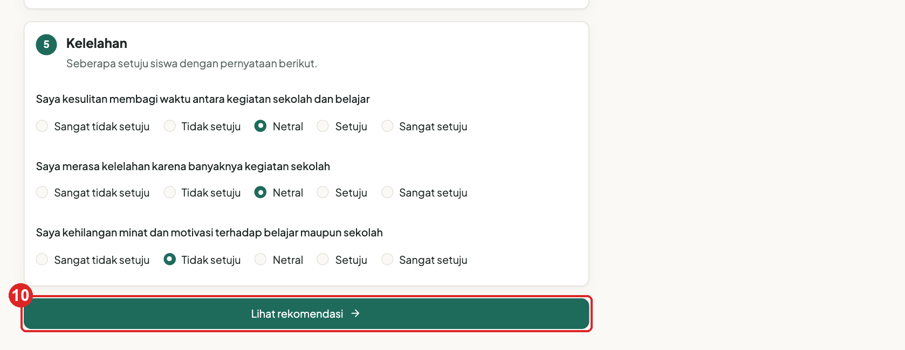

Klik **Lihat rekomendasi** (no. 10) di bawah kartu terakhir. Formulir berganti menjadi layar hasil dalam 1–2 detik, dan halaman kembali ke atas. Jawaban hanya dikirim saat tombol ini diklik, jadi mengubah jawaban tidak langsung mengubah hasil.

[[PAGEBREAK]]

## 3.5 Membaca hasil

| No. | Bagian | Cara membaca |
|---|---|---|
| 1 | **Ubah jawaban** | Kembali ke formulir. Jawaban sebelumnya tetap terisi, jadi cukup ubah yang perlu lalu klik **Lihat rekomendasi** lagi |
| 2 | **Penilaian baru** | Mengosongkan jawaban (kembali ke nilai bawaan) dan membuka formulir baru untuk siswa lain |
| 3 | **Perlu perhatian segera** (kotak merah) | Muncul bila prediksi kecemasan termasuk **10% tertinggi** populasi referensi. Apa pun hasil SMART, sertakan **konseling** dan pertimbangkan rujukan ke guru BK, psikolog, atau layanan kesehatan jiwa |
| 4 | **Rekomendasi utama** | Bentuk dukungan dengan skor SMART tertinggi, penjelasan singkatnya, dan **skor kecocokan** (0–1) |
| 5 | **Perkiraan tingkat kecemasan** | Prediksi Random Forest (0–10). Label berwarna menunjukkan posisi siswa: *Di bawah rata-rata*, *Sekitar rata-rata*, *Di atas rata-rata*, atau *Jauh di atas rata-rata*. Kalimat di bawahnya menyebut persentil: "lebih tinggi dari …% siswa pembanding" |
| 6 | **Prioritas penanganan** | Skor prioritas SMART (0–1). Makin tinggi, makin perlu didahulukan. Labelnya: *Rendah*, *Sedang*, *Tinggi*, atau *Sangat tinggi* |
| 7 | **Urutan lima pilihan** | Kelima bentuk dukungan diurutkan dari skor tertinggi. Makin panjang batang, makin cocok untuk siswa ini. Guru BK tetap bebas memilih di antara pilihan teratas |
| 8 | **Mengapa …?** | Kalimat alasan: alternatif pemenang dan profil bobotnya, **pendorong utama** (kriteria yang paling menyumbang), selisih dengan alternatif kedua, dan posisi skor prioritas |
| 9 | **Rincian perhitungan** | Panel yang dapat dibuka untuk melihat perhitungan lengkap (subbab 3.6) |

**Tips membaca selisih.** Bila selisih skor alternatif pertama dan kedua kecil (< 0,02), kotak **Mengapa …?** menambahkan kalimat "Selisihnya kecil, jadi … juga layak dipertimbangkan". Kedua alternatif sama-sama layak dipertimbangkan.

## 3.6 Rincian perhitungan

Klik **Rincian perhitungan** (Gambar 4, no. 9). Panel terbuka dengan tiga tab (no. 1 pada Gambar 5).

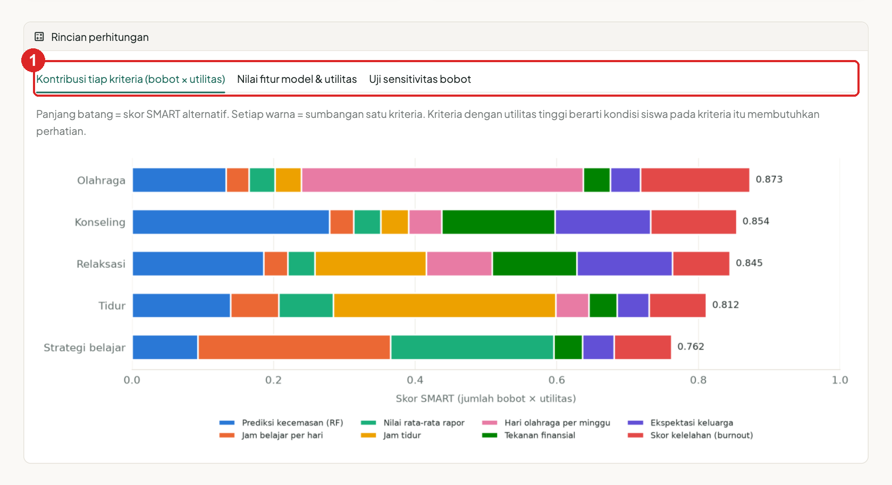

**Kontribusi tiap kriteria (bobot × utilitas).** Setiap batang adalah satu alternatif. Panjang batang = skor SMART, dan setiap warna = sumbangan satu kriteria (bobot × utilitas). Warna yang lebar menunjukkan alasan utama.

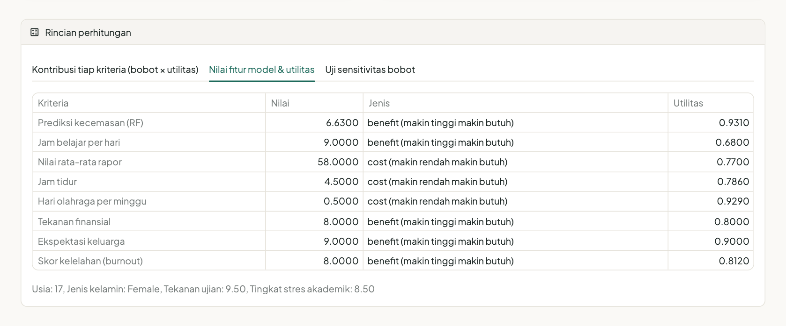

**Nilai fitur model & utilitas.** Tabel delapan kriteria SMART:

- **Nilai**: nilai kriteria siswa. Prediksi kecemasan berasal dari model; sisanya dari jawaban.
- **Jenis**: *benefit* = makin tinggi makin butuh perhatian (mis. kelelahan); *cost* = makin rendah makin butuh perhatian (mis. jam tidur).
- **Utilitas** 0–1: posisi siswa dibandingkan populasi referensi. Nilai 1 berarti kondisi paling membutuhkan perhatian.

Di bawah tabel tercantum fitur model lain yang bukan kriteria SMART (usia, jenis kelamin, tekanan ujian, dan tingkat stres).

## 3.7 Uji sensitivitas bobot

Buka tab **Uji sensitivitas bobot** di panel **Rincian perhitungan**.

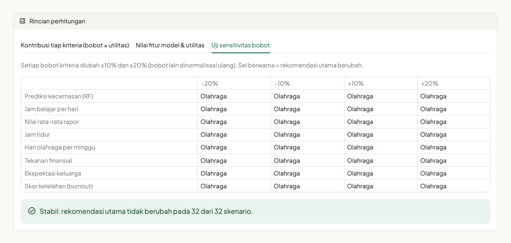

Setiap baris adalah satu kriteria. Setiap kolom adalah perubahan bobotnya: −20%, −10%, +10%, +20%. Isi sel adalah rekomendasi utama setelah bobot diubah. **Sel berwarna oranye muda** berarti rekomendasi berubah. Kotak hijau "Stabil" berarti rekomendasi kokoh. Kotak kuning berarti rekomendasi berubah pada sebagian skenario, sehingga hasil siswa ini sebaiknya ditinjau bersama alternatif kedua.

## 3.8 Mengubah profil bobot

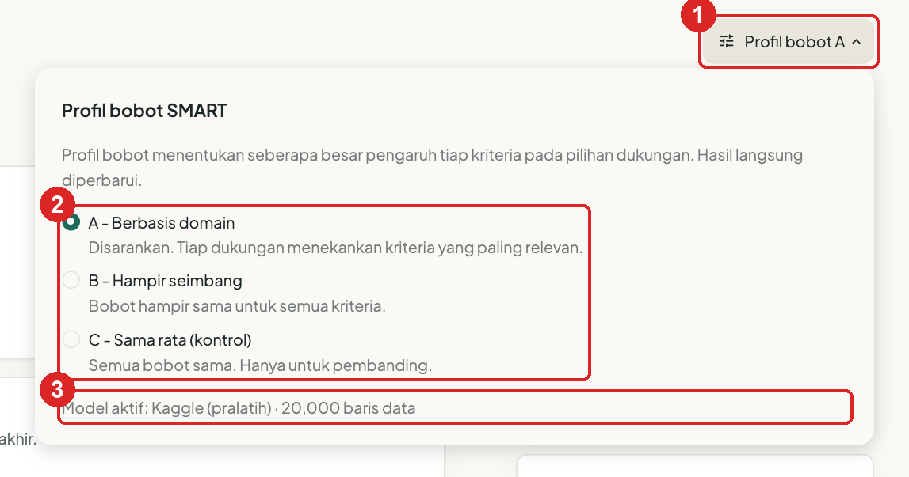

1. Klik tombol **Profil bobot** (no. 1) di kanan atas halaman Rekomendasi atau Analisis.
2. Pilih salah satu profil (no. 2):
   - **A - Berbasis domain** (bawaan, disarankan): tiap dukungan menekankan kriteria yang paling relevan. Profil ini paling stabil.
   - **B - Hampir seimbang**: bobot hampir sama untuk semua kriteria.
   - **C - Sama rata (kontrol)**: semua bobot sama, hanya untuk pembanding.
3. Klik di luar panel untuk menutupnya. Hasil langsung dihitung ulang, dan huruf pada tombol berganti.

Baris paling bawah panel (no. 3) menunjukkan **model aktif**: sumber data model (Kaggle, atau Kaggle → data kuesioner riil) dan jumlah data. Bila profil **C** dipilih, semua alternatif mendapat bobot sama sehingga skornya selalu seri, dan aplikasi menampilkan peringatan di bawah judul halaman.

[[PAGEBREAK]]

# 4. Menilai Satu Kelas

Klik **Nilai satu kelas sekaligus** di Beranda (Gambar 1, no. 4), atau pilih **Satu kelas (unggah berkas)** di halaman Rekomendasi (Gambar 2, no. 1). Tampilan ini menyusun daftar prioritas satu kelas atau sekolah sekaligus.

## 4.1 Menyiapkan berkas

Ada dua format yang diterima:

1. **Ekspor Google Form.** Di Google Form, buka tab **Respons**, lalu klik **Lihat di Spreadsheet**. Di spreadsheet, pilih **File → Download → CSV** atau **Microsoft Excel (.xlsx)**. Unggah berkas itu tanpa diubah. Aplikasi mengenali kolom pertanyaan secara otomatis.
2. **CSV 11 kolom** dengan nama kolom persis seperti Lampiran A. Kolom `student_id` bersifat opsional.

Ukuran maksimum berkas 50 MB.

## 4.2 Mengunggah dan membaca hasil

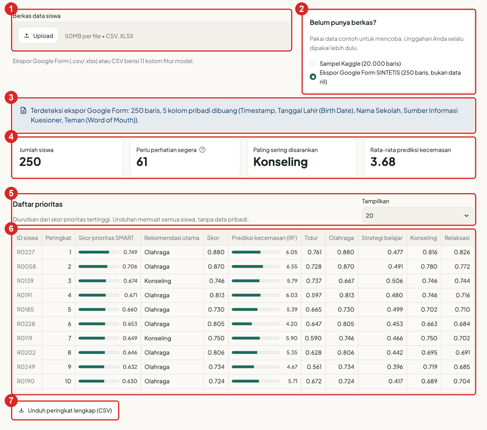

| No. | Bagian | Keterangan |
|---|---|---|
| 1 | **Berkas data siswa** | Klik **Upload** lalu pilih berkas .csv/.xlsx, atau seret berkas ke kotak ini |
| 2 | **Belum punya berkas?** | Tanpa unggahan, aplikasi memakai data contoh: **Sampel Kaggle (20.000 baris)** atau **Ekspor Google Form SINTETIS** (250 baris data buatan, bukan siswa nyata). Unggahan selalu dipakai lebih dulu; pilihan ini nonaktif selama ada berkas |
| 3 | Deteksi berkas | Jenis berkas yang terdeteksi, jumlah baris, dan **kolom pribadi yang dibuang** (waktu isi, tanggal lahir, nama sekolah, sumber informasi, nama teman) |
| 4 | Ringkasan kelas | **Jumlah siswa**; **Perlu perhatian segera** (prediksi kecemasan di 10% teratas populasi referensi); **Paling sering disarankan**; **Rata-rata prediksi kecemasan** |
| 5 | **Daftar prioritas** dan **Tampilkan** | Pilih jumlah baris yang ditampilkan (10, 20, 50, …) |
| 6 | Tabel prioritas | Diurutkan dari **skor prioritas SMART** tertinggi. Kolom: ID siswa, peringkat, skor prioritas (dengan batang), rekomendasi utama dan skornya, prediksi kecemasan (dengan batang), dan skor kelima alternatif. Klik judul kolom untuk mengurutkan |
| 7 | **Unduh peringkat lengkap (CSV)** | Mengunduh hasil semua siswa sebagai CSV tanpa data pribadi. Pada ekspor Google Form, setiap siswa diberi ID anonim (R0001, …) sesuai urutan baris berkas |

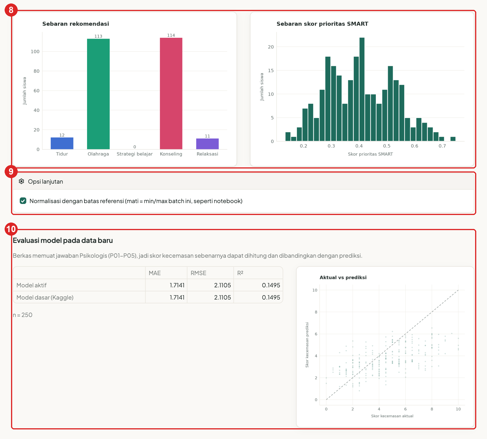

| No. | Bagian | Keterangan |
|---|---|---|
| 8 | Grafik sebaran | **Sebaran rekomendasi** (jumlah siswa per bentuk dukungan) dan **Sebaran skor prioritas SMART** |
| 9 | **Opsi lanjutan** | Klik untuk membuka. Kotak **Normalisasi dengan batas referensi** dicentang secara bawaan: siswa dibandingkan dengan populasi referensi. Tanpa centang: siswa dibandingkan antarsiswa dalam berkas itu saja, seperti di notebook |
| 10 | **Evaluasi model pada data baru** | Muncul bila berkas memuat jawaban bagian **Psikologis** (P01–P05). Aplikasi menghitung skor kecemasan sebenarnya dan membandingkannya dengan prediksi (MAE, RMSE, R²) untuk model aktif dan model dasar Kaggle, lengkap dengan grafik aktual vs prediksi |

## 4.3 Pesan kesalahan yang mungkin muncul

| Pesan | Penyebab | Solusi |
|---|---|---|
| Kolom fitur model hilang | Berkas bukan ekspor Google Form dan tidak memiliki 11 kolom | Unggah ekspor asli dari Google Form, atau lengkapi kolom sesuai Lampiran A |
| Berkas tidak dapat diproses: missing fields / ambiguous fields | Judul pertanyaan di Google Form diubah | Hubungi pengelola aplikasi untuk memperbarui pemetaan kolom (`spk/gform_mapping.json`) |
| … nilai kosong diisi dengan median data latih | Ada jawaban kosong | Tidak perlu tindakan; periksa kembali data bila jumlahnya besar |
| Angka di luar rentang dikosongkan | Mis. nilai rapor > 100 | Perbaiki data sumber lalu unggah ulang |

[[PAGEBREAK]]

# 5. Halaman Analisis

Halaman **Analisis** menampilkan bukti kinerja model dan SPK. Semua grafik memakai populasi referensi 20.000 siswa (Gambar 10, no. 1) dan mengikuti profil bobot yang dipilih lewat tombol **Profil bobot** (no. 2). Isinya dibagi dalam lima tab (no. 3): **Data**, **Model**, **SMART**, **Sensitivitas**, dan **Keadilan**.

## 5.1 Tab Data

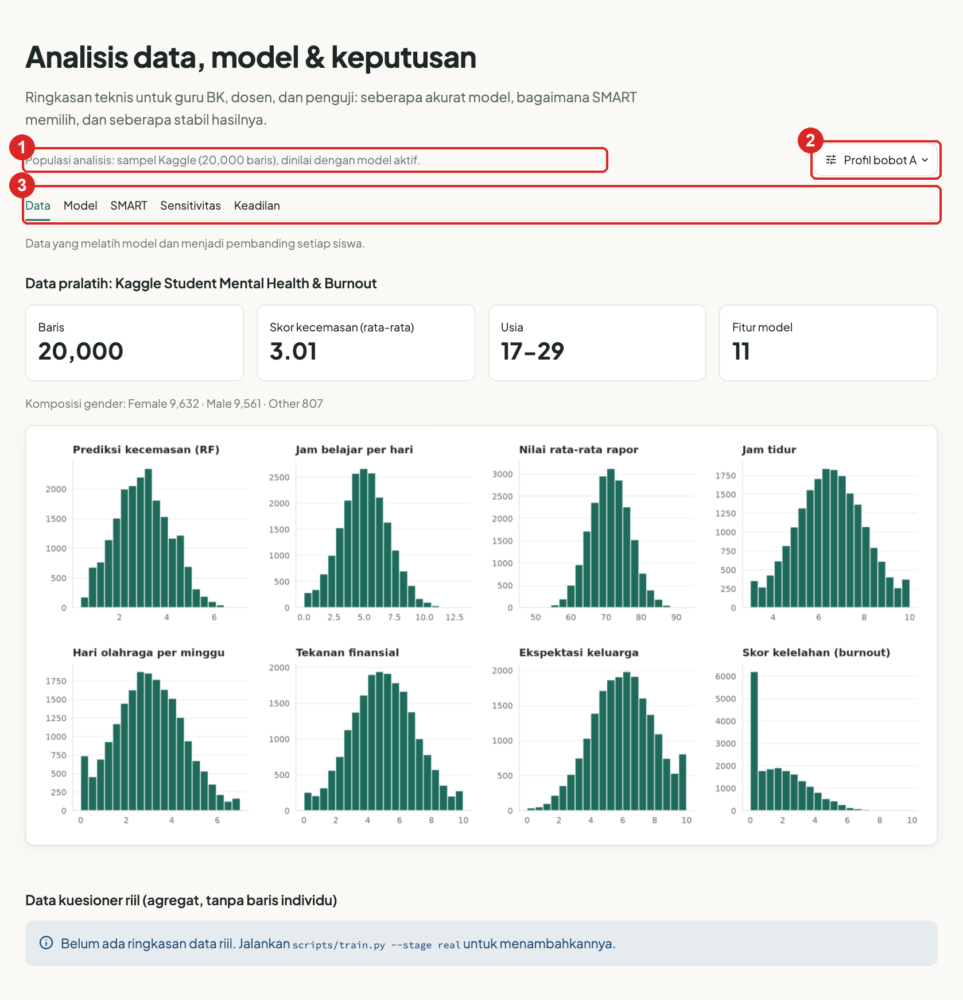

Menampilkan jumlah data, rata-rata skor kecemasan, rentang usia, jumlah fitur model, komposisi gender, dan histogram delapan kriteria SMART. Setelah model dilatih dengan data kuesioner riil, bagian **Data kuesioner riil** juga menampilkan ringkasan agregat: jumlah respons, *box plot* tiap fitur, dan korelasi dengan skor kecemasan. Tidak ada data per siswa yang ditampilkan.

## 5.2 Tab Model (Data Mining)

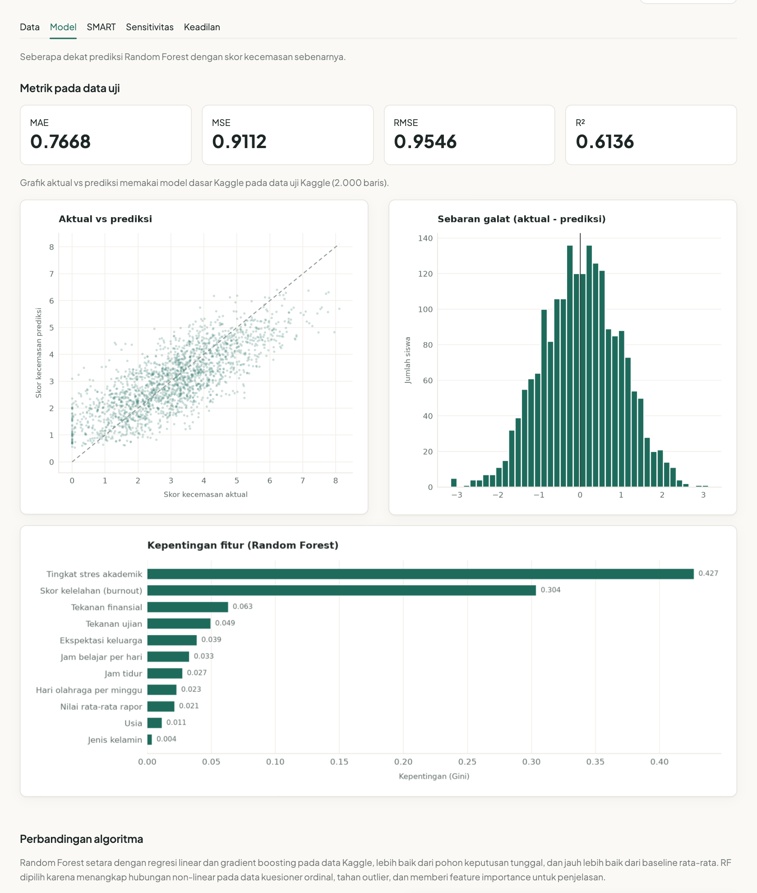

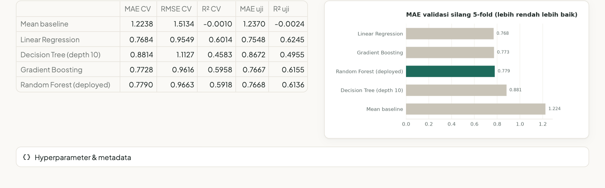

- **MAE / MSE / RMSE / R²**: akurasi prediksi pada data uji. MAE 0,77 berarti rata-rata prediksi meleset ±0,77 poin pada skala 0–10.
- **Aktual vs prediksi**: titik yang dekat garis diagonal berarti prediksi tepat.
- **Sebaran galat**: selisih aktual − prediksi; makin terpusat di 0 makin baik.
- **Kepentingan fitur**: faktor yang paling memengaruhi prediksi. Tingkat stres akademik dan kelelahan adalah yang terbesar.
- **Perbandingan algoritma**: alasan pemilihan Random Forest dibanding regresi linear, pohon keputusan, gradient boosting, dan baseline. Panel **Hyperparameter & metadata** di bawahnya memuat detail teknis model.

## 5.3 Tab SMART (SPK)

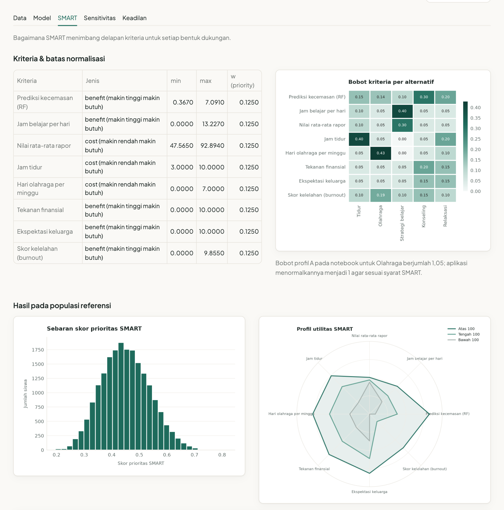

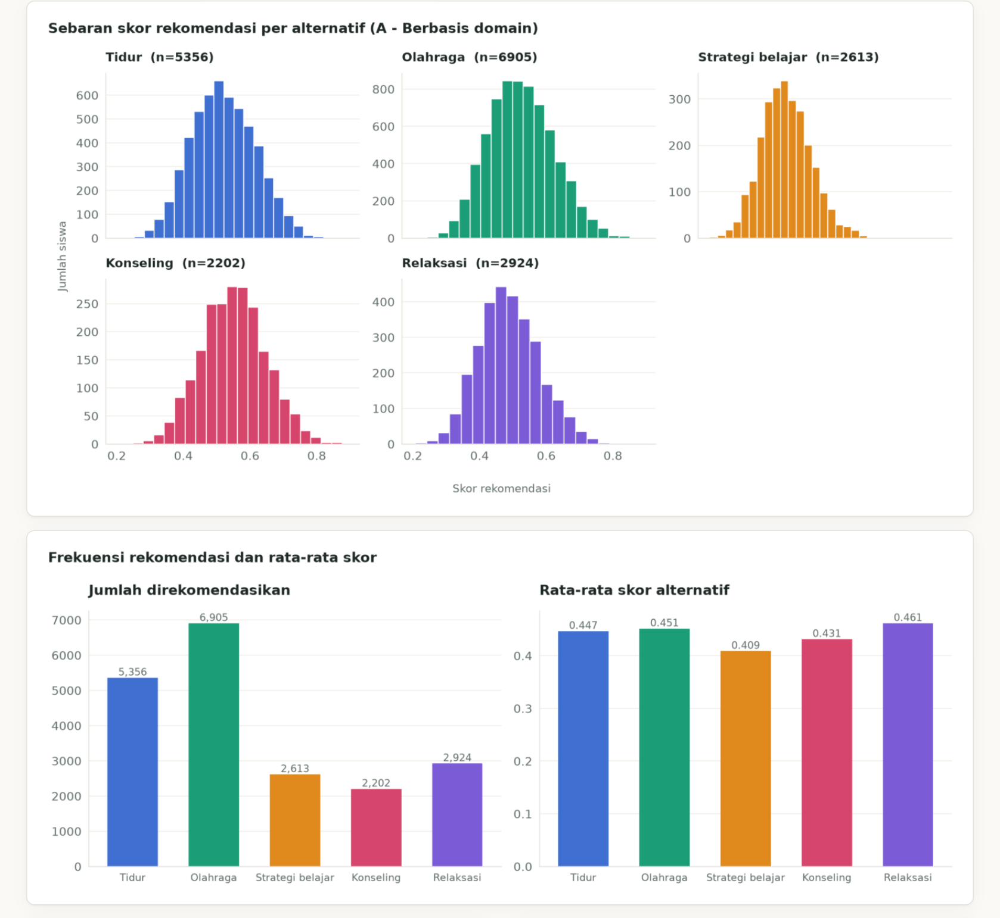

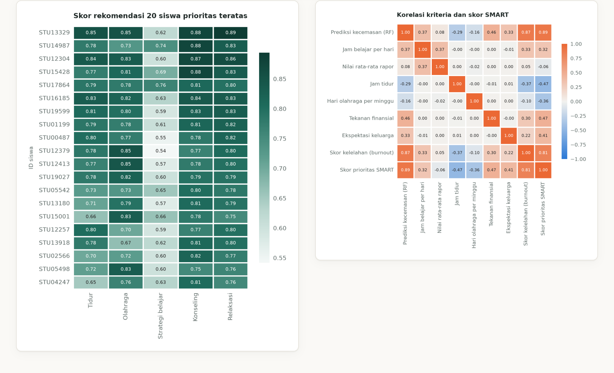

Tab ini menjelaskan bagaimana SMART bekerja pada seluruh populasi. Isinya: jenis dan batas normalisasi setiap kriteria, bobot tiap alternatif (peta warna), sebaran skor prioritas, profil utilitas kelompok atas/tengah/bawah, sebaran skor per alternatif, frekuensi rekomendasi beserta rata-rata skornya, skor rekomendasi 20 siswa dengan prioritas tertinggi, dan korelasi antara kriteria dan skor SMART.

## 5.4 Tab Sensitivitas

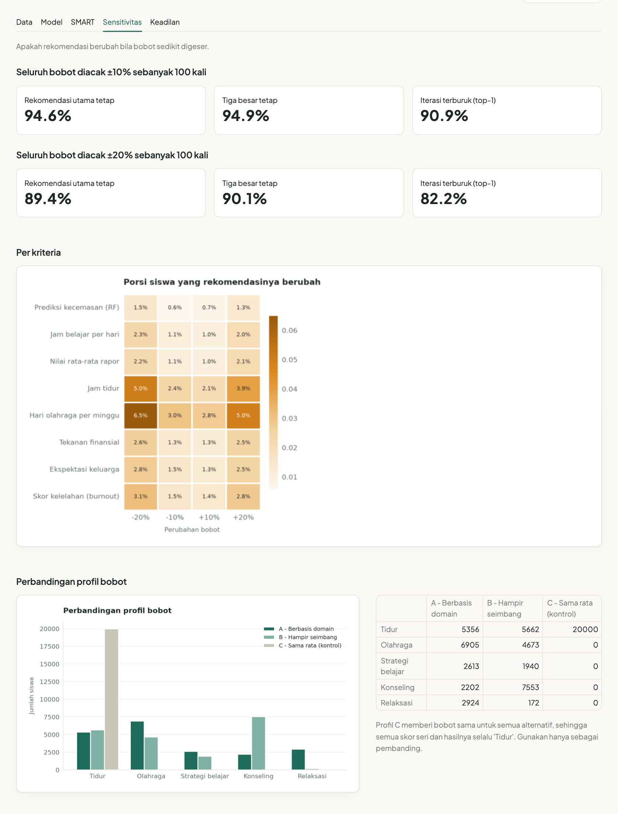

- **Stabilitas global**: persentase siswa yang rekomendasi utamanya (dan tiga besarnya) tetap saat semua bobot diacak ±10% atau ±20% sebanyak 100 kali. Profil A: 94,6% tetap pada ±10%.
- **Per kriteria**: persentase siswa yang rekomendasinya berubah bila satu kriteria diubah bobotnya. Makin gelap warnanya makin sensitif.
- **Perbandingan profil bobot**: jumlah siswa per rekomendasi untuk profil A, B, dan C.

## 5.5 Tab Keadilan

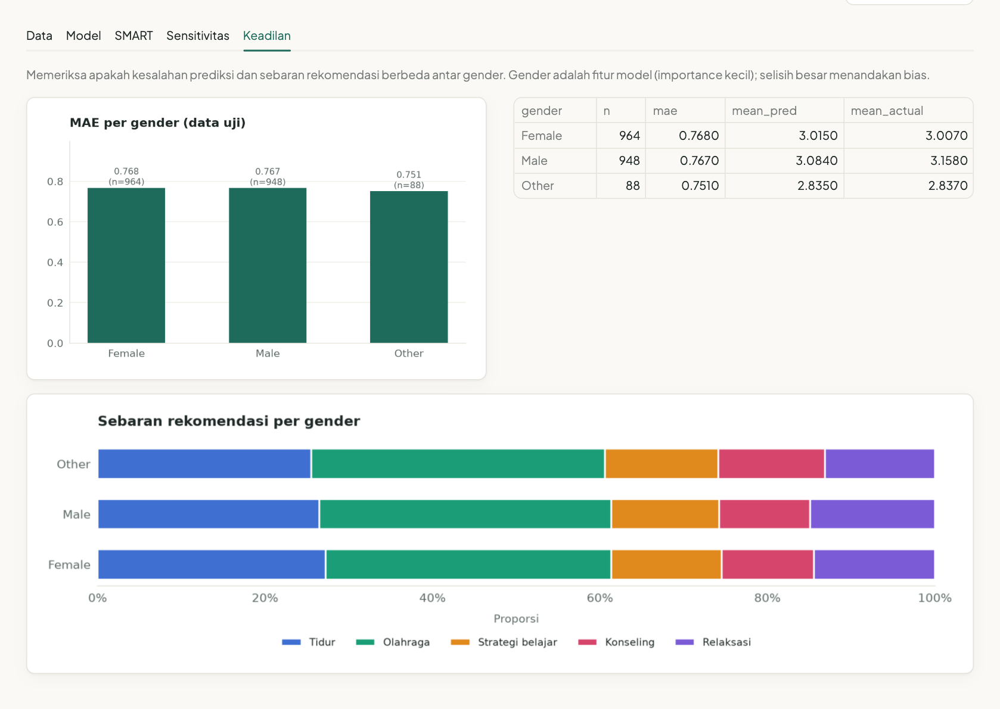

Membandingkan kesalahan prediksi (MAE) dan sebaran rekomendasi antar gender. Selisih kecil (< 0,02 poin) menunjukkan model tidak bias terhadap gender tertentu.

[[PAGEBREAK]]

# 6. Halaman Tentang

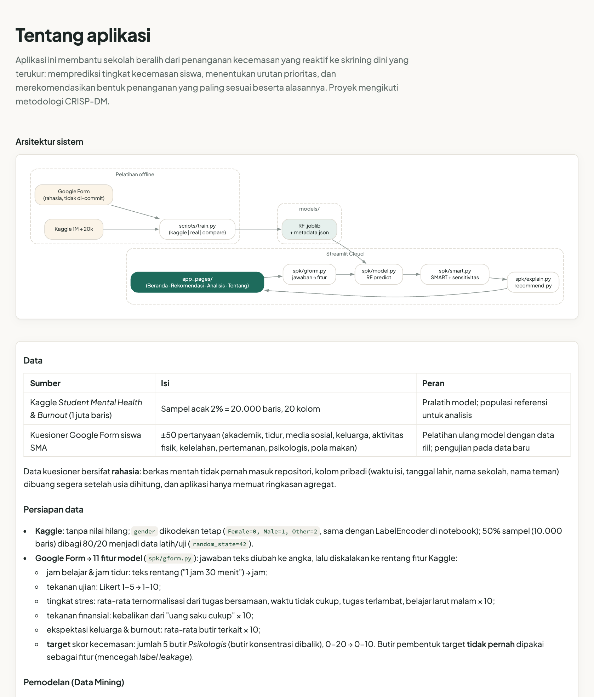

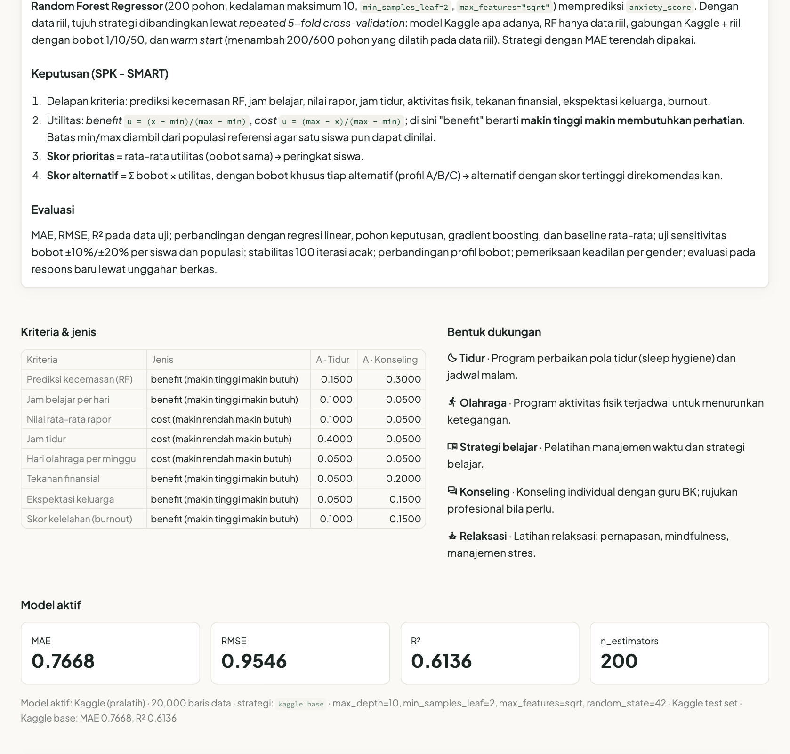

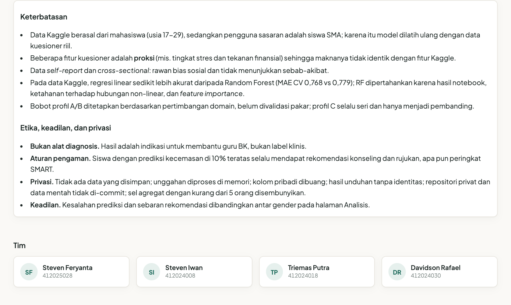

Halaman ini menjelaskan tujuan, arsitektur, sumber data, persiapan data, metode Random Forest dan SMART, evaluasi, kriteria dan bentuk dukungan, metrik model aktif, keterbatasan, serta prinsip etika dan privasi aplikasi.

# 7. Mengganti Bahasa

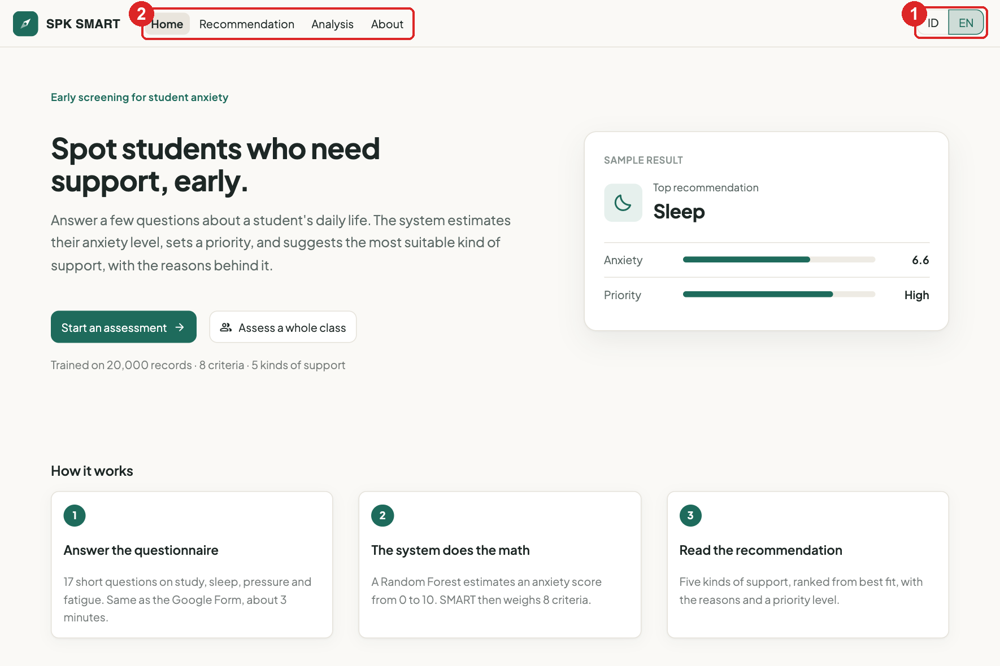

Klik **EN** (no. 1) di pojok kanan atas untuk beralih ke bahasa Inggris, atau **ID** untuk kembali ke Bahasa Indonesia. Menu halaman (no. 2) dan seluruh isi halaman ikut berganti. Hasil yang sudah diproses, profil bobot, dan pilihan tampilan (satu siswa atau satu kelas) tetap tersimpan selama sesi berjalan. Jawaban formulir yang belum diproses akan kembali ke nilai bawaan.

# 8. Privasi dan Etika

- Aplikasi **tidak menyimpan** data yang diketik atau diunggah. Data hanya diproses di memori selama sesi.
- Kolom pribadi pada ekspor Google Form dibuang otomatis. Hasil unduhan hanya memakai ID anonim.
- Hasil adalah **indikasi**, bukan diagnosis. Jangan memberi label kepada siswa berdasarkan skor.
- Siswa dengan kotak **Perlu perhatian segera** perlu ditindaklanjuti dengan konseling dan, bila perlu, rujukan profesional.
- Bicarakan hasil dengan siswa secara pribadi dan suportif.

# 9. Tanya Jawab

| Pertanyaan | Jawaban |
|---|---|
| Di mana pengaturan profil bobot? | Klik tombol **Profil bobot** di kanan atas halaman Rekomendasi atau Analisis (subbab 3.8) |
| Mengapa rekomendasi berbeda saat profil bobot diganti? | Setiap profil menimbang kriteria secara berbeda. Profil A adalah bawaan karena paling stabil (lihat Analisis → Sensitivitas) |
| Apakah skor 6/10 berarti siswa mengalami gangguan kecemasan? | Tidak. Skor adalah perkiraan dari kebiasaan dan tekanan, bukan hasil pemeriksaan klinis |
| Mengapa semua hasil "Tidur" pada profil C? | Profil C memberi bobot sama pada semua alternatif sehingga skornya seri. Profil C hanya pembanding |
| Bagaimana kembali ke formulir setelah hasil tampil? | Klik **Ubah jawaban** untuk memperbaiki jawaban, atau **Penilaian baru** untuk siswa lain |
| Halaman lama memuat atau kosong? | Muat ulang halaman. Saat pertama dibuka, server mungkin sedang "bangun" |
| Bisakah data siswa disimpan di aplikasi? | Tidak, demi privasi. Unduh hasil peringkat (CSV) bila perlu disimpan oleh sekolah |

[[PAGEBREAK]]

# Lampiran A. Format CSV 11 Kolom

| Kolom | Arti | Rentang |
|---|---|---|
| `age` | usia (tahun) | 12–30 |
| `gender` | jenis kelamin | Male / Female / Other |
| `study_hours_per_day` | jam belajar mandiri per hari | 0–14 |
| `academic_performance` | nilai rata-rata rapor | 0–100 |
| `exam_pressure` | tekanan ujian | 1–10 |
| `stress_level` | tingkat stres akademik | 0–10 |
| `sleep_hours` | jam tidur per malam | 3–12 |
| `physical_activity` | hari berolahraga per minggu | 0–7 |
| `financial_stress` | tekanan finansial | 0–10 |
| `family_expectation` | ekspektasi keluarga | 0–10 |
| `burnout_score` | skor kelelahan | 0–10 |

Kolom opsional: `student_id` (ID sendiri), dan `anxiety_score` (skor kecemasan sebenarnya, untuk evaluasi).

# Lampiran B. Kuesioner Evaluasi Pengguna

Setelah mencoba aplikasi, pengguna diminta mengisi Google Form evaluasi (skala 1 = sangat tidak setuju sampai 5 = sangat setuju):

| No. | Aspek | Pertanyaan |
|---|---|---|
| 1 | Pemahaman fitur | Seberapa mudah Anda memahami informasi dan hasil analisa yang ditampilkan oleh aplikasi ini? |
| 2 | Kesesuaian hasil | Apakah rekomendasi atau keputusan yang diberikan oleh aplikasi masuk akal dan sesuai dengan kondisi nyata? |
| 3 | Manfaat & efisiensi | Apakah aplikasi ini membuat proses pengambilan keputusan menjadi lebih cepat atau lebih mudah dibandingkan cara manual? |
| 4 | Stabilitas sistem | Apakah aplikasi berjalan lancar (tidak loading terlalu lama atau error) saat Anda mencoba menggunakan fitur-fiturnya? |
| 5 | Kenyamanan visual (UI) | Apakah tampilan aplikasi (warna, ukuran tulisan, dan tata letak) nyaman dilihat dan tidak membingungkan? |

Tautan Google Form evaluasi: ⟦ISI⟧
