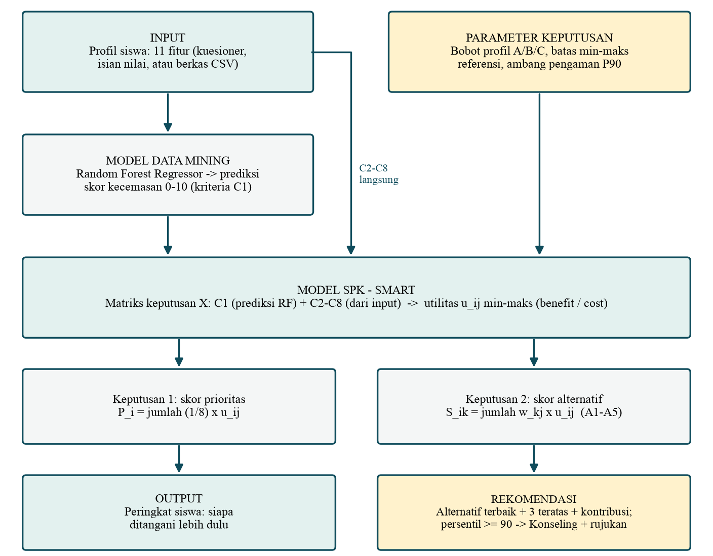
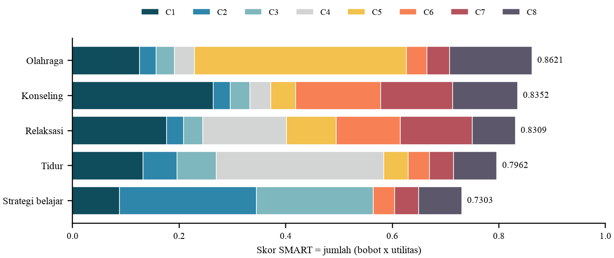
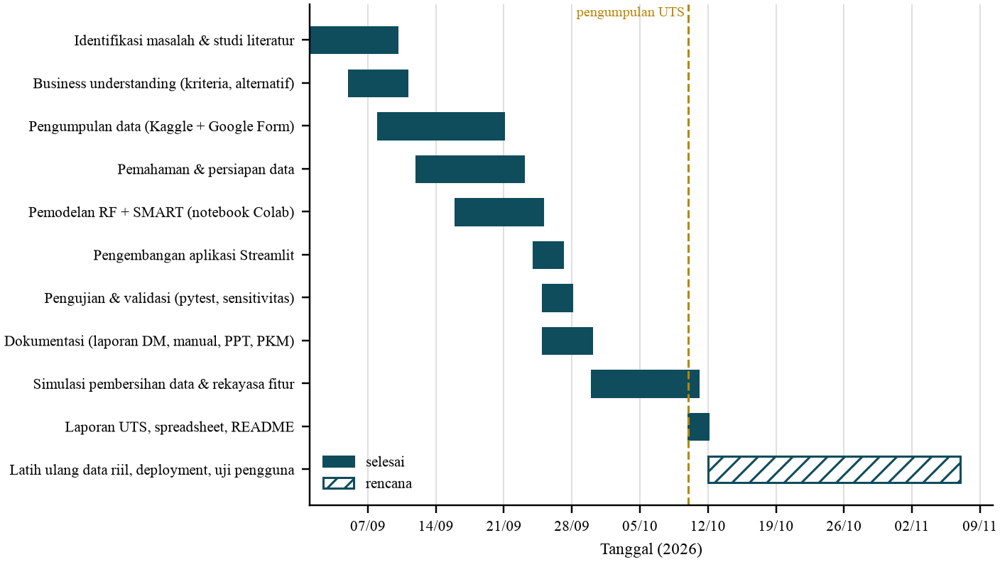

# BAB 1. PENDAHULUAN & INTELLIGENCE

## 1.1 Identifikasi Permasalahan

Kecemasan adalah masalah kesehatan mental yang paling sering dialami remaja. Secara global, satu dari tujuh remaja berusia 10–19 tahun mengalami gangguan mental, dan kecemasan termasuk penyebab utama kesakitan pada kelompok usia ini (World Health Organization, 2025). Di Indonesia, survei nasional I-NAMHS menemukan bahwa satu dari tiga remaja berusia 10–17 tahun mengalami masalah kesehatan mental dalam 12 bulan terakhir, dan gangguan kecemasan merupakan gangguan yang paling banyak ditemukan. Survei yang sama menunjukkan bahwa hanya 2,6% remaja dengan masalah kesehatan mental yang mengakses layanan profesional, sementara 38,2% pengasuh memilih sekolah sebagai tempat mencari bantuan (Center for Reproductive Health, University of Queensland dan Johns Hopkins Bloomberg School of Public Health, 2022).

Sekolah karena itu menjadi garda depan, dan tumpuan utamanya adalah guru Bimbingan dan Konseling (BK). Regulasi menetapkan satu guru BK melayani sekitar 150 siswa (Kementerian Pendidikan dan Kebudayaan, 2014). Pada praktiknya, identifikasi siswa yang cemas masih bergantung pada observasi guru BK dan laporan sukarela. Cara ini memiliki tiga keterbatasan:

1. **Kapasitas terbatas.** Jumlah guru BK jauh lebih sedikit daripada siswa, sehingga penjaringan menyeluruh sulit dilakukan secara rutin.
2. **Reaktif.** Penanganan biasanya dimulai setelah gejala terlihat jelas atau prestasi sudah menurun.
3. **Subjektif.** Bentuk penanganan sering dipilih berdasarkan pengalaman pribadi, tanpa dasar multikriteria yang terdokumentasi dan dapat ditelusuri.

Bukti bahwa masalah ini dapat diukur dan dipetakan datang dari data. Pada 1.000.000 baris dataset *Student Mental Health and Burnout* (sharmajicoder, t.t.), skor kecemasan berkorelasi kuat dengan tingkat stres (r = 0,761) dan skor kelelahan atau *burnout* (r = 0,668), berkorelasi sedang dengan tekanan finansial (r = 0,354), tekanan ujian (r = 0,350), jam belajar (r = 0,269), dan ekspektasi keluarga (r = 0,264), serta berkorelasi negatif dengan jam tidur (r = −0,200) dan aktivitas fisik (r = −0,132). Pada 292 respons kuesioner siswa SMA, faktor terkuatnya tekanan ujian (r = 0,50), *burnout* (r = 0,49), dan ekspektasi keluarga (r = 0,39). Faktor-faktor pemicu ini dapat ditanyakan melalui kuesioner singkat tanpa menanyakan gejala secara langsung. Penelitian terdahulu juga menunjukkan bahwa *machine learning* mampu mengenali tingkat kecemasan dari data kuesioner (Bhatnagar, Agarwal dan Sharma, 2023; Wang *et al.*, 2025), tetapi penelitian tersebut berhenti pada prediksi dan belum menjawab pertanyaan praktis guru BK.

Rumusan masalah yang dicari solusinya adalah:

1. Bagaimana memperkirakan tingkat kecemasan siswa dari faktor gaya hidup dan akademik?
2. Siswa mana yang perlu ditangani lebih dahulu, dengan dasar yang objektif dan terukur?
3. Bentuk penanganan apa yang paling sesuai untuk tiap siswa, beserta alasan yang dapat dijelaskan kepada siswa dan orang tua?

## 1.2 Aktivitas Fase Intelligence

Menurut model proses pengambilan keputusan Simon, fase *intelligence* adalah tahap menelusuri lingkungan untuk menemukan kondisi yang memerlukan keputusan, lalu merumuskan masalahnya (Simon, 1960; Turban, Sharda dan Delen, 2011). Aktivitas yang dilakukan kelompok pada fase ini dirangkum pada Tabel 1.

Tabel 1. Aktivitas fase Intelligence

| No | Aktivitas | Cara | Hasil |
|---|---|---|---|
| 1 | Studi literatur masalah | Menelaah laporan WHO, survei I-NAMHS, regulasi BK, dan penelitian prediksi kecemasan | Bukti bahwa kecemasan remaja tinggi dan layanan terbatas |
| 2 | Perumusan masalah dan tujuan | Diskusi kelompok; dokumen *business understanding* | Tiga rumusan masalah, lima alternatif, delapan kriteria |
| 3 | Penelusuran data sekunder | Mencari dataset publik di Kaggle yang memuat faktor pemicu dan skor kecemasan | Dataset 1 juta baris; dipakai 692.545 baris usia pelajar 14–25 |
| 4 | Penyusunan instrumen data primer | Menyusun kuesioner Google Form untuk siswa SMA (±50 butir, 12 bagian) | Kuesioner dan pemetaan jawaban ke 11 fitur model |
| 5 | Analisis data eksploratif | Statistik deskriptif, korelasi, pemeriksaan kualitas data | Faktor dominan dan kolom yang harus dikeluarkan (*leakage*) |
| 6 | Kategorisasi masalah dan pengguna | Analisis karakteristik keputusan | Masalah semi-terstruktur; pengguna utama guru BK |

## 1.3 Pengumpulan dan Analisis Data

Proyek memakai dua sumber data dengan peran berbeda (Tabel 2). Data Kaggle besar dan lengkap sehingga cocok untuk melatih model awal, tetapi populasinya mahasiswa. Data kuesioner sesuai populasi sasaran (siswa SMA), tetapi jumlahnya kecil. Model karena itu dilatih lebih dulu pada data Kaggle, lalu dilatih ulang dengan data kuesioner.

Tabel 2. Sumber data

| Aspek | Data sekunder (Kaggle) | Data primer (kuesioner) |
|---|---|---|
| Sumber | Kaggle `sharmajicoder/student-mental-health-and-burnout` | Google Form yang disebarkan kelompok kepada siswa SMA |
| Cara memperoleh | Unduh dengan `kagglehub`; seluruh berkas dibersihkan ke usia 14–25 lalu dibagi 80/20 per usia (`random_state` = 42) | Penyebaran tautan melalui sekolah, media sosial, dan teman |
| Jumlah data | 1.000.000 baris × 20 kolom; dipakai 692.545 baris (554.036 latih, 138.509 uji) | 304 respons × 68 kolom; dipakai 292 respons (usia 14–25, butir psikologis lengkap) |
| Jenis data | Numerik kontinu dan kategorikal | Pilihan rentang, skala Likert 5 titik, isian angka |
| Populasi | Mahasiswa usia 17–29 tahun | Siswa usia 14–24 tahun (median 15) |
| Peran | Pralatih model; populasi referensi batas SMART | Pelatihan ulang dan pengujian model |
| Kerahasiaan | Publik | Rahasia, tidak masuk repositori; data pribadi dibuang saat diunggah |

Dari 20 kolom Kaggle, dipakai 11 fitur dan satu target (Tabel 3). Berkas tidak memiliki nilai hilang, baris duplikat, maupun nilai mustahil; membuang *outlier* tidak menaikkan akurasi model sehingga tidak ada baris lain yang dibuang. Empat kolom (`mental_health_index`, `depression_score`, `dropout_risk`, `risk_level`) adalah variabel hasil yang sangat terkait dengan target, sehingga dikeluarkan untuk mencegah *label leakage*. Kolom `social_support`, `screen_time`, dan `internet_usage` hampir tidak berkorelasi dengan kecemasan (|r| < 0,01), dan `academic_year` tidak berlaku untuk siswa SMA.

Tabel 3. Variabel yang dipakai (data Kaggle, 1.000.000 baris)

| Variabel | Arti | Rata-rata | Min | Maks | Peran |
|---|---|---|---|---|---|
| age | usia (tahun) | 23,00 | 17 | 29 | fitur (dibersihkan ke 14–25) |
| gender | jenis kelamin | Female 480.070 · Male 479.643 · Other 40.287 | | | fitur |
| study_hours_per_day | jam belajar per hari | 5,00 | 0,00 | 14,00 | fitur + kriteria C2 |
| academic_performance | nilai rata-rata (0–100) | 71,00 | 42,37 | 97,25 | fitur + kriteria C3 |
| exam_pressure | tekanan ujian (1–10) | 6,00 | 1,00 | 10,00 | fitur |
| stress_level | tingkat stres (0–10) | 4,25 | 0,00 | 10,00 | fitur |
| sleep_hours | jam tidur per malam | 6,50 | 3,00 | 10,00 | fitur + kriteria C4 |
| physical_activity | hari olahraga per minggu | 3,01 | 0,00 | 7,00 | fitur + kriteria C5 |
| financial_stress | tekanan finansial (0–10) | 5,00 | 0,00 | 10,00 | fitur + kriteria C6 |
| family_expectation | ekspektasi keluarga (0–10) | 5,98 | 0,00 | 10,00 | fitur + kriteria C7 |
| burnout_score | skor kelelahan (0–10) | 1,78 | 0,00 | 10,00 | fitur + kriteria C8 |
| **anxiety_score** | skor kecemasan (0–10) | 2,99 | 0,00 | 10,00 | **target** |

Kuesioner memuat 12 bagian: identitas, kebiasaan belajar, tidur, akademik, media sosial, tuntutan dan tekanan, aktivitas fisik, kegiatan di luar sekolah, kelelahan, pertemanan, butir psikologis, dan pola makan. Lima butir psikologis (gugup/cemas, sulit mengendalikan khawatir, konsentrasi, pikiran terganggu, sulit menyelesaikan tugas) mengadaptasi pendekatan skrining GAD-7 (Spitzer *et al.*, 2006) dan hanya dipakai untuk membentuk label skor kecemasan. Jawaban lain dipetakan ke 11 fitur yang sama dengan skala Kaggle oleh modul `spk/gform.py`. Kolom identitas (nama sekolah, nama teman, tanggal lahir) dibuang segera setelah usia dihitung. Pada 292 respons yang dipakai, rata-rata skor kecemasan 5,01 (Kaggle 2,99), *burnout* 4,67 (Kaggle 1,78), dan jam belajar di luar sekolah 2,1 jam (Kaggle 5,0). Sebaran yang berbeda ini membuat model Kaggle tidak dapat dipakai langsung untuk siswa SMA, sehingga model dilatih ulang dengan data kuesioner.

Data dipakai untuk memahami masalah dengan tiga cara: (1) korelasi menunjukkan faktor mana yang paling berkaitan dengan kecemasan, sehingga menjadi dasar kriteria SPK; (2) sebaran nilai (min–maks) dari 20.000 baris data uji menjadi batas referensi normalisasi SMART; dan (3) model yang dilatih pada data ini menghasilkan prediksi kecemasan yang menjadi kriteria utama keputusan.

## 1.4 Kategorisasi Permasalahan

Masalah ini dikategorikan berdasarkan karakteristik keputusannya (Tabel 4).

Tabel 4. Kategorisasi permasalahan

| Dimensi | Kategori | Alasan |
|---|---|---|
| Struktur keputusan | Semi-terstruktur | Sebagian dapat dihitung (prediksi, skor), sebagian tetap butuh penilaian guru BK dan profesional (Gorry dan Scott Morton, 1971) |
| Tingkat keputusan | Operasional | Keputusan rutin per siswa atau per kelas, berulang setiap periode skrining |
| Jenis masalah data mining | Prediksi (regresi, *supervised*) | Target skor kecemasan bernilai kontinu 0–10 |
| Jenis masalah keputusan | Multikriteria: pemeringkatan dan pemilihan | Delapan kriteria saling bertentangan; harus memilih satu dari lima alternatif dan mengurutkan siswa |
| Sifat data | Kuantitatif, *self-report*, *cross-sectional* | Kuesioner sekali isi; rawan bias jawaban |
| Risiko | Tinggi (kesehatan mental) | Butuh penjelasan, aturan pengaman, dan keputusan akhir oleh manusia |

Pola masalahnya adalah gabungan **diagnosis** dan **preskripsi**. Data mining menjawab seberapa tinggi indikasi kecemasan, sedangkan SPK menjawab siapa yang ditangani lebih dulu dan penanganan apa yang paling sesuai.

## 1.5 Identifikasi Pengguna SPK

Tabel 5. Pengguna SPK dan keputusan yang dibuat

| Pengguna | Peran | Kebutuhan | Keputusan yang dibuat |
|---|---|---|---|
| Guru BK | Pengguna utama | Skrining cepat banyak siswa, urutan prioritas, alasan rekomendasi | Siswa mana dipanggil lebih dulu; program penanganan apa yang diberikan |
| Wali kelas / kepala sekolah | Pengguna hasil | Ringkasan kondisi kelas dan sekolah | Alokasi waktu BK dan program sekolah (mis. kelas relaksasi, jadwal olahraga) |
| Siswa dan orang tua | Penerima rekomendasi | Penjelasan yang mudah dipahami dan menjaga privasi | Menerima dan menjalankan program penanganan |
| Psikolog / layanan kesehatan jiwa | Pihak rujukan | Daftar siswa berisiko tinggi | Menerima rujukan dari aturan pengaman |

## 1.6 Formulasi Tujuan SPK

Tujuan pengembangan SPK adalah membantu guru BK untuk:

1. **Mendeteksi dini** siswa dengan indikasi kecemasan tinggi dari data kuesioner, tanpa menanyakan gejala secara langsung.
2. **Menyusun prioritas** siswa yang perlu ditangani lebih dulu, sehingga waktu BK yang terbatas dipakai secara adil dan terukur.
3. **Merekomendasikan bentuk penanganan** dari lima alternatif, lengkap dengan alasan yang dapat dijelaskan kepada siswa dan orang tua.

Sistem ini adalah alat bantu skrining dan pendukung keputusan, **bukan alat diagnosis klinis**. Keputusan akhir tetap pada guru BK dan tenaga profesional.

[[PAGEBREAK]]

# BAB 2. PERANCANGAN

## 2.1 Model Permasalahan

Model permasalahan menghubungkan input siswa, model data mining, model keputusan, dan keluaran (Gambar 1).

- **Variabel input:** 11 fitur profil siswa (Tabel 3) dari kuesioner, isian nilai langsung, atau berkas CSV banyak siswa. Parameter keputusan: profil bobot, batas min–maks referensi, dan ambang aturan pengaman.
- **Proses prediksi:** model *Random Forest Regressor* memetakan 11 fitur ke prediksi skor kecemasan ŷ = f(x₁, …, x₁₁) pada skala 0–10.
- **Hubungan antarvariabel:** prediksi ŷ menjadi kriteria C1. Tujuh fitur lain langsung menjadi kriteria C2–C8. Tekanan ujian, tingkat stres, usia, dan gender hanya memengaruhi keputusan melalui ŷ.
- **Proses rekomendasi:** delapan kriteria dinormalisasi menjadi utilitas 0–1. Skor prioritas (rata-rata utilitas) mengurutkan siswa. Skor tiap alternatif (jumlah bobot × utilitas) mengurutkan lima penanganan.
- **Output:** prediksi dan persentil kecemasan, skor dan peringkat prioritas, peringkat lima alternatif dengan kontribusi tiap kriteria, uji sensitivitas, dan rekomendasi akhir setelah aturan pengaman.

## 2.2 Kandidat Model Data Mining

Target skor kecemasan bernilai kontinu, sehingga kandidat yang dibandingkan adalah algoritma regresi (Tabel 6).

Tabel 6. Kandidat algoritma data mining

| Algoritma | Prinsip | Kelebihan | Kekurangan | Alasan dipertimbangkan |
|---|---|---|---|---|
| Baseline rata-rata | Selalu menebak rata-rata data latih | Batas bawah pembanding | Tidak belajar dari fitur | Model lain harus jauh lebih baik |
| Regresi linear | Kombinasi linear fitur | Sangat mudah ditafsirkan, cepat | Tidak menangkap hubungan non-linear | Pembanding sederhana yang kuat |
| Decision Tree | Aturan if–then bertingkat | Mudah dijelaskan | Mudah *overfitting*, tidak stabil | Model tunggal yang mudah dibaca |
| Random Forest | Rata-rata ratusan pohon dari sampel *bootstrap* (Breiman, 2001) | Tahan *outlier*, non-linear, ada *feature importance*, bisa *warm start* | Kurang transparan dari pohon tunggal; prediksi ekstrem ditarik ke tengah | Terbaik pada penelitian kecemasan terdahulu (Bhatnagar, Agarwal dan Sharma, 2023; Wang *et al.*, 2025) |
| Gradient Boosting | Pohon dibangun berurutan untuk memperbaiki galat (Friedman, 2001) | Akurasi tinggi | Lebih sensitif terhadap parameter, lebih lambat | Pesaing *ensemble* yang kuat |

## 2.3 Kriteria Pemilihan Model Data Mining

*Accuracy*, *precision*, *recall*, dan *F1-score* adalah metrik klasifikasi. Karena target proyek ini kontinu (regresi), metrik yang setara dipakai:

- **MAE** (*mean absolute error*) = (1/n) Σ |y − ŷ|, rata-rata selisih dalam satuan skor. Ini metrik utama karena mudah dipahami guru BK (Chai dan Draxler, 2014).
- **RMSE** = √((1/n) Σ (y − ŷ)²), menghukum kesalahan besar.
- **R²** = 1 − SS_res / SS_tot, porsi variasi skor yang dijelaskan model.
- **Interpretabilitas**, waktu latih, dan kemampuan dilatih ulang dengan data riil.

Validasi silang 5-*fold* dijalankan pada 50.000 baris latih yang sama untuk semua algoritma. Setiap algoritma lalu dilatih pada seluruh 554.036 baris latih dan diuji pada 138.509 baris uji yang sama, dengan pustaka scikit-learn (Pedregosa *et al.*, 2011). Hasilnya ada pada Tabel 7.

Tabel 7. Perbandingan performa model (data Kaggle)

| Algoritma | MAE CV | RMSE CV | R² CV | MAE uji | R² uji | Waktu latih (s) | Interpretabilitas |
|---|---|---|---|---|---|---|---|
| Baseline rata-rata | 1,2128 | 1,5040 | −0,0001 | 1,2217 | 0,0000 | 0,007 | – |
| Regresi linear | **0,7604** | **0,9499** | **0,6011** | 0,7602 | 0,6064 | 0,041 | tinggi |
| Decision Tree (kedalaman 10) | 0,7989 | 1,0047 | 0,5537 | 0,7644 | 0,6010 | 0,689 | tinggi |
| Gradient Boosting | 0,7606 | 0,9505 | 0,6006 | **0,7579** | **0,6083** | 7,439 | sedang |
| **Random Forest (dipakai)** | 0,7610 | 0,9515 | 0,5998 | 0,7583 | 0,6077 | 20,241 | sedang (*feature importance*) |

Waktu latih adalah rata-rata satu lipatan validasi silang (40.000 baris). Random Forest memakai 300 pohon, kedalaman 12, dan daun minimal 50 siswa, hasil *random search* 25 pengaturan dengan validasi silang 5-*fold*.

Regresi linear, Gradient Boosting, dan Random Forest praktis setara pada data Kaggle (selisih R² uji ≤ 0,002); semua jenis model berhenti di R² ±0,61 karena ±40% variasi skor adalah derau yang tidak dibawa 11 fitur. Random Forest tetap dipilih karena (1) kinerjanya setara dengan algoritma terbaik dan jauh lebih baik dari baseline; (2) data kuesioner riil berbentuk ordinal dan tidak dijamin linear; (3) strategi pelatihan ulang memerlukan model *ensemble* pohon; dan (4) *feature importance* menunjukkan faktor dominan yang masuk akal, yaitu tingkat stres (0,75) dan *burnout* (0,21).

**Pada data riil.** Dari tujuh strategi pelatihan ulang, model Random Forest yang dilatih hanya dengan data kuesioner terpilih: MAE 1,113 dan R² 0,441 pada 59 respons *holdout*, dibanding MAE 1,874 dan R² −0,346 untuk model Kaggle tanpa latih ulang. Model inilah yang dipakai aplikasi untuk siswa SMA.

## 2.4 Alternatif Tindakan

Alternatif disusun dari faktor yang dapat diubah dan terbukti berkaitan dengan kecemasan pada data (§1.1). Setiap alternatif menyasar faktor tertentu (Tabel 8).

Tabel 8. Alternatif tindakan

| Kode | Alternatif | Uraian tindakan | Faktor yang disasar |
|---|---|---|---|
| A1 | Tidur (*Sleep*) | Program perbaikan pola tidur (*sleep hygiene*) dan jadwal malam | jam tidur pendek |
| A2 | Olahraga (*Exercise*) | Program aktivitas fisik terjadwal untuk menurunkan ketegangan | aktivitas fisik rendah, *burnout* |
| A3 | Strategi belajar (*Study*) | Pelatihan manajemen waktu dan strategi belajar | jam belajar panjang, nilai rendah |
| A4 | Konseling (*Counseling*) | Konseling individual dengan guru BK; rujukan profesional bila perlu | prediksi kecemasan tinggi, tekanan finansial dan keluarga |
| A5 | Relaksasi (*Relaxation*) | Latihan pernapasan, *mindfulness*, dan manajemen stres | kecemasan, tidur, tekanan |

## 2.5 Kriteria dan Parameter Pengambilan Keputusan

Delapan kriteria diturunkan dari faktor yang berkorelasi dengan kecemasan dan dari keluaran model (Tabel 9). Dalam proyek ini **benefit** berarti nilai tinggi menaikkan utilitas (siswa lebih membutuhkan perhatian), dan **cost** berarti nilai rendah yang menaikkan utilitas.

Tabel 9. Kriteria keputusan

| Kode | Kriteria | Definisi dan satuan | Jenis | Dasar penetapan |
|---|---|---|---|---|
| C1 | Prediksi kecemasan | keluaran Random Forest, 0–10 | benefit | inti masalah yang ditangani |
| C2 | Jam belajar | jam per hari | benefit | korelasi +0,269 |
| C3 | Nilai rapor | rata-rata 0–100 | cost | kesulitan akademik memicu kecemasan |
| C4 | Jam tidur | jam per malam | cost | korelasi −0,200 |
| C5 | Aktivitas fisik | hari olahraga per minggu | cost | korelasi −0,132 |
| C6 | Tekanan finansial | skala 0–10 | benefit | korelasi +0,354 |
| C7 | Ekspektasi keluarga | skala 0–10 | benefit | korelasi +0,264 (riil +0,389) |
| C8 | *Burnout* | skala 0–10 | benefit | korelasi +0,668 (riil +0,490) |

Ada dua jenis bobot. **Bobot prioritas** sama untuk semua kriteria (w_j = 1/8), karena prioritas siswa harus netral terhadap jenis masalah. **Bobot alternatif** berbeda untuk tiap alternatif: setiap alternatif memberi bobot terbesar pada kriteria yang langsung ditanganinya. Contohnya, Tidur menekankan jam tidur (0,40) dan Strategi belajar menekankan jam belajar (0,40) serta nilai rapor (0,30). Bobot ditetapkan secara langsung (*direct rating*) seperti pada SMART (Edwards dan Barron, 1994), lalu dinormalisasi agar berjumlah 1. Pada notebook awal, bobot Olahraga berjumlah 1,05, sehingga aplikasi membagi setiap bobotnya dengan 1,05. Tabel 10 memuat bobot profil A yang dipakai aplikasi secara default.

Tabel 10. Bobot alternatif profil A (setelah normalisasi)

| Kode | Alternatif | C1 | C2 | C3 | C4 | C5 | C6 | C7 | C8 | Jumlah |
| --- | --- | --- | --- | --- | --- | --- | --- | --- | --- | --- |
| A1 | Tidur | 0,1500 | 0,1000 | 0,1000 | 0,4000 | 0,0500 | 0,0500 | 0,0500 | 0,1000 | 1,00 |
| A2 | Olahraga | 0,1429 | 0,0476 | 0,0476 | 0,0476 | 0,4286 | 0,0476 | 0,0476 | 0,1905 | 1,00 |
| A3 | Strategi belajar | 0,1000 | 0,4000 | 0,3000 | 0,0000 | 0,0000 | 0,0500 | 0,0500 | 0,1000 | 1,00 |
| A4 | Konseling | 0,3000 | 0,0500 | 0,0500 | 0,0500 | 0,0500 | 0,2000 | 0,1500 | 0,1500 | 1,00 |
| A5 | Relaksasi | 0,2000 | 0,0500 | 0,0500 | 0,2000 | 0,1000 | 0,1500 | 0,1500 | 0,1000 | 1,00 |

Aplikasi juga menyediakan profil B (hampir seimbang: kriteria utama 0,15–0,20, lainnya 0,10) dan profil C (semua 1/8, sebagai kontrol). Ketiga profil dan bobot mentahnya ada pada sheet **Bobot** di spreadsheet.

## 2.6 Pemilihan Metode MCDM

Lima metode MCDM dibandingkan terhadap karakteristik masalah (Tabel 11).

Tabel 11. Perbandingan metode MCDM

| Metode | Prinsip | Kebutuhan | Kecocokan dengan masalah |
|---|---|---|---|
| SAW | Jumlah bobot × nilai ternormalisasi (dibagi maks) | Bobot, matriks keputusan | Cocok, tetapi normalisasi bergantung pada nilai maksimum kelompok yang sedang dinilai |
| TOPSIS (Hwang dan Yoon, 1981) | Jarak ke solusi ideal positif dan negatif | Seluruh alternatif dinilai bersama | Skor satu siswa berubah bila siswa lain ditambah (*rank reversal*); kurang cocok untuk penilaian satu per satu |
| AHP (Saaty, 1980) | Perbandingan berpasangan dan rasio konsistensi | Penilaian ahli 28 pasang kriteria per alternatif | Butuh panel ahli dan uji konsistensi; belum tersedia |
| PROMETHEE (Brans dan Vincke, 1985) | Fungsi preferensi dan aliran *outranking* | Fungsi dan ambang preferensi tiap kriteria | Parameter sulit dijelaskan kepada guru BK |
| **SMART** (Edwards, 1977; Edwards dan Barron, 1994) | Utilitas min–maks × bobot langsung | Bobot, batas min–maks | **Dipilih** |

SMART dipilih karena:

1. **Transparan.** Skor adalah jumlah bobot × utilitas, sehingga kontribusi setiap kriteria dapat ditampilkan dan dijelaskan. Hal ini penting di bidang sensitif seperti kesehatan mental.
2. **Dapat menilai satu siswa.** Dengan batas min–maks referensi dari 20.000 siswa data uji, skor seorang siswa tidak bergantung pada siswa lain yang dinilai bersamaan.
3. **Mendukung benefit dan cost** secara langsung lewat dua rumus utilitas.
4. **Ringan dan stabil.** Perhitungan cepat untuk ribuan siswa, dan stabil terhadap perubahan bobot kecil (diuji pada §2.7).
5. **Tidak memerlukan panel ahli** untuk perbandingan berpasangan pada tahap awal. Bobot dapat disempurnakan bersama guru BK kemudian.

## 2.7 Rancangan Validasi

Tabel 12. Rancangan validasi model data mining dan model keputusan

| Objek | Uji | Cara | Target |
|---|---|---|---|
| Model data mining | *Holdout* | Data dibagi 80% latih dan 20% uji | MAE < baseline; R² ≥ 0,60 |
| Model data mining | Validasi silang | 5-*fold* CV untuk membandingkan algoritma | Selisih MAE antaralgoritma kecil |
| Model data mining | Data riil | 7 strategi latih ulang dibandingkan dengan CV berulang; terbaik diuji pada *holdout* data kuesioner | MAE lebih rendah dari model Kaggle tanpa latih ulang |
| Model data mining | Data baru | Respons baru diuji lewat `scripts/evaluate.py` atau unggahan di aplikasi | MAE stabil |
| Model keputusan | Replikasi perhitungan | Spreadsheet menghitung ulang SMART dengan rumus Excel lalu dibandingkan dengan keluaran aplikasi | Selisih < 10⁻⁹; rekomendasi sama |
| Model keputusan | Sensitivitas per kriteria | Bobot satu kriteria diubah ±10% dan ±20%, lalu dinormalisasi ulang | Perubahan rekomendasi kecil |
| Model keputusan | Stabilitas menyeluruh | Semua bobot diacak ±10% sebanyak 100 kali | ≥ 90% rekomendasi utama tetap |
| Model keputusan | Aturan pengaman dan keadilan | Siswa di atas persentil 90 selalu dirujuk; MAE dan sebaran rekomendasi per gender | 100% dirujuk; selisih kecil |
| Kebergunaan | Uji pengguna | Google Form 5 pertanyaan skala 1–5 untuk guru BK dan siswa | Rata-rata ≥ 4 |

[[PAGEBREAK]]

# BAB 3. BUKTI PERHITUNGAN & PEMAHAMAN MODEL SPK

## 3.1 Tautan File Spreadsheet dan README

| Berkas | Isi | Tautan |
|---|---|---|
| `Perhitungan-SMART-SPK-Kecemasan.xlsx` | Perhitungan SMART lengkap dengan rumus Excel (12 sheet) | ⟦ISI: tautan Google Drive⟧ |
| `README.md` | Judul, identitas kelompok, metode, alasan, rumus, tahapan, arti kriteria, interpretasi | ⟦ISI: tautan Google Drive⟧ |
| Repositori kode | Aplikasi, skrip pembuat spreadsheet (`deliverables/build/build_uts_xlsx.py`) | https://github.com/UKRIDA-Developer-Team/SIMBULL-SMART (privat) |

## 3.2 Formulasi Matematis MCDM

Notasi: i = siswa (i = 1..m), j = kriteria (j = 1..8), k = alternatif (k = 1..5), x_ij = nilai siswa i pada kriteria j, min_j dan maks_j = batas referensi kriteria j.

1. **Utilitas kriteria benefit:** u_ij = (x_ij − min_j) / (maks_j − min_j).
2. **Utilitas kriteria cost:** u_ij = (maks_j − x_ij) / (maks_j − min_j).
3. **Pemotongan:** u_ij = min(1, maks(0, u_ij)), agar nilai di luar batas referensi tetap di 0–1. Bila maks_j = min_j, maka u_ij = 1.
4. **Normalisasi bobot:** w_kj = w'_kj / Σ_j w'_kj, sehingga Σ_j w_kj = 1 untuk setiap alternatif.
5. **Skor prioritas siswa:** P_i = Σ_j w_j · u_ij dengan w_j = 1/8. Siswa diurutkan dari P_i terbesar.
6. **Skor alternatif:** S_ik = Σ_j w_kj · u_ij. Rekomendasi siswa i adalah alternatif k* = argmaks_k S_ik.
7. **Aturan pengaman:** jika persentil prediksi kecemasan siswa ≥ 90, rekomendasi akhir = Konseling + rujukan profesional.
8. **Sensitivitas:** bila bobot kriteria c diubah dengan faktor (1 + d) lalu dinormalisasi ulang, skor baru S'_ik = (S_ik + w_kc · d · u_ic) / (1 + w_kc · d).

Rumus 1–3 adalah fungsi utilitas linear min–maks SMART. Batas min_j dan maks_j diambil dari 20.000 siswa referensi (data uji Kaggle), bukan dari kelompok yang sedang dinilai, agar satu siswa pun dapat dinilai dan hasilnya tidak berubah ketika siswa lain ditambahkan.

## 3.3 Implementasi Perhitungan Spreadsheet

Spreadsheet mereplikasi modul `app/spk/smart.py` untuk 10 siswa: dua contoh profil di aplikasi (S01 risiko tinggi, S02 risiko rendah) dan delapan baris data uji Kaggle yang dipilih agar kelima alternatif muncul sebagai rekomendasi. Satu-satunya nilai yang disalin dari aplikasi adalah prediksi Random Forest (C1) dan persentilnya, karena model Random Forest tidak dapat dijalankan di Excel. Semua langkah lain memakai rumus (Tabel 13). Teks biru menandai input, teks hitam rumus, teks hijau rumus antar-sheet, dan sel kuning pilihan yang boleh diubah (profil bobot, siswa studi kasus, ambang pengaman).

Tabel 13. Isi sheet dan contoh rumus

| Sheet | Isi | Contoh rumus |
|---|---|---|
| Kriteria | C1–C8, jenis, batas min–maks referensi | `=COUNTA(A5:A12)` |
| Alternatif | A1–A5 dan uraian tindakan | – |
| Bobot | Profil A mentah, A ternormalisasi, B, C, bobot aktif, bobot prioritas | `=C7/$K7`; `=IF($C$3="A",C15,IF($C$3="B",C23,C31))` |
| Data | 11 fitur, prediksi RF, persentil, skor aktual | `=SUMPRODUCT(ABS(N7:N14-P7:P14))/COUNT(P7:P14)` |
| MatriksKeputusan | x_ij siswa × kriteria | `=Data!N5` |
| Normalisasi | Utilitas u_ij | `=IF(B$8=B$7,1,MAX(0,MIN(1,IF(B$6="benefit",(x-B$7)/(B$8-B$7),(B$8-x)/(B$8-B$7)))))` |
| SkorPrioritas | Kontribusi w_j·u_ij, P_i, peringkat, urutan | `=SUMPRODUCT(Normalisasi!B11:I11,$B$9:$I$9)`; `=RANK(J11,$J$11:$J$20,0)` |
| SkorAlternatif | S_ik, rekomendasi, alternatif ke-2, selisih | `=SUMPRODUCT(Normalisasi!$B11:$I11,Bobot!$C$39:$J$39)`; `=INDEX($B$10:$F$10,MATCH(MAX($B11:$F11),$B11:$F11,0))` |
| StudiKasus | Matriks alternatif × kriteria untuk satu siswa, sensitivitas ±10/20% | `=($K$20+w*$C33*u)/(1+w*$C33)` |
| Rekomendasi | Aturan pengaman, rekomendasi akhir, interpretasi, rekap | `=IF(E6>=$C$3,"YA","tidak")` |
| Validasi | Perbandingan dengan keluaran aplikasi untuk profil aktif | `=IF(AND(MAX(D6:I6)<1E-9,J6=K6),"COCOK","BEDA")` |

## 3.4 Matriks Keputusan

Matriks keputusan X memuat nilai 10 siswa pada delapan kriteria (Tabel 14). Batas referensi dan jenis tiap kriteria ada pada Tabel 15.

Tabel 14. Matriks keputusan X (x_ij)

| ID | C1 | C2 | C3 | C4 | C5 | C6 | C7 | C8 |
| --- | --- | --- | --- | --- | --- | --- | --- | --- |
| S01 | 6,3433 | 9,0000 | 58,0000 | 4,5000 | 0,5000 | 8,0000 | 9,0000 | 8,0000 |
| S02 | 1,8244 | 3,0000 | 85,0000 | 8,0000 | 5,0000 | 2,0000 | 4,0000 | 1,0000 |
| S03 | 3,0701 | 3,8709 | 81,7717 | 10,0000 | 4,0050 | 5,4482 | 3,3614 | 1,4397 |
| S04 | 3,8299 | 3,5281 | 62,4857 | 6,2732 | 4,1534 | 7,9879 | 8,2227 | 1,7762 |
| S05 | 3,2476 | 1,7726 | 60,3480 | 5,0637 | 3,1232 | 3,8977 | 9,4915 | 1,7034 |
| S06 | 3,4070 | 3,8872 | 70,7633 | 7,7683 | 2,5148 | 5,2189 | 8,3491 | 1,8644 |
| S07 | 3,8002 | 5,3599 | 69,2344 | 4,1941 | 1,6744 | 6,8689 | 5,8023 | 2,5872 |
| S08 | 3,0377 | 6,1870 | 75,9431 | 3,9002 | 6,6194 | 6,1734 | 7,2115 | 2,3396 |
| S09 | 4,0547 | 5,5875 | 70,3137 | 5,1146 | 1,7839 | 2,2783 | 3,9856 | 4,4207 |
| S10 | 1,1573 | 5,1768 | 75,1260 | 7,2475 | 4,6126 | 3,3937 | 3,3629 | 0,0000 |

Tabel 15. Jenis kriteria dan batas referensi normalisasi

| Kode | Kriteria | Jenis | Min referensi | Maks referensi |
| --- | --- | --- | --- | --- |
| C1 | Prediksi kecemasan | benefit | 0,3327 | 7,1611 |
| C2 | Jam belajar | benefit | 0,0000 | 14,0000 |
| C3 | Nilai rapor | cost | 45,1721 | 92,6267 |
| C4 | Jam tidur | cost | 3,0000 | 10,0000 |
| C5 | Aktivitas fisik | cost | 0,0000 | 7,0000 |
| C6 | Tekanan finansial | benefit | 0,0000 | 10,0000 |
| C7 | Ekspektasi keluarga | benefit | 0,0000 | 10,0000 |
| C8 | Burnout | benefit | 0,0000 | 9,8546 |

Hasil normalisasi menjadi utilitas ada pada Tabel 16. Contoh untuk S01 pada C4 jam tidur (cost): u = (10,0000 − 4,5000) / (10,0000 − 3,0000) = 0,7857. Contoh pada C1 prediksi kecemasan (benefit): u = (6,3433 − 0,3327) / (7,1611 − 0,3327) = 0,8802.

Tabel 16. Matriks utilitas U (u_ij)

| ID | C1 | C2 | C3 | C4 | C5 | C6 | C7 | C8 |
| --- | --- | --- | --- | --- | --- | --- | --- | --- |
| S01 | 0,8802 | 0,6429 | 0,7297 | 0,7857 | 0,9286 | 0,8000 | 0,9000 | 0,8118 |
| S02 | 0,2185 | 0,2143 | 0,1607 | 0,2857 | 0,2857 | 0,2000 | 0,4000 | 0,1015 |
| S03 | 0,4009 | 0,2765 | 0,2287 | 0,0000 | 0,4279 | 0,5448 | 0,3361 | 0,1461 |
| S04 | 0,5122 | 0,2520 | 0,6352 | 0,5324 | 0,4067 | 0,7988 | 0,8223 | 0,1802 |
| S05 | 0,4269 | 0,1266 | 0,6802 | 0,7052 | 0,5538 | 0,3898 | 0,9491 | 0,1729 |
| S06 | 0,4502 | 0,2777 | 0,4607 | 0,3188 | 0,6407 | 0,5219 | 0,8349 | 0,1892 |
| S07 | 0,5078 | 0,3828 | 0,4929 | 0,8294 | 0,7608 | 0,6869 | 0,5802 | 0,2625 |
| S08 | 0,3961 | 0,4419 | 0,3516 | 0,8714 | 0,0544 | 0,6173 | 0,7211 | 0,2374 |
| S09 | 0,5451 | 0,3991 | 0,4702 | 0,6979 | 0,7452 | 0,2278 | 0,3986 | 0,4486 |
| S10 | 0,1208 | 0,3698 | 0,3688 | 0,3932 | 0,3411 | 0,3394 | 0,3363 | 0,0000 |

## 3.5 Proses Ranking Alternatif

**Keputusan 1: prioritas siswa.** Skor prioritas adalah rata-rata delapan utilitas (bobot 1/8). Tabel 17 mengurutkan siswa dari skor tertinggi.

Tabel 17. Skor dan peringkat prioritas siswa

| Peringkat | ID | Skor prioritas P_i | Prediksi RF (C1) | Persentil RF |
| --- | --- | --- | --- | --- |
| 1 | S01 | 0,8099 | 6,34 | 99,4 |
| 2 | S07 | 0,5629 | 3,80 | 75,4 |
| 3 | S04 | 0,5175 | 3,83 | 76,1 |
| 4 | S05 | 0,5006 | 3,25 | 59,0 |
| 5 | S09 | 0,4916 | 4,05 | 81,8 |
| 6 | S06 | 0,4618 | 3,41 | 64,3 |
| 7 | S08 | 0,4614 | 3,04 | 52,3 |
| 8 | S03 | 0,2951 | 3,07 | 53,3 |
| 9 | S10 | 0,2837 | 1,16 | 6,5 |
| 10 | S02 | 0,2333 | 1,82 | 17,4 |

**Keputusan 2: penanganan per siswa.** Skor setiap alternatif dihitung dengan bobot profil A (Tabel 18). Alternatif dengan skor tertinggi menjadi rekomendasi.

Tabel 18. Skor alternatif S_ik (profil A) dan rekomendasi

| ID | Tidur | Olahraga | Strategi belajar | Konseling | Relaksasi | Rekomendasi | Selisih #1−#2 |
| --- | --- | --- | --- | --- | --- | --- | --- |
| S01 | 0,7962 | **0,8621** | 0,7303 | 0,8352 | 0,8309 | Olahraga | 0,0269 |
| S02 | 0,2390 | 0,2330 | 0,1959 | 0,2281 | **0,2483** | Relaksasi | 0,0093 |
| S03 | 0,1907 | 0,3345 | 0,2780 | **0,3482** | 0,2950 | Konseling | 0,0137 |
| S04 | 0,4979 | 0,4266 | 0,4416 | 0,5551 | **0,5551** | Relaksasi | 0,0000 |
| S05 | 0,5387 | 0,4670 | 0,3816 | 0,4776 | **0,5403** | Relaksasi | 0,0015 |
| S06 | 0,3877 | **0,4899** | 0,3811 | 0,4780 | 0,4772 | Olahraga | 0,0120 |
| S07 | **0,6232** | 0,5901 | 0,4414 | 0,5394 | 0,6036 | Tidur | 0,0195 |
| S08 | **0,5807** | 0,2681 | 0,4125 | 0,4721 | 0,5231 | Tidur | 0,0576 |
| S09 | 0,5613 | **0,5871** | 0,4314 | 0,4518 | 0,5054 | Olahraga | 0,0258 |
| S10 | 0,3001 | 0,2495 | **0,3044** | 0,2282 | 0,2752 | Strategi belajar | 0,0043 |

**Studi kasus S01 (profil risiko tinggi).** Tabel 19 menunjukkan matriks kontribusi w_kj × u_j untuk S01. Jumlah tiap baris adalah skor alternatif. Gambar 2 menampilkan kontribusi yang sama dalam bentuk grafik, seperti di halaman Rekomendasi aplikasi.

Tabel 19. Matriks kontribusi w_kj × u_j siswa S01 (profil A)

[[WIDTHS 5,11,8.5,8.5,8.5,8.5,8.5,8.5,8.5,8.5,8,8 size=16]]
| Kode | Alternatif | C1 | C2 | C3 | C4 | C5 | C6 | C7 | C8 | S_k | Peringkat |
| --- | --- | --- | --- | --- | --- | --- | --- | --- | --- | --- | --- |
| A1 | Tidur | 0,1320 | 0,0643 | 0,0730 | 0,3143 | 0,0464 | 0,0400 | 0,0450 | 0,0812 | 0,7962 | 4 |
| A2 | Olahraga | 0,1257 | 0,0306 | 0,0347 | 0,0374 | 0,3980 | 0,0381 | 0,0429 | 0,1546 | **0,8621** | 1 |
| A3 | Strategi belajar | 0,0880 | 0,2571 | 0,2189 | 0,0000 | 0,0000 | 0,0400 | 0,0450 | 0,0812 | 0,7303 | 5 |
| A4 | Konseling | 0,2641 | 0,0321 | 0,0365 | 0,0393 | 0,0464 | 0,1600 | 0,1350 | 0,1218 | 0,8352 | 2 |
| A5 | Relaksasi | 0,1760 | 0,0321 | 0,0365 | 0,1571 | 0,0929 | 0,1200 | 0,1350 | 0,0812 | 0,8309 | 3 |

Olahraga mendapat skor tertinggi (0,8621) karena S01 hanya berolahraga 0,5 hari per minggu (u = 0,9286) dan bobot C5 pada Olahraga besar (0,4286), sehingga C5 menyumbang 0,3980. Konseling berada di urutan kedua (0,8352) karena prediksi kecemasan S01 sangat tinggi (u = 0,8802, menyumbang 0,2641). Uji sensitivitas pada sheet StudiKasus menunjukkan rekomendasi S01 tidak berubah pada 32 dari 32 skenario perubahan bobot ±10% dan ±20%, sama dengan tabel sensitivitas di aplikasi. Sebagai pembanding, S04 hanya stabil pada 22 dari 32 skenario karena skor Relaksasi dan Konseling hampir sama (selisih 0,00002).

## 3.6 Interpretasi Hasil

Hasil peringkat dipakai guru BK dengan tiga langkah:

1. **Urutan penanganan.** Siswa dipanggil sesuai peringkat prioritas (Tabel 17). S01 (P = 0,8099) ditangani pertama, diikuti S07 (0,5629) dan S04 (0,5175). S02 (0,2333) berada di urutan terakhir.
2. **Bentuk penanganan.** Setiap siswa mendapat program sesuai alternatif dengan skor tertinggi (Tabel 18). Bila selisih dengan alternatif kedua sangat kecil (< 0,02), seperti pada S02, S03, S04, S05, S06, S07, dan S10, guru BK sebaiknya mempertimbangkan kedua program.
3. **Aturan pengaman.** Prediksi kecemasan S01 (6,34) lebih tinggi dari 99,4% populasi referensi, melewati ambang persentil 90. Rekomendasi akhirnya menjadi **Konseling dan rujukan profesional**, sedangkan program Olahraga menyusul. Ini mencegah siswa berisiko tinggi hanya diberi program ringan.

Tabel 20. Rekomendasi akhir

| Prioritas | ID | Rekomendasi SMART | Alternatif ke-2 | Aturan pengaman | Rekomendasi akhir |
| --- | --- | --- | --- | --- | --- |
| 1 | S01 | Olahraga | Konseling | YA | **Konseling + rujukan profesional** |
| 2 | S07 | Tidur | Relaksasi | tidak | Tidur |
| 3 | S04 | Relaksasi | Konseling | tidak | Relaksasi |
| 4 | S05 | Relaksasi | Tidur | tidak | Relaksasi |
| 5 | S09 | Olahraga | Tidur | tidak | Olahraga |
| 6 | S06 | Olahraga | Konseling | tidak | Olahraga |
| 7 | S08 | Tidur | Relaksasi | tidak | Tidur |
| 8 | S03 | Konseling | Olahraga | tidak | Konseling |
| 9 | S10 | Strategi belajar | Tidur | tidak | Strategi belajar |
| 10 | S02 | Relaksasi | Tidur | tidak | Relaksasi |

Spreadsheet menghasilkan skor yang sama dengan aplikasi untuk ketiga profil bobot: **10 dari 10 siswa cocok**, dengan selisih maksimum 6,7E−16 atau praktis nol (pembulatan bilangan titik mengambang) dan rekomendasi utama yang identik. Pada populasi referensi 20.000 siswa, perubahan acak ±10% pada semua bobot profil A mempertahankan 94,3% rekomendasi utama; pada 292 responden riil, 95,5%. Dengan demikian, perhitungan SMART pada aplikasi dapat ditelusuri dan diulang secara manual.

[[PAGEBREAK]]

# BAB 4. LOGBOOK & JADWAL KEGIATAN

## 4.1 Logbook

Setiap aktivitas nyata ditulis dalam satu baris (Tabel 21). Bukti berupa *commit* Git pada repositori kelompok.

Tabel 21. Logbook kegiatan

[[WIDTHS 8,10,10,16,11,11,12,11,11 size=16]]
| Tanggal | Anggota | Aktivitas | Detail pekerjaan | Tools/AI | Hasil | Kendala | Tindak lanjut | Bukti |
|---|---|---|---|---|---|---|---|---|
| 01/09 | Triemas Putra | Menyiapkan repositori | Membuat repositori GitHub dan struktur awal proyek | GitHub | Repositori proyek | – | Membagi tugas anggota | Git commit db20447 |
| 09/09 | Steven Feryanta | Business understanding | Merumuskan masalah, tujuan, kriteria, dan alternatif penanganan | Markdown | Dokumen *business understanding* | Template awal masih berupa rekomendasi ekstrakurikuler | Alternatif diganti menjadi 5 penanganan kecemasan | Git commit b5e1e96 |
| 10/09 | Davidson Rafael | Identitas kelompok | Menambah foto dan identitas anggota pada README | GitHub | README anggota | Ukuran foto terlalu besar | Foto diganti | Git commit 4eedc14, 8128e34 |
| 16/09 | Triemas Putra | Data understanding | Statistik deskriptif, korelasi, kualitas data Kaggle | Python, Google Colab | Dokumen dan PPT fase 2 | Kolom hasil berkorelasi sangat tinggi dengan target | Kolom dikeluarkan (*leakage*) | Git commit 6db03a4 |
| 24/09 | Triemas Putra | Data preparation | Sampling, *encoding*, pembagian data | Python, Google Colab | Dokumen dan PPT fase 3 | – | Lanjut pemodelan | Git commit a5491d9 |
| 24/09 | Triemas Putra | Pemodelan RF + SMART | Melatih Random Forest dan menghitung SMART di notebook | Google Colab | RF MAE 0,767; rekomendasi 20.000 siswa | Bobot Olahraga profil A berjumlah 1,05 | Bobot dinormalisasi di aplikasi | Git commit 774c88a |
| 25/09 | Steven Iwan | Persiapan deployment | Menyiapkan struktur aplikasi, model, `requirements.txt`, konfigurasi Streamlit | Python, Streamlit | Kerangka aplikasi | – | Pengembangan halaman aplikasi | Git commit 820abe8 |
| 25/09 | Triemas Putra | Pengembangan aplikasi | Aplikasi multi-halaman bilingual, pipeline latih ulang data riil, 39 tes otomatis | Python, Streamlit, pytest, Claude Code | Aplikasi berjalan lokal | SMART satu siswa tidak dapat dinormalisasi dari kelompoknya sendiri (min = maks) | Memakai batas referensi saat pelatihan | Git commit 18b8b02 |
| 25/09 | Triemas Putra | Perbaikan aplikasi | Memperbaiki pergantian bahasa, rentang input SMA, tabel, contoh profil | Python, Claude Code | Aplikasi versi perbaikan | Pergantian bahasa mereset mode input; nilai SMA terpotong | Kunci widget dan rentang input diperbaiki | Git commit 694c9b9 |
| 25/09 | Triemas Putra | Dokumentasi | Menulis ulang dokumen CRISP-DM, laporan teknis DM, user manual, PPT | Node.js (docx), Claude Code | Laporan DM, manual, PPT | Dokumen awal tidak sesuai aplikasi | Rancangan awal diarsipkan | Git commit abf55af, f957ffb |
| 28/09 | Triemas Putra | Proposal PKM-KC | Menyusun draf proposal format PKM-KC 2026 | Node.js (docx), Claude Code | Draf proposal | Data riil belum tersedia | Bagian angka ditandai untuk diisi | Git commit b73fb79 |
| 30/09–10/10 | ⟦ISI: anggota⟧ | Simulasi pembersihan data | Simulasi data kotor (teks, nilai hilang), pembersihan, rekayasa fitur | Python, Google Colab | Notebook `SimulasiClean-FEngineering.ipynb` | Jawaban berupa kalimat tidak dapat dibaca | Baris tak terbaca diisi median | Berkas notebook |
| 10/10 | Triemas Putra | Laporan UTS SPK | Spreadsheet SMART dengan rumus, README, laporan UTS | Python (openpyxl), Node.js (docx), Claude Code | Spreadsheet cocok 10/10 dengan aplikasi | LibreOffice tidak tersedia untuk menghitung ulang rumus | Diverifikasi dengan ONLYOFFICE | Berkas spreadsheet |
| 16/11 | Triemas Putra | Pembersihan usia & latih ulang model dasar | Data Kaggle 1 juta baris dibersihkan ke usia pelajar 14–25 (692.545 baris), dibagi 80/20 per usia, RF dituning dengan *random search* + CV 5-fold | Python, scikit-learn, Claude Code | R² 0,608, MAE 0,758 pada 138.509 baris uji | R² berhenti di ±0,61 (derau data); membuang *outlier* tidak membantu | Validasi dengan data kuesioner riil | ⟦ISI: commit⟧ |
| 16/11 | Triemas Putra | Laporan penggabungan pertanyaan | Menelusuri butir kuesioner mana yang digabung menjadi fitur dan kriteria SMART | Python, Claude Code | `reports/question_merge_report.md`, tabel di halaman Data Mining | – | Jalankan pada ekspor riil | ⟦ISI: commit⟧ |
| 17/11 | Triemas Putra | Validasi & latih ulang dengan data riil | 304 respons Google Form divalidasi (pemetaan kolom, kualitas, reliabilitas); 7 strategi latih ulang dibandingkan | Python, scikit-learn, Claude Code | Model data riil: MAE *holdout* 1,113 vs 1,874 model Kaggle | α ekspektasi keluarga turun oleh butir 'bisa bercerita'; tingkat stres α 0,32 | Butir 'bisa bercerita' dikeluarkan; perbaiki butir stres | ⟦ISI: commit⟧ |
| 17/11 | Triemas Putra | Pembaruan laporan & tangkapan layar | Laporan DM, UTS, PKM, presentasi, dan user manual memakai hasil Kaggle dan data riil; tangkapan layar diambil ulang untuk tampilan terbaru | Node.js (docx, pptxgenjs, puppeteer), Claude Code | Seluruh dokumen diperbarui | Skrip tangkapan layar lama tidak cocok dengan tampilan baru | Skrip diperbarui | ⟦ISI: commit⟧ |

## 4.2 Jadwal Kegiatan

Jadwal kegiatan dari identifikasi masalah sampai implementasi ditunjukkan dalam bentuk *bar chart* pada Gambar 3. Batang terisi adalah kegiatan yang sudah selesai. Batang bergaris adalah rencana setelah pengumpulan UTS: pelatihan ulang dengan data kuesioner riil, *deployment* ke Streamlit Community Cloud, dan uji pengguna dengan guru BK.

[[PAGEBREAK]]

# DAFTAR PUSTAKA

Bhatnagar, S., Agarwal, J. dan Sharma, O.R. (2023) 'Detection and classification of anxiety in university students through the application of machine learning', *Procedia Computer Science*, 218, pp. 1542–1550.

Brans, J.P. dan Vincke, P. (1985) 'A preference ranking organisation method (the PROMETHEE method for multiple criteria decision-making)', *Management Science*, 31(6), pp. 647–656.

Breiman, L. (2001) 'Random forests', *Machine Learning*, 45(1), pp. 5–32.

Center for Reproductive Health, University of Queensland dan Johns Hopkins Bloomberg School of Public Health (2022) *Indonesia – National Adolescent Mental Health Survey (I-NAMHS): Laporan Penelitian*. Yogyakarta: Pusat Kesehatan Reproduksi, Universitas Gadjah Mada.

Chai, T. dan Draxler, R.R. (2014) 'Root mean square error (RMSE) or mean absolute error (MAE)? – Arguments against avoiding RMSE in the literature', *Geoscientific Model Development*, 7(3), pp. 1247–1250.

Edwards, W. (1977) 'How to use multiattribute utility measurement for social decisionmaking', *IEEE Transactions on Systems, Man, and Cybernetics*, 7(5), pp. 326–340.

Edwards, W. dan Barron, F.H. (1994) 'SMARTS and SMARTER: improved simple methods for multiattribute utility measurement', *Organizational Behavior and Human Decision Processes*, 60(3), pp. 306–325.

Friedman, J.H. (2001) 'Greedy function approximation: a gradient boosting machine', *The Annals of Statistics*, 29(5), pp. 1189–1232.

Gorry, G.A. dan Scott Morton, M.S. (1971) 'A framework for management information systems', *Sloan Management Review*, 13(1), pp. 55–70.

Hwang, C.L. dan Yoon, K. (1981) *Multiple Attribute Decision Making: Methods and Applications*. Berlin: Springer-Verlag.

Kementerian Pendidikan dan Kebudayaan (2014) *Peraturan Menteri Pendidikan dan Kebudayaan Nomor 111 Tahun 2014 tentang Bimbingan dan Konseling pada Pendidikan Dasar dan Pendidikan Menengah*. Jakarta: Kementerian Pendidikan dan Kebudayaan.

Pedregosa, F. *et al.* (2011) 'Scikit-learn: machine learning in Python', *Journal of Machine Learning Research*, 12, pp. 2825–2830.

Saaty, T.L. (1980) *The Analytic Hierarchy Process*. New York: McGraw-Hill.

sharmajicoder (t.t.) *Student Mental Health and Burnout* [dataset]. Kaggle. Tersedia di: https://www.kaggle.com/datasets/sharmajicoder/student-mental-health-and-burnout (Diakses: 10 September 2026).

Simon, H.A. (1960) *The New Science of Management Decision*. New York: Harper & Row.

Spitzer, R.L., Kroenke, K., Williams, J.B.W. dan Löwe, B. (2006) 'A brief measure for assessing generalized anxiety disorder: the GAD-7', *Archives of Internal Medicine*, 166(10), pp. 1092–1097.

Turban, E., Sharda, R. dan Delen, D. (2011) *Decision Support and Business Intelligence Systems*. 9th edn. Upper Saddle River, NJ: Pearson Prentice Hall.

Wang, F., Xu, P., Huang, Y., Liu, L., Kong, L. dan Yang, F. (2025) 'Social anxiety prediction model for nursing students based on machine learning: a cross-sectional survey', *Frontiers in Psychiatry*, 16, 1721618.

World Health Organization (2025) *Mental health of adolescents*. Tersedia di: https://www.who.int/news-room/fact-sheets/detail/adolescent-mental-health (Diakses: 28 September 2026).
